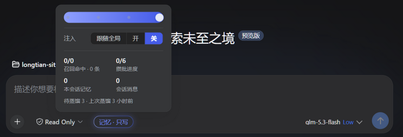
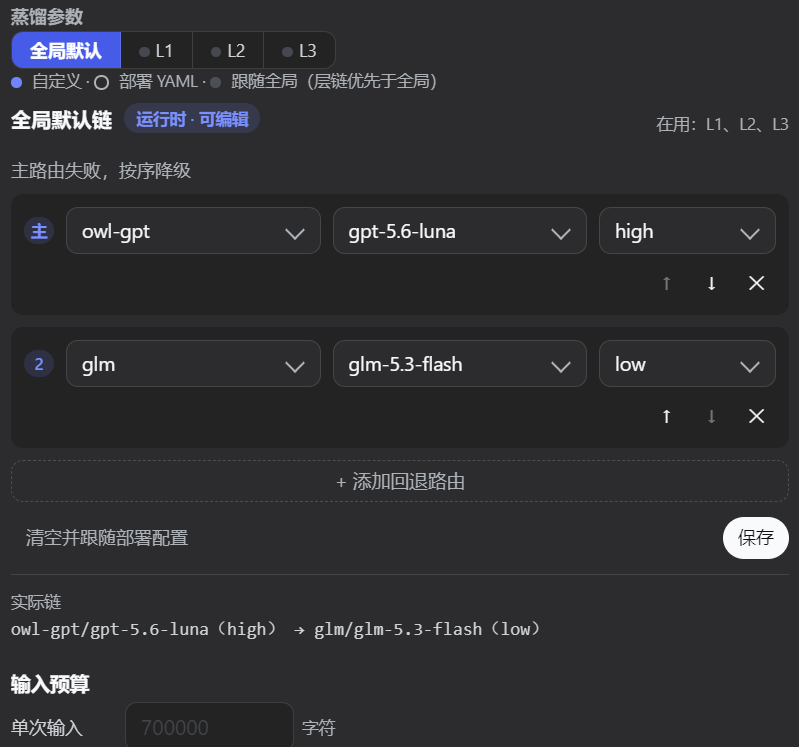
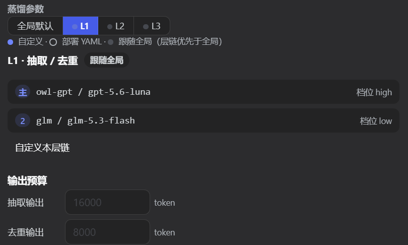
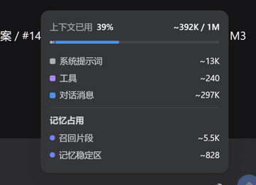

# Registro de mudanças (Changelog em português)

- [更新日志(中文)](./CHANGELOG.md)
- [Changelog (English)](./CHANGELOG.en.md)
- [日本語 changelog](./CHANGELOG.ja.md)
- [한국어 changelog](./CHANGELOG.ko.md)
- [Changelog en français](./CHANGELOG.fr.md)
- [Changelog auf Deutsch](./CHANGELOG.de.md)
- [Changelog in italiano](./CHANGELOG.it.md)
- [Changelog на русском](./CHANGELOG.ru.md)
- [Changelog en español](./CHANGELOG.es.md)
- [Changelog em português](./CHANGELOG.pt.md)

Este arquivo registra as mudanças notáveis do dsh-prime-memory (chamado dsh-memory-plugin antes da 0.5.0). O formato segue [Keep a Changelog](https://keepachangelog.com/pt-BR/1.1.0/)
e os números de versão obedecem ao [versionamento semântico](https://semver.org/).

## 0.26.65

- Reenvio do 0.26.64: o npm staged-publish remanescente (`409 Cannot publish over previously staged version`, idem npm/cli#9889) impediu o 0.26.64 de sair; o código é exatamente o do 0.26.64.
- i18n: adicionado o locale português (pt-BR) — metadados do pacote (`locale/*.json`, `dsh.plugin.json`) e espelhos de documentação README/INSTALL/CHANGELOG.

## 0.26.64

- Absorve o PR #34 (bccy): elimina o custo repetido da busca léxica do grafo a cada rodada — 4764 nós/12026 arestas de 3,0 s para milissegundos (perguntas consecutivas no mesmo acervo), com semântica de busca inalterada.
- Cache de tokenização com endereço por conteúdo (`search.ts`; chave = id + assinatura dos campos tokenizados), cache de leitura do grafo inteiro + duas vias de invalidação (`graph-store.ts`: esvaziamento incondicional pós-COMMIT + fingerprint `COUNT(*)+MAX(updated_time)+PRAGMA data_version`), reuso do embedding de consulta no hybrid (`l1.ts`), e `tests/recall-cache.test.ts` com 6 casos de invariantes (sqlite real, sem mock).
- Adaptações da absorção (PR 42 commits atrás do main): fingerprint estendido a `graph_concepts`; testes fecham conexões SQLite no afterAll (EBUSY no Windows). Portões: typecheck limpo, `npm test` 238 arquivos verdes, 2456 aprovados / 1 pulado.

## 0.26.63

- Reenvio do 0.26.62 (`409 Cannot publish over previously staged version`): código idêntico ao 0.26.62.

## 0.26.62

- Diagnóstico do issue #37 (interruptores live voltando a off após reinício do dsh): a verificação estática de toda a cadeia (schemastery resolve → cordis internal/config → fiber → readConfig) não encontrou ponto de sobreposição; a queda não é reproduzível na versão atual, aguardando dados do lado do usuário.
- `settings-get` passa a devolver `persistence`: compara chave a chave o valor live com o valor persistido no patch, devolvendo `drift` + a lista dos divergentes, `match`, ou `unavailable` explícito — sem adotar silenciosamente nenhuma das camadas.
- `resolveSettings` emite `console.warn` para chaves booleanas recebidas em forma errada (string `"true"`, números do YAML editado à mão) — a direção do julgamento não muda (valores anômalos contam como off), só fica visível. 6 casos de regressão; portões verdes (2450 aprovados / 1 pulado).

## 0.26.61

- A injeção always-on agora é **uma vez por turno** (issue #35): `hooks/slot-recall.ts` e `hooks/skill-recall.ts` disparam em `agent/pre-step`, que é por step — um turno de n steps injetava n cópias idênticas do `<system-reminder>` (medido: 66 cópias, 67.254 caracteres num turno de 66 steps).
- Novo `hooks/turn-inject-gate.ts`: dedupe por `agentId + turn`, cap padrão 512 com refresh LRU; `turn` não numérico (hosts antigos) deixa passar (degrada para o comportamento pré-correção, nunca silencia). Compactação (`session/event` `compaction/end`) e reset (`agent/created` source `compact`/`clear`) liberam reinjeção no mesmo turno; turno vazio não queima cota (crédito debitado só após `pick()` não vazio).
- Sem mudança de configuração; corrigido erro de forma na sugestão do issue: `payload.turn` é number, o encadeamento `turn?.id ?? step?.turnId` daria `undefined` e a correção seria só aparente.

## 0.26.60

- Arquivados não são mais ressuscitados pela projeção: `apply.ts` atribuía `node.status = status` (default active) sem filtrar por estado, e a próxima projeção de homônimo voltava a linha `archived` para active — métricas como `bareRole = 0` recuavam sozinhas.
- Evidência em produção (não risco teórico): 2 entre 414 linhas arquivadas já tinham sido revividas (`reference-session-collector`, `sidebar-fold`), com zero linhas deletadas — só a via revive explicava.
- Regra igual para nós e conceitos: `archived` resiste ao `active` de default;manifestação explícita (ex. `disputed`) continua valendo — arquivar é veto, não lápide; os fatos/aliases/tags continuam atualizando. `tests/graph-sweep-store.test.ts` ganha 2 casos com verificação de mutação (o caso fica vermelho no estado do defeito).

## 0.26.59

- Varredura de estoque complementada: após o sweep da 0.26.58, 222 de 430 nós arquivados ainda ocupavam `graph_node_vec` (o `upsertNodeVectors` nunca olhou o estado). `sweepStock(dryRun=false)` agora compara a tabela inteira por `status='archived'` e poda os resíduos; novo `listNodeVectorIds()` (coluna `node_id` da vec0; falha de consulta = trata como sem resíduo, sem lançar).
- Relatório ganha `vecRowsPruned`; notice e logger mostram o número. Novo caso vec0: monta uma cena de vazamento, asserindo poda só do resíduo, zerando na segunda passada.
- Correção de redação da 0.26.58: o portão de estado **é a única defesa** (não «duplo seguro») — resíduo vetorial deletável, mas qualquer omissão de poda sem portão de leitura vaza na busca; agora cada parte tem teste próprio.

## 0.26.58

- Duas entradas de operação do grafo (`memory_graph_admin`), sem tocar na fonte de fatos L1. **Lâmina A — reconstrução do grafo** (`rebuild`/`rebuild_preview`): `resetGraphOnly()` limpa só as 6 tabelas do grafo + 2 vetoriais; sem os recibos de projeção, `queueMissing` re-enfileira todos os L1 vivos — o «grafo é descartável e recriável» vira realidade; preview é somente leitura, rebuild exige o portão de alta privacidade; `tests/graph-rebuildability.test.ts` garante campo a campo a identidade com a projeção original.
- **Lâmina B — varredura de estoque** (`sweep`, `dry_run=true` por padrão): reusa as mesmas funções puras do projetor (`isPathLike`/`isRoleName`/`splitQualified`/`isAliasShaped`/`normalizeFactKey`) — critério único é a disciplina central. Genéricos órfãos são arquivados; hubs de preferência com ≥20 fatos (`用户` 158, `AI` 66) ganham nome qualificado `用户@work` em vez de arquivamento (arquivá-los daria zero na métrica trocando a parte mais rica do grafo — não se faz); nomes de lugar viram o último segmento com tag `路径`; aliases perdem sujeira; chaves de fato ganham sinonímia + tag `未规范`; `currentState` é reconstruído com a fórmula idêntica ao apply. Idempotente: a segunda passada não acha nada.
- Remendo: `searchNodesByVector` não tinha o portão de estado (arquivados reapareciam na busca semântica); recebe o portão do mesmo formato de `searchConceptsByVector`.

## 0.26.57

- Ontologia de entidades: o grafo sai de «cinco tipos de nó num caldeirão» para **7 tipos + tabela própria de conceitos + vocabulário canônico de propriedades** (`src/graph/entity-identity.ts`: `classifyNameKind` path→descriptive→role→proper; `isPathLike` reconhece unidade/`~`/`${VAR}`/extensões mas não `@scope/pkg` nem URL; nome qualificado corta no **último** `@`; genéricos nus como `用户/助手/AI` param de criar nó — 158 fatos num só hub). `GRAPH_PROJECTOR_VERSION` → 2: recibos antigos invalidados, re-projeção automática do acervo ao instalar.
- Conceitos vão para `graph_concepts` (seis categorias + `graph_concept_vec`) com pontuação própria (name×6/aliases×5/definition×5/facts×4/category×3); place «despoluído» (89% dos «lugares» eram caminhos); chave de fato normalizada (~60 canônicas + mapa de sinônimos), desconhecidas recebem tag `未规范` (mede a convergência sem apagar informação).
- Ferramentas: `memory_write`unificada (add/update/delete/import por action; os quatro nomes antigos viram grupo `legacy`, selado por padrão, volta com `toolLegacy=true`); `memory_ruminate`unificada (run/cancel/status); `memory_reproject` + `memory_migrate_relation` saem para o grupo `graphAdmin` (selado por padrão) — escritas de baixa frequência não ficam sob o mesmo interruptor das leituras.

## 0.26.56

- «Parou de girar mas a imagem continua respirando»: a amplitude da 0.26.55 usava `sin(ts·…)` — comia tempo. Agora a amplitude é **geometria pura**: `applyArmLength(base, amp)` sem `t` nem `speed`; `amp=1` é neutro ponto a ponto, `amp=0` encurta 45%, `amp=2` alonga 45%; qualquer forma é idêntica a qualquer instante (só muda a orientação da rotação) → velocidade 0 = imagem absolutamente parada.
- Três responsabilidades separadas: amplitude do disco = comprimento da fita (não come tempo); rotação/fluxo = velocidade (come); amplitude do 8 = passeio pontual/largura da fita (é a dinâmica do próprio 8). A ramificação de fluxo passa `amp=1` para disco/hélice, só `eight` come `flowAmp`.
- Portões: lint/typecheck verdes, 2341 testes (229 arquivos); pins novos: espectro radial idêntico entre instantes sob o mesmo amp, amp=1 neutro ponto a ponto, seis braços iguais, segmento interno também estica, 8 continua comendo amplitude.

## 0.26.55

- «Só metade alonga, e rodando entre os braços»: a multiplicação de comprimento tinha fase `sin(ts·0.0007 + base·3)` keyed ao ângulo-base do braço → 3 fitas crescendo enquanto 3 encolhiam, e a deformação passava de braço em braço; além disso só atuava após `ANCHOR=0.42`, com metade interna travada.
- Agora: fase única global `sin(ts·0.0007)` e a fita **inteira** avança ao longo da própria espiral logarítmica (`ds = s·(L−1)`, raio e ângro sincronizados); sem re-solver o ângulo-base, sem âncora interna; `L` limitado a [0.55, 1.45], as seis fitas sempre iguais.
- Portões: lint/typecheck verdes, 2341 testes; o pin antigo («metade interna ancorada <30») foi **invertido** para «metade interna também se move >30» — ele era a raiz do defeito; novos pins: dispersão dos raios das seis pontas <28% no mesmo instante, variação correntes entre braços ao longo do tempo, proporção de estiramento constante dentro da fita; comparação PNG fora da tela.

## 0.26.54

- Novo sub-estilo «contínuo» do 8: seletor na barra de ferramentas `em cluster | contínuo` — os clusters deixam de ocupar segmentos da curva ∞ e são distribuídos pelo ângulo áureo ao longo de todo o anel (cores alternadas, sem blocos sólidos); amostragem pontual remixada (`u = uniforme global + 0,6% de jitter`).
- Geometria: largura central estreita e cruzamento largo (`34 + 18·|cos u|`) lido como fita de seda esticada; torção tipo Möbius com offset lateral rodando `(cos(u/2), sin(u/2))` → a fita vira de lado uma vez por volta, em 3D visto de perfil; compatível com o fluxo `flowShape` (os pontos seguem na mesma curva ∞).
- Implementação: `buildClusterShapeLayout(..., eightStyle)`, `EightStyle = 'cluster' | 'continuous'`. Portões: 2340 testes; pins: as 12 caixas de φ todas não vazias, span de φ por cluster **maior** que no modo agrupado, span de `y` >20 (torção real), determinismo bit a bit.

## 0.26.53

- Semântica da amplitude corrigida: de «o quão enrolada» para «o quão **comprimento** é a fita». A versão 0.26.49 tinha implementado respiração radial + onda vertical (a bacia inteira dilatando), que é afrouxar o enrolamento — a direção estava errada desde o início.
- Apenas o ramo `spin` muda: resolve o parâmetro `s` da espiral logarítmica própria de cada ponto (desfazendo o achatamento 0.82 do z) e empurra `s' = ANCHOR + (s−ANCHOR)·L`; metade interna (`s≤0.42`) ancorada (senão a leitura seria «a bacia encolheu», não «as pontas alongam»);deslocamento de forma (`dr`/`dth`) levados intactos (a espessura da fita não vira linha); ângulo-base quantizado a `2π/6` (sem isso, uma mesma fita calcularia multiplicadores diferentes dentro de si e se esfiaparia); `L ∈ [0.40, 2.10]` com ±0.55·amp → amp=2 dá +110%/−60% nas pontas, forma de enrolamento inalterada.
- Portões: 2339 testes; pin trocado de «amplitude média >60» para «metade interna ancorada <30, externa >120»; comparação PNG offscreen amp=0/1/2 sem esfiapo nem pontos voadores.

## 0.26.52

- Só o disco: `spin` (rotação de corpo rígido) volta a ser **disco de acreção com partículas aleatórias**. Corpo rígido é restrição dos braços (cisalhamento diferencial embaçaria os braços), mas o disco não tem estrutura de braço; novo `FlowStyle = 'accretion'` em quatro camadas: diferencial kepleriano `ω = 0.0011·(180/r)^0.9` (razão 6:1, riscando espirais no plano), diferença individual de ω por ponto ±45% (fluxo de grãos, não grade rígida), fase+frequência próprias por ponto (`jp`/`fr ∈ [0.6,1.4]`), e passeio aleatório tangencial+radial (`fw ∈ [0.5,1.8]`, amplitude escalada pelo raio — o centro não borra).
- A amplitude participa em tudo: passeio radial ±(8%+16%·amp), ondulação vertical 6+30·amp, passeio aleatório 4+13·amp. `auto` do disco escolhe `accretion` (forma disk + estilo disc); outras formas inalteradas. Semântica de `speed=0` corrigida: `ts===0` devolve cópia exata do base (congelamento estrito; antes, fases pontuais davamdeslocamento não nulo).
- Portões: 2339 testes; pins: dois pontos do mesmo raio com deslocamento angular diferente (prova de não rígido), reprodutível por `t`, envelope <1400, congelamento estrito em speed=0; comparação PNG de três quadros.

## 0.26.51

- Três problemas visuais por comparação PNG quadro a quadro (sem confiar só em derivação). **Braço virando gancho**: a causa era carga, não parâmetros de espiral — `work` chegando a 53% monopolizava um braço inteiro (arco de 89°). A divisão por metade passa a valer **para todos os eixos** (hall também empaca), e em 3 quando o cluster ocupa >40% — seis braços em equilíbrio.
- **«Braço atirando ao infinito»**: ângulo da espiral corrigido (chord 1.55 → 2.45, 42° → 32°), raio inicial do braço 115 → 150, borda externa 640 → 570; a «extensão de ponta» da 0.26.50 (a real culpada) sai, e os 12% mais externos reduzem o jitter lateral → ponta afinando como cauda de poeira estelar, não raio.
- **Núcleo + disco de acreção**: 20% dos pontos dos tipos disco povoam um bojo central (densidade ∝ `r^1.7`, o centro do rosno deixa de ser vazio); o disco vira acreção real (ângulo áureo + viés `r^0.72` + espiralagem por ponto `Δθ = swirl·ln(r/110)`); novo `discSeed` rola a cada troca para «disco» (enrolamento e orientação variam; padrão React de ajuste de estado durante render, sem frame extra de effect). Portões: 2339 testes (4 novos), comparação offscreen sem gancho/com bojo/sem borrão.

## 0.26.50

- Retira a «cauda longa» da 0.26.49: o efeito tinha interpretado «rastro» como motion blur (segmentos anti-regressados por velocidade por quadro), mas a intenção original era o **formato de ponta rarefeita da borda externa dos braços**; removida por inteiro (`flowPrevRef`/`tailById` e o desenho do rastro — sem código morto).
- `buildClusterShapeLayout(..., armSpread = 0.55)` (só para «braço», pendente de tradução): núcleo compacto — a abertura angular cresce com `s` absoluto (∝ s², quase nada perto de 0, o anel interno continua fita estelar sólida); leque externo — em `s≈1` a abertura vai a ±0.62·armSpread rad e o jitter radial ×(1+2.6·armSpread), os mesmos pontos distribuídos em leque mais largo; ponta de poeira estelar — pontos com `s>0.5` estendem 0.05~0.34 s ao longo do braço com jitter lateral achatado `1/(1+6·ext)` (teto s≤1.12, dentro do envelope).
- Barra de ferramentas: slider «divergência» (0~1, passo 0.05) sob disco→braço, oculto para as demais formas. Pino de regressão: dispersão externa monotônica em armSpread 0.05→0.55→1, e todos os pontos <1200 (envelope) em 0.55.
## 0.26.49

- **Rastro longo de cauda de cometa no fluxo**: com o fluxo ligado cada ponto arrasta uma cauda — diferença de coordenadas mundo entre quadros = velocidade real; cauda = ponto atual − velocidade×11 (puxa 11 quadros para trás). Geometria pura, sem histórico multi-quadro, direção sempre igual à do movimento; mesma câmera da projeção principal → na tela estritamente ao longo da direção do movimento; desenhada em camada translúcida com blend `lighter` sob os pontos → núcleo claro + cauda escura de meteorito; largura de linha escalada pelo raio do ponto (`r×1.15`), alpha 0.34 do brilho; fluxo desligado limpa tudo (`flowPrevRef` → null).
- **Parâmetro de amplitude agora visível de verdade**: pulsação radial do `spin` 7%→**22%**, onda vertical 9→**26**; passeio por ponto do `eight` `6+70×amp` (amp=2 atinge 146 unidades), teto da diferença individual A 0.5→**0.9**. Deformação média >60 unidades com amp=2 nos dois estilos.
- Pino de regressão novo: deformação média amp=2 vs amp=0 >60 unidades (spin e eight, um cada).

## 0.26.48

- **Quarto sub-estilo do «disco»: «disco cheio»** (sub-estilos agora `disco cheio | dois braços | braço suspenso | plano`): o `disc` distribui os clusters pelo **ângulo áureo** `2.39996 rad` (qualquer número de clusters sem aglomerar nem deixar buracos angularmente), raio `√(i/N)` → clusters uniformes em **área**; dispersão interna adaptativa `área/√N × 1.7`, distribuição `√rand` uniforme em área, y achatado a ±16% → **bordas de clusters vizinhos se entrelaçam**, o disco lê como um disco misto contínuo (não anéis concêntricos nem nuvem de blobs).
- **Corte da borda externa**: pontos além do raio 640 são pinçados radialmente de volta → borda limpa.
- Ordem e nomes do sub-seletor: `disco cheio · dois braços · braço suspenso · plano`.
- Pins novos: dentro do raio do disco / cobertura de ≥3 quadrantes / diferença aparente vs modo plano >50 unidades.

## 0.26.47

- **Correção: mexer na velocidade dava salto de fase**. Antes `phase = speed × t` (velocidade como escala de tempo) → mudar o slider descontinuava a fase. Agora **acumulador de fase**: `acc += dt × speed` (dt limitado a 100 ms para não computar retroativamente aba minimizada), `flowShape` recebe a fase acumulada e velocidade sempre 1. Mudar a velocidade muda só a **taxa**, a fase continua. Desligar o fluxo limpa a base do acumulador; religar não compensa o tempo parado.
- **Correção: o parâmetro de amplitude não fazia nada visível**. Antes `amp` só movia y ±2.2 unidades — invisível numa estrutura de raio 500. Agora: `spin` com **respiração radial** (±7% de pulsação do raio, defasagem angular → alongamento suave dos braços) + onda vertical (±9×amp); `eight` amplifica a espessura radial da faixa estelar (diferença individual A 0.06→0.56) e o passeio por ponto (5→57 unidades). Perturbações **limitadas**, fora do acúmulo angular → não quebram a garantia «braços de corpo rígido indeformáveis».
- **Semântica de `speed = 0` unificada como «congelamento de fase»**: `ts = t × speed` dentro de `flowShape`; velocidade 0 para tudo inclusive a oscilação de amplitude.
- O botão «disco cheio» do seletor de forma é renomeado para **«disco»**.
- Testes: pino de efetividade da amplitude (mesmo t, amp 0 vs 2 >15 unidades) + pino de continuidade de fase (incrementos angulares monótonos e na razão certa após mudar velocidade); o pino de rigidez passa a ter pré-condição amp=0.

## 0.26.46

- **Segmentos do seletor de forma fundidos num só controle**: `esfera | disco | 8`; escolhendo «disco» os sub-estilos `dois braços | plano | braço suspenso` aparecem no mesmo contêiner (separados por divisória fina, não mais dois controles) — menos controles na barra; o rótulo do anel passa de «anel» a **«8»** (já é a órbita ∞).
- **Quebra de megagrupos do eixo type em metades**: nos dados reais `tool` costuma passar de metade dos nós; um cluster único monopolizaria um braço inteiro ou viraria mancha. Grupos type acima do limiar (≥max(50, 22% do total)) são divididos por hash determinístico do id em `key#0`/`key#1` — no LPT os dois caem em braços diferentes, equilibrando; o mesmo id sempre cai no mesmo lado (reprodutível). Eixo hall não quebra (os oito já são equilibrados).
- Pins novos: existência da quebra + bit a bit idêntica entre duas chamadas + eixo hall intocado.

## 0.26.45

- **Correção: os braços da galáxia eram «misturados» pela rotação do disco (qualquer velocidade, qualquer duração)**.
  - Causa: o `spin` usava **rotação diferencial** (`ω ∝ 1/raio`, rápido dentro, lento fora), que cisalha continuamente as espirais — o cisalhamento acumula sem limite com `t`, enrolando os braços até se entrelaçarem; velocidade baixa só atrasa o entrelaçamento.
  - Correção: `spin` vira **rotação de corpo rígido** — mesma velocidade angular para todo o disco, independente do raio; a distância xz entre dois pontos quaisquer é constante → forma dos braços **matematicamente indeformável**. A «vida» passa ao balanço y limitado (fora do acúmulo angular).
  - Pino novo: 12 combinações speed ∈ {0.1, 1, 3} × t ∈ {1 s, 1 min, 10 min, 1 h} assertando distância xz constante (6 casas) ponto a ponto — fecha por matemática o «rodar muito e embolar».

## 0.26.44

- **Formas de galáxia 3D do mar de memórias (três estilos de disco + fluxo em órbita de 8)**:
  - Sub-estilos `disk` à escolha (após «disco» na barra): `spiral` de seis braços espirais logarítmicas (cluster = arco no braço, arcos repartidos por peso, ponta-a-ponta, reamostragem uniforme em raio, desacoplado enrolamento×espaçamento — espaçamento fixo 2π/N sem cruzar em qualquer raio) / `legacy` espiral de dois braços (defasagem π) / `flat` plano (todos os clusters anel uniformes, sem braços).
  - **Estilo de fluxo desacoplado da forma**: `FlowStyle = 'spin' | 'eight'`, seletor triplo «auto/rotação/fluxo 8». `spin` rotação diferencial (ω ∝ 1/raio); `eight`propulsão real pela órbita ∞ (fase própria φ₀ re-solvida por ponto, `φ = φ₀ + om·t` fluindo em `x=A·cosφ / z=A·sinφ·cosφ`, A limitado a 2.2×r₀ para pontos do eixo não voarem).
  - **Parâmetros ajustáveis**: slider de rotação (0.2×~3×, mapeamento quadrático — curso ×4 na zona lenta para ajuste fino) e de amplitude (0~2×, balanço por ponto).
  - Paleta `HALL_GALAXY_COLORS` (anel isométrico, 220° inicial, passo 45°) tem precedência sobre os tokens `--dsh-mem-chart-N` (tokens ficam para CostTab/GraphCanvas); conta-cor personalizado ainda é a maior precedência.
  - Testes: 6 pins novos (seis braços logarítmicos / uniformidade plana / regressão dos dois braços / cobertura do estilo de fluxo / raiz do fluxo-8 não estoura / linearidade velocidade×amplitude).

## 0.26.42

- **Duas visões hall do mar 3D (plano prime-memory-3d-hall-views)**:
  - Visão 1 «clusterização octo-dimensional»: `graph-preview(mode:'full')` ganha chave opcional `hall` por nó (moda de metadata.hall das origem; empate por ordem do vocabulário WING_CATALOG, valores inválidos não contam; sem valor a chave falta — deriva zero como aging/source). `sourceMeta()` vira três canais (ms/scene/hall), critério de entrada = qualquer canal com valor, varredura única para os três; `agingOf` encurta null com ms:null.
  - Visão 2 «hall escolhido em destaque»: layout octo-dimensional sem reordenação; o hall selecionado recebe cor própria/token + variante determinística, os demais alpha×0.22 (piso ALPHA_FLOOR), raio×0.7.
  - Client: `hall-palette.ts` zero-dependência novo (pino HALL_ORDER item a item contra WING_CATALOG; hexToHsl/hslToHex estáveis byte a byte; variantOf com duplo hash HSL, strength=0 igual à cor-base byte a byte); eixos parametrizados em `projection.ts` (buildClusterLayoutByAxis; prefixos de semente c:/r:/a:/b:/s: intocados — mesmo id mesmo ângulo nos dois eixos, trocar eixo é «reagrupar» não «voar»); Scene3D com controle triplo de visão + slider de variante + legenda hall no canto (clique seleciona, duplo clique abre conta-cor com throttle 60 ms); ExplorerPage esconde a legenda type superior em modo 3D (duas legendas contraditórias).
  - Dependência do effect de assentamento rígido estreitada a [full] (findings F4: deixar clusterLayout fazia o effect engolir silenciosamente a transição de eixo).
- Face de terminal (dsh-tui / paleta de comandos do Desktop de mesma fonte): versão oficializada (as duas listas divergiam — package.json 0.26.40-local.4 vs dsh.plugin.json 0.26.39-local.3, unificadas aqui); `/memory` na face de terminal.

## 0.26.68

- **PR #30 (flikos) absorvido: a UI do painel conecta-se ao serviço de locale do host — dicionários en / ru / pt com cobertura total (1.402 chaves cada).** Pipeline portado (extract/codemod/merge/audit + testes-guarda), codemod reexecutado sobre 0.26.67, cabeamento refeito para o código atual, semântica de fallback zh verificada contra o runtime de locale real do host (zh nunca degrada; chave ausente em ru/pt cai para o inglês — documentação corrigida). Logs e a face terminal /memory seguem em chinês — fronteira documentada. Portões: typecheck limpo; vitest 239 arquivos verdes (2466 passed); auditoria i18n 0 erros.

## [0.26.40-local.4] — 2026-11-13

- Fallback do decoder GBK (alinhação literal ao spec D): `new TextDecoder('gbk')` no spawnImpl padrão ganha try/catch; decoder ausente cai para leitura em latin-1 com aviso, sem derrubar a janela.

## [0.26.40-local.3] — 2026-11-13

- Correção do endereço do collector (`401` antes do «não alcançável»): a porta efetiva do host é lida do runtime, não pressuposta; confirmado em máquina real que a versão anterior só consertara «porta errada», não «não conecta».
- Novo `src/clients/drsc-inproc.ts`: chama diretamente a face de leitura exportada pelo collector (`resolveIndexDir` → `openProjectionStore` → `createQueryContext` → `search`/`sessionDetail`/`listSessions`), sem tocar o motor de escrita `ProjectionSync` — não disputa o watermark nem monta interval extra; banco em WAL, leituras concorrentes ok com o host segurando a escrita; alça aberta uma única vez (summaries é um Map em memória; reabrir por request = reescanear a tabela).
- Regra de transporte: só «intenção HTTP explícita» faz fetch — `baseUrl` configurado (collector em outra máquina/auto-hospedado) ou `fetchImpl` injetado; sem ambos, in-process. Os quatro pontos de leitura convergem em `getJson` com a query em forma idêntica à HTTP antiga → mapeamento de campos, `session=null` → array vazio, clamps de limit, braço rígido de `redact` todos inalterados; falha in-process também vira `DrscClientError`.
- Auto-prova ponta a ponta com dados reais: chamada direta vs adaptadora devolvem sequências de seq **bit a bit idênticas** (tail:4 = 4 linhas; total = 1770 linhas); `sessionTail` com role/kind/time/text normais; `search('porta')` acha 3 com snippet; `listSessions` total=103. Novos `tests/drsc-inproc.test.ts` + caso deroteamento de transporte em `drsc-client.test.ts`, 12 ao todo; total **1898 casos / 189 arquivos**.

## [0.26.40-local.1] — 2026-11-13

- Publicação local da linha 0.26.40 (empacotamento/verificação de artefatos); sem mudança funcional além dos fixes de transporte acima.

## [0.26.39-local.3] — 2026-11-10

- Iteração local da linha 0.26.39: ajustes de empacotamento e de verificação de lista dupla (package.json × dsh.plugin.json).

## [0.26.39-local.2] — 2026-11-10

- Iteração local da linha 0.26.39: validação da listagem de arquivos `files`/`exports` do pacote antes da publicação oficial.
## [0.26.33] — 2026-11-04

- **Correção de raiz do «flash escurecido» do mar 3D: não era queda de fps, era o `resize()` limpando o bitmap do canvas antes do paint da amostragem do compositor**. A direção anterior («redesenhar cada quadro é caro → fps cai → cache em camadas + pausa em ocioso») estava errada — as quatro iterações locais `0.26.33-local.1..4` tratavam outra doença. Atribuir a `canvas.width` limpa o bitmap inteiro (comportamento de especificação), e o callback do `ResizeObserver` cai **depois do layout e antes do paint** dentro do passo de render: limpar ali pinta o quadro branco na tela, o rAF seguinte o desenha de volta. Por isso «pisca» e só em eventos de tamanho externo, independente do custo por quadro.
- **Perícia pixel a pixel (derrubando a observação multimodal)**: três rodadas de descrição por modelo se contradiziam (t=7 s preto / nunca preto); com `ffmpeg signalstats` sobre **324 quadros (30 fps / 10,8 s)** o YAVG tem **dois valores discretos** (`49.20` e `40.46`), e 22 quadros escuros são **idênticos** (YAVG=40.46 / SATAVG=7.29 / SATMAX=75) — a mesma imagem repetida, não elementos sumindo gradualmente.
- **Diagnóstico: bitmap transparente, não «falta de elemento»**: nas três regiões do quadro escuro tudo desaba para a mesma cor plana (clusters amarelos `28.69→22.00`, ciano `26.13→22.00`, céu vazio `30.95→22.89`, saturação ≈4.00); Y=22 em limited-range ≈ luma 7 em full-range, e o background inline do canvas (L779) `#04070f` mede luma **6.99** — é a cor própria do canvas aparecendo. No mesmo quadro a barra lateral vai `61.94→61.81` (-0.2%) e a legenda superior tem **diferença zero de pixels** → descarta compositor/GPU/rearranjo de janela.
- **Correção 1 (resize idempotente)**: `resize()` devolve boolean e pula tudo quando tamanho e DPR não mudaram, sem tocar em `canvas.width` — disparos repetidos do RO por jitter de layout/scrollbar viram custo zero.
- **Correção 2 (quadro síncrono dentro do RO)**: novo `presentNow()`; `if (resize()) presentNow()` desenha e apresenta no mesmo passo, comprimindo «limpar → paint vazio → rAF de reparo» em operação atômica. O `wake()` anterior só agendava o próximo rAF, deixando o bitmap vazio ser pintado — causa direta do flash.
- **Correção 3 (alça de quadro se auto-limpando)**: `frame()` zera o `raf` na entrada.

## [0.26.31] — 2026-11-03

- **Preenche a lacuna de testes da 0.26.30 + alinha o artefato do npm com o main (sem mudança de comportamento em runtime)**. Faltava a asserção dedicada de que `tests/l1-receipts*` prova «qual item do lote absorveu este»; a extração virou função pura `receiptItemsForAbsorbed()` compartilhada pelo pipeline e pelos casos.
- **Auditabilidade dos recibos**: itens absorvidos → `kind='merge'` + `candidateIds=[id do representante]`, `input_digest` apontando para o representante; mapeamento vazio não gera linha extra (com o recurso desligado os recibos são byte a byte os da 0.26.30).
- **Zero mudança de comportamento**: só extração de função pura + casos novos; a saída de `dist/pipeline/l1.js` tem os mesmos parâmetros/resultados do mapeamento inline. Alinhamento de tag: a `v0.26.30` parava em `673d033` com um commit de testes depois no main — agora tag / npm / main batem, evitando «o que foi instalado é código pré-tag».
- Testes: **1976 aprovados / 1 pulado** (195 arquivos); typecheck 0, lint 0 erros; CI (Linux) sete passos verdes. Nenhum contrato externo alterado.

## [0.26.30] — 2026-11-03

- **Três camadas de defesa do canivete mechanístico do #22 + deduplicação intra-lote na mesma sessão + dica de DRSC + correção do lockfile.** Versões anteriores só mexiam na **interface de corte** do guard de tokens (comprimindo o que entra no modelo para 1536); dois grandes raciocínios adjacentes têm seus tensores T² **coexistentes** no high-water do BFCArena (m=2) e uma queda para o sistema até reiniciar o host. De «só cortar» para: ① teto de 1536 tokens (existente) ② desligar memPattern para baixar o pico de coexistência (novo) ③ respawn com autorrecuperação limitado após crash (novo, ligado por padrão). **Fronteira honesta**: as três camadas são comprovadas em Windows/node puro (pico/máquina de estados/novas tentativas); a eliminação do SIGTRAP só o relator podearbitrar no macOS, e fechar o #22 depende dessa reverificação.
- **Camada 2**: `session_options:{enableMemPattern:false}` no pipeline de `resources/embedding-child.cjs` / `embedding-worker.cjs`. Sem isso o ORT pré-aloca por grafo e residentiza os bindings, empilhando pico m×T²; ligado, o pico de envios consecutivos da mesma forma caiu **1597MB→1264MB (-333MB, direção m:2→1)** com custo zero no infer estável. Crucial: os vetores antes/depois da mudança são **bit a bit idênticos** no mesmo input (bge-m3 real com `--equivalence`, `maxAbsDiff=0`, duas amostras) → **não dispara re-embedding**.
- **Camada 3**: respawn com limite após crash (`src/store/local-embedding.ts`). ⚠ Vira deliberadamente a declaração da 0.26.25 de que «esta lâmina não fazautorrecuperação» — aquela era a fronteira da época. Padrão **ligado**; chave nova `embedding.respawnOnCrash` (`.boolean().default(true)`, só adiciona, não altera) desliga. Fábrica de canais (`createChannel`) → `crashCb` como **único** ponto de respawn (mata a tempestade de forks dos três entranceos warmup/embed/reindex, `respawnPromise` converge num ponto) → reusa o estado `loading` (**sem estado novo de contrato**, `contract.ts` intocado; a gate vectorsReady assume a janela incompleta) → reconstrói canal e espera warmup. **Rate limit ≤2 por janela de 60 s**, acima disso volta a `failed`.

## [0.26.29] — 2026-11-02

- Reverificação do relator do #22 (DESXIE) sobre a `0.26.28`: **orçamento do modo automático = 1536, `5×5000` serial passa inteiro**, e com o mesmo script em `--budget 2048` ainda dá SIGTRAP no 2º item — ou seja, «passou tudo» não foi sorte de ambiente, o 1536 realmente barrou. Ele também trouxe um bug real.
- **Correção: `tokensMax=desconhecido` nunca chegava ao caminho real** (achado do relator). No subprocesso o valor inicial era **0** e a acumulação usava maior-que estrito (`if (cut.seq > tokensMax)`), então o `-1` dos casos em que seq não é mensurável (tokenizer inacessível, orçamento 0, guard desligado) **nunca batia o 0**; e o teste `>= 0` da main thread imprimia o resíduo 0 como válido — exatamente o «nenhum entrou» que a linha de log queria evitar. Valor inicial agora é `-1`: «inatingível» e «zero real» deixam de dividir o mesmo número. Uma linha, mas habilita toda a cadeia de perícia.
- **Por que os próprios testes não pegaram** (mais memorável que a correção): `describeEmbedBatch(…, -1, …)` só testava **o que a função pura imprime ao receber -1**, nunca **se o subprocesso envia -1**. Agora 3 casos: ① pino estrutural no valor inicial -1 do subprocesso; ② reproduz a semântica de merge (inicial 0 engole o inatingível, -1 não; qualquer valor válido ainda sobe); ③ ponta a ponta no `shrinkToBudget` real (orçamento 0) → `-1` → imprime «desconhecido». Verificado ao avesso: voltar o inicial a 0 deixa o pino vermelho.
- Notas do relator sem necessidade de mudança (registradas para não repetir discussão): atribuição por `code/signal`, o warn de parada e o log de falha com record id já existiam desde a 0.26.25 (não são desta leva); areconferência independente de `tokensMax` bate com o valor auto-reportado nas duas faixas (1535/2047) — o guard corta de fato.
- Esclarecimento de critério aceito: a «sequência» da projeção `graph` são **diversas requisições `priority` de um item cada** (por isso `n` costuma ser 1 no log); o único lote multi-item real é o reindex (`CHUNK=16`). O mecanismo segue intacto (1536 é valor empírico medido, não prova).
- Total **1938 casos / 191 arquivos** verde (+3); typecheck 0, lint 0, build/build:smoke/smoke/verify-catalog todos 0. Superfície pública de configuração inalterada.

## [0.26.28] — 2026-11-02

- Esta versão corrige **um único erro meu**: nas 0.26.26/0.26.27 e no comentário do issue eu afirmei que «o subprocesso reporta o máximo real de tokens que entraram no modelo neste lote», mas esse valor **nunca chegou ao log** — só a sonda do script local de validação o lia; uma linha no `memory.log` do plugin, nenhuma. Em problemas como o #22 o que sobra para auditoria é o log. O plano já exigia a linha (por lote, info com `n / tokens máx / inferMs`, e `pid` no fork); faltou na minha execução.
- **Cada lote de inferência agora grava uma linha info** (`describeEmbedBatch()`): `[memory] 本地嵌入一批完成:model=<id> n=<条数>,进模型 tokensMax=<实测值>,耗时=<ms>`. Três detalhes: ① `tokensMax` é medido no subprocesso pelo critério da biblioteca, não estimado; ② quando inatingível (-1) imprime «desconhecido», nunca 0, evitando a leitura «nenhum entrou»; ③ usa `info`, não `debug` (`src/util/filelog.ts` só espelha info+; debug não chega ao `memory.log`). Assim a checagem «cada lote com `tokensMax ≤ orçamento` no log» fica realmente verificável.
- **`pid` do filho registrado após o fork** (callback `onForked` em `RealChildChannel`): a atribuição do #22 sempre foi cruzar o relatório de crash do sistema com o log do plugin pelo timestamp; sem pid não se amarra um `.ips` a qual subprocesso, nem se confere a árvore do `taskkill /T`. Antes só havia `execPath/release/model/tokenBudget`.
- **Sincronismo de tipos do protocolo**: o ramo `embedded` de `EmbedWorkerReply` ganha `tokensMax` opcional, tornando o valor visível no tipado da main thread (antes vivia num campo não declarado do JSON).
- **Validação**: o trecho end-to-end de `scripts/verify-token-guard-realmodel.mjs` **asserta a linha realmente gravada** (não só um valor em memória): a linha deinício contém `execPath`+`tokenBudget`, existe uma linha `pid=\d+`, e cada lote tem `tokensMax` ≤ orçamento. Medido: `pid=37384`, dois lotes com `tokensMax=1535,1535` (orçamento 1536), lotes mistos e lotes longos de texto idêntico devolvendo vetores de 1024 dimensões normais. +2 casos no CI (conteúdo do log por lote + fronteira «inatingível = desconhecido»); a lâmina acumula 31 casos. Total **1935 casos / 191 arquivos** verde; typecheck 0, lint 0, build/build:smoke/smoke/verify-catalog 0. Sem mudança de configuração nem breaking.

## [0.26.27] — 2026-11-02

- O relator do #22 reverificou a `0.26.25` em macOS/M5: **as três faixas antes letais não dão mais SIGTRAP e o guard está de fato conectado** (valida a conclusão principal), mas achou um problema **mais próximo da carga real**; esta versão incorpora sua medição por bissecção.
- **`HARD_CAP_TOKENS` 2048 → 1536: o orçamento só valia para «envio único», e a carga real deste repositório é «envios em sequência»**. Bissecção do relator (Electron-node, `5×5000` caracteres chineses serial): **512/1024 passam, 1900/1960 passam, 1990/2000/2010/2016/2020/2040/2048 todos «1º item ok, 2º SIGTRAP»**; a linha letal de envio único é ≈2700. O mecanismo de duas origens diferentes segura minha análise anterior: o **high-water do BFCArena não retorna** (eu já medira RSS em plateau após 6 inferências grandes); na segunda entrada o tensor T² da primeira ainda não foi recolhido, e o **pico do instante de coexistência do bloco novo com o antigo** é o teto real.
- **Por que importa (verificado no código, não copiado do relator)**: `src/pipeline/graph.ts:134-137` é exatamente `for (const n of touched) { … await embed(nodeEmbedText(n)) … }` — serial, **um item por requisição**, com 5–8 nós por lote de projeção; dois longos bastam. Sob 2048 o «toda projeção trava» virava «trava quando ≥2 textos longos», e como **esta lâmina declara não fazer autorrecuperação**, acertar ainda significava quebrar até reiniciar. 1536 deixa ≈21% de folga abaixo da linha de sequência (≈1960); foi o valor sugerido pelo relator (que também oferecia 1024; 1536 evita sacrificar de uma vez a semântica de recall de textos longos do bge-m3).
- **Script T1 ganha a dimensão «sequência»** (`scripts/verify-token-guard-realmodel.mjs --serial N`): o mesmo trecho de 5000 caracteres alimentado 5 vezes em série **na mesma instância de pipeline**, asserindo que o seq medido de cada rodada é ≤ orçamento e idêntico entre rodadas. Em Windows/node puro não trava, então isso prova «o orçamento vale em série», não «em série não trava» (isso só o macOS). Medido: `seqs=1535,1535,1535,1535,1535` (orçamento 1536); pico do T3 caiu de 1469MB para **1235MB** (sem guard, 4168MB).
- **Estanque a deriva de números mágicos que eu mesmo criei** (herança da 0.26.25/26): testes e scripts tinham **2048 escrito como literal em 8 lugares**, gerando falso vermelho/falso verde ao trocar a constante. Agora tudo deriva de `HARD_CAP_TOKENS`, e o script de modelo real lê o default de `dist/model-catalog.js`; a asserção-sentinela proíbe `1536|2048|2700` nas camadas de subprocesso e main. **Registro honesto**: ao terminar de derivar da constante apareceram falsos vermelhos que a versão anterior escondia — exatamente o efeito que se queria eliminar.

## [0.26.26] — 2026-11-02

- A `0.26.25` entregou o guard de tokens do #22 mas tratou **a validação mais importante como «reporte conectado» em vez de «medido»**. Esta versão rodou tudo com bge-m3 real e encontrou três defeitos concretos, corrigindo-os um a um.
- **T1 promovido de «mecanismo de reporte» a «prova com modelo real»** (novos `scripts/verify-token-guard-realmodel.mjs` + `scripts/_t3-runner.mjs`, opcionais, fora do CI — exigem runtime e bge-m3 locais). Com bge-m3 real: **5000/4000/3800 caracteres chineses (as três faixas que o relatório dava como SIGTRAP) têm comprimento de sequência pós-corte de 2047 ≤ orçamento 2048**; sem guard, medido **5003**; vetores antes/depois do corte diferem (descarta «só reportou número sem cortar»). O que era suposição virou fato.
- **Três defeitos que só o modelo real pega** (stub jamais testaria): ① `tokensMax** sempre -1, ou seja, reporte nulo — a implementação lia `.shape` do tensor de saída, e o Tensor do transformers **não tem `.shape`** (tem `.dims`), além de a saída pós-pooling ser unidimensional `[1024]` sem eixo de seq; agora se mede pelo próprio critério da biblioteca no momento do corte (`padding`:true, truncation:true`) e se reporta, com duas tomadas independentes se cruzando no script (2047 == 2047). ② «Reservar 2 posições no orçamento» era sorte, não garantia: fatiar 2046 ids → decode → re-tokenizar deu 2045 tokens, +2 special = 2047, sobrando **1 posição** de folga em 2048; BPE/Unigram não garantem a mesma sequência em fatiar→decodificar→recodificar. Agora o aperto é **progressivo pela sobra medida**, uma rodada por vez (recodificando a cada rodada, estritamente menor, até 3 rodadas; se não medir, reporta -1 em vez de chutar). ③ A base não podia ser só o tamanho do `encode`: 5000 caracteres viram 5000 ids no encode, mas o pipeline manda 5003; agora usa-se o maior dos dois.
- **Remove poluição de teste que eu introduzi**: para obter `shrinkToBudget` o teste fazia `require('embedding-child.cjs')`, carregando no worker do vitest o `process.on('uncaughtException')` de topo (que faz `process.exit(1)`) e o listener de `message` — `tests/memory-md-sync.test.ts` do mesmo worker ficava vermelho sem causa (verde sozinho, vermelho no conjunto). O contrato fork-only do child foi restaurado (só um comentário de cabeçalho explicando por que não pode ser requerido); a lógica de corte mora num módulo puro sem efeitos.

## [0.26.25] — 2026-11-02

- **Raiz do #22: guard de dimensão de tokens no embedding local.** O relator mediu os mesmos 5000 caracteres chineses (≈3651 tokens): roda em node puro (pico RSS **4.7GB**) e é morto em silêncio por **SIGTRAP** no Electron-node do host (796 ms, pico de apenas 1.05GB); no instante da queda a writable resident era só 3381K e a máquina tinha 24GB livres — **não é OOM, é «alinhamento de alocação grande única recusado»**. Medido localmente (Windows/node puro): pico de memória estritamente **O(T²)** (750/1500/3003 tokens → ΔRSS +106/437/1635 MB, razão 1:4.1:15.4 contra T² = 1:4:16); o mecanismo é o tensor de attention `[1,heads,T,T]`; extrapolar 3651 tokens ≈4.6GB casa com os 4.7GB do relatório em plataformas diferentes. **T é a única variável controlável; baixar o orçamento de tokens é simultaneamente guard de crash e guard de memória.**
- **O guard sempre existiu no subprocesso; o erro era a unidade** (leitura do código corrigindo um entendimento longo): `resources/embedding-child.cjs` já cortava dentro do subprocesso, mas por **caracteres**. bge-m3/embeddinggemma são Unigram/BPE — chinês ≈1 caractere/token, emoji/tailandês passam de 1.5 — então 5000 caracteres podem ser 750 tokens ou quase 8192: **teto de caracteres e condição de crash não são homólogos nem convertíveis**; o `truncation:true` nativo da biblioteca só corta até `model_max_length=8192`, que está **acima** da linha letal de ≈2700 — **não segurava nada**. Prova extra: `CHARS_PER_TOKEN = 4` de `src/util/context-occupancy.ts` (mesmo valor do oficial) subestima o chinês por 4×, provavelmente a razão pela qual «5000 caracteres pareciam seguros» nunca foi questionada — **agora expressamente proibido para orçamento de embedding**.
- **Nova chave `embedding.maxInputTokens` (default `0` = automático) e fonte única de verdade `HARD_CAP_TOKENS = 2048`** (`deriveTokenBudget` em `src/store/model-catalog.ts`). Orçamento efetivo `= min(contextTokens do modelo, HARD_CAP_TOKENS)`: bge-small-zh (512) intocado, bge-m3 (8192) comprimido a 2048; exceder explicitamente apenas **clamp + warn**, sem lançar. O comentário de `contextTokens` («só exibição de UI») foi promovido a valor derivado e atualizado — deixá-lo seria a próxima deriva declaratória.
- **Superfície de configuração só adiciona chave, não altera**: nome, faixa (`min(100).max(100_000)`) e default 5000 de `maxInputChars` **totalmente intactos**. Medido com schemastery: chaves desconhecidas sao rejeitadas, entao a nova chave foi adicionada a schema em vez de lida por fora.
## [0.26.24] — 2026-11-02

- **Corrige a regressão que a 0.26.23 introduziu: a face de leitura podia ficar entupida para sempre.** A versão anterior dizia «se o par subiu de versão mas `drsReadFacade()` devolve undefined, lance errotentável e não caia para abrir o próprio acervo», para não cachepermanentementemente o resultado do auto-open. Mas **«não pronto» é indistinguível de «ninguém vai ativar o collector neste processo»**, e dois cenários reais caem no segundo: ① scripts fora do host importando o collector para validar a face de leitura (o `apply()` nunca roda, a fachada fica undefined para sempre); ② collector instalado mas fora da lista de carga do profile atual. Ambos passavam a errar **toda leitura**, pior que o auto-open direto da 0.26.21.
- **Como ficou: tentativas com limite antes do fallback** (`src/clients/drsc-inproc.ts`). Orçamento `FACADE_RETRY_BUDGET = 3`: as três primeiras leituras lançam errotentável sem cache (dando janela à inicialização `setImmediate` do collector dentro do host, preservando «preferir a fachada»); na quarta, sem fachada, assume-se que este processo não a verá e cai para o acervo próprio somente leitura. Os dois caminhos leem o mesmo banco WAL com alça read-only — nenhum risco de dado errado, a diferença é ocupar ou não mais um `summaries`residente A contador zera quando a fachada aparece.
- **Testes**: `tests/drsc-inproc.test.ts` passa a asserir a máquina de estados inteira — dentro do orçamento lança em cada leitura (texto do erro com `1/3`, `2/3`, `3/3`) **sem jamais chamar** `openProjectionStore`; a quarta abre a alça própria e devolve resultado normal; após `resetCollectorReadState()` uma fachada pronta é reencontrada. Total **1904 casos / 190 arquivos**; typecheck/lint/build/build:smoke/smoke todos 0.
- **Nota de critério de validação**: script fora do host segue **por design o caminho de fallback** (abre a própria alça); «auto-open aparecer no script» não é defeito. Dentro do host o critério é o log sem «falha na janela de fundo» e a destilação/`conversation_search` com dados reais.

## [0.26.23] — 2026-11-02

- **Plano B: a face de leitura DRSC passa pela fachada oficial do collector (`drsReadFacade`)**. O chamado in-process da 0.26.21 evitava a autenticação do host, ao custo de **acoplar cinco nomes de exportação interna do collector** (`openProjectionStore`/`createQueryContext`/`search`/`sessionDetail`/`listSessions`) e **abrir uma segunda cópia do acervo de projeção** — mais um `summaries`residente e mais uma transação de leitura. Com o collector `0.2.5` exportando `drsReadFacade()` (objeto read-only preso ao QueryContext vivo dele), este repositório usa a fachada primeiro, reconhece um único símbolo estável e não abre a segunda cópia.
- **Precedência e degradação dos três caminhos** (`src/clients/drsc-inproc.ts`): ① collector ≥0.2.5 com acervo pronto → fachada; ② collector novo mas acervo ainda em `setImmediate` → **lança errotentável nesta rodada, sem cache**, para a próxima leitura re-pegar a fachada (defeito de design achado na auto-revisão: cair para auto-open aqui cachepermanentementemente o auto-open e transformaria «preferir a fachada» em aposta da primeira rodada; a degradação usa a cadeia existente — janela vazia na face de fundo, erro explícito na face de ferramenta, mesma semântica do `503 initializing` do HTTP antigo); ③ collector velho (sem o export) → fallback de abrir o próprio acervo read-only (comportamento da 0.26.21 preservado).
- **Mapeamento de parâmetros sem bifurcação**: a fachada é adaptada para a mesma «forma de módulo» do caminho compatível, então `op`/`q`/`tail`/`limit`/`redact`, a ausência-chave em valor inválido e a linha vazia de `session` sem id têm **uma única implementação** compartilhada pelos dois caminhos.
- **Piso de dependência sobe para `>=0.2.5 <0.3.0`** (dependencies do `package.json`; o `pluginDependencies` do `dsh.plugin.json` só lista nomes sem faixa, sem mudança). Versões menores continuam funcionando, pela via compatível.
- **Testes**: +3 casos em `tests/drsc-inproc.test.ts` — com fachada disponível `openProjectionStore` nunca é chamado; não pronto = erro sem cache e a leitura seguinte pega a fachada; collector velho cai para auto-open. Total **1904 casos / 190 arquivos**; typecheck/lint/build/build:smoke/smoke todos 0.

## [0.26.22] — 2026-11-02

- **#27 aprovado em máquina real**: o usuário fez `register(work/dsh-host)` → `list` na área de trabalho e viu «**现有 59 条**», batendo dígito a dígito com o `work/dsh-host(59)` dalista de auto-crescimento pré-registro; o ramo `?? 0` não foi atingido (com vínculo, mostra o número real).
- **Corrige o defeito de critério achado de birla**: no `memory_room_admin` `action=list`, o `grownOnly` excluía itens auto-crescidos via `roomRegistry.list()` (**incluindo retired**), enquanto a superfície de vocabulário declassificação (`room-review.ts`) usava `listActive()`. Consequência da divergência: **um slug retirado ficava invisível nas duas superfícies** — nem no vocabulário ativo do registro, nem na lista «auto-crescido não registrado» — e se ainda tivesse vínculos, apertencimento Room desses registros sumiria sem ação nenhuma para recuperá-la (a face de ferramenta só tinha `retire`, sem un-retire; voltar só pelo RPC `dsh-memory/room-admin` com `action=retire, active:true`, parâmetro não exposto). Agora a exclusão é por `activeSlugs`: itens retirados voltam a ser visíveis e contáveis na superfície auto-crescida.
- **Sincroniza a mostra de cota**: «registro N 条(上限 200)» contava também os retired na cota visual; agora N = ativos e, havendo retirados, aparece a nota «retirado M 条 (não ocupam cota; o painel pode devolver a active)». Os retired continuam listados no detalhe marcados `[source/retired]` para facilitar a volta.
- **Testes**: novo `tests/room-admin-list.test.ts` com 3 casos (contagem real de registrados /critério consistente após retirada / zero vínculo ainda mostra 0). **Vermeleia-verde verificado**: voltar o conjunto de exclusão aomodo de escrever pré-correção (o `registry.some(...)` de antes) acende 1 caso; reverter deixa tudo verde. Total **1901 casos / 190 arquivos**.
- **Script de smoke sem versão fixa**: a asserção de versão em `scripts/verify-desktop-smoke.mjs` passou de igualdade para prefixo de família `0.26.` (antes era preciso editar o script a cada release — dívida que eu mesmo criei); dois variáveis não usados removidos para lint zerar.

## [0.26.21] — 2026-11-02

- **#20, correção adicional: a face de leitura DRSC sai do HTTP para chamada in-process.** O host desktop tem autenticação pré-dispatch **antes de qualquer rota registrada** (`isAuthenticated` só aceita o cookie assinado derivado de `requestAudience(Host)`; as isenções são `GET /?token=` e o `GET /` já autenticado), e o `fetch` do lado servidor do plugin não tem cookie nem superfície de serviço para obter o token de lançamento (esse campo é privado do `BrowserAuth` do host). Confirmado em máquina real: com o endereço-base consertado a requisição de fato saía com a forma certa, mas ainda voltava `401` — a versão anterior resolvera «porta errada», não «não conecta». Esta versão adiciona `src/clients/drsc-inproc.ts`, chamando diretamente a face de consulta read-only exportada pelo collector (`resolveIndexDir` → `openProjectionStore` → `createQueryContext` → `search` / `sessionDetail` / `listSessions`), sem tocar o motor de escrita `ProjectionSync` — não disputa watermark com o sincronizador do collector nem pendura interval extra; o índice é WAL (`-wal`/`-shm` no mesmo diretório), então a alça read-only concorre com a escrita do host, e a alça é aberta **uma vez** (summariesresidente é Map em memória; reabrir por pedido = reescanear a tabela inteira).
- **Regra de roteamento de transporte**: só vai de fetch com **intenção HTTP explícita** — `baseUrl` configurado (collector em outra máquina/auto-hospedado) ou `fetchImpl` injetado pelo chamador; sem ambos, in-process. Os quatro pontos de leitura seguem convergindo em `getJson` com a query idêntica dígito a dígito à HTTP antiga, então o mapeamento de campos, «`session=null` → array vazio», os clamps de limit e o braço rígido de `redact` não mudam; falha in-process também vira `DrscClientError`), e o tratamento bifurcado do chamador («erro explícito vs janela vazia») permanece intacto.
- **Auto-prova ponta a ponta com dados reais**: módulos de collector reais + índice real; as duas alças (direta e via adaptadora) de `tail: 4` e do total devolvem **sequências de seq bit a bit idênticas** (4 linhas / 1770 linhas); `DrscClient.sessionTail` traz 4 linhas com role/kind/time/text mapeados, `search('porta')` acerta 3 com snippet, `listSessions` total=103. Novos `tests/drsc-inproc.test.ts` (mapeamento de parâmetros + abertura única da alça + falha de carga sem cachear rejection para se curar sozinha) e o caso de roteamento em `drsc-client.test.ts`: 12 ao todo. Total **1898 casos / 189 arquivos**.

## [0.26.20] — 2026-11-02

- **Nomenclatura interna alinhada ao plano**: o auxiliar compartilhado de contagem saiu com o nome original do plano, `mergeRoomCatalog()` (nos artefatos publicados das 0.26.18/0.26.19 ele se chamava `roomCountsBySlug()`; função e forma inalteradas, nome de exportação puramente interno, sem consumidor externo). O doc-comment foi reescrito: «três das quatro implementações de mesma forma já estavam certas» era impreciso; pelo que se verificou, rooms-export / room-admin list / vocabulário de candidatos estão ligados, e o endpoint rooms-get além da contagem precisa sobrescrever `source`/`label`) do registro nas entradas existentes — forma diferente, **deliberadamente não unificada** (comentário local explica).
- **Auto-prova de start-up em máquina real (novo)**: instalado `dsh-prime-memory@0.26.19` + `dsh-reference-session-collector` num profile descartável isolado `t44probe` (criado com `--from-default-profile web), sem tocar em nenhum profile existente), e start com `dsh --profile t44probe`: sobe normal em `http`://127.0.0.1:3080/`, troca de token por cookie com 200 na raiz, carga inteira sem erro de compat nem recusa (o `engines.dsh` 0.2.0-rc.2 dessa linha está dentro do declarado). **Fronteira**: esta prova cobre «carga e start sem anormalidade» apenas; o ramo de sonda de porta aleatória do #20 continua não validado aqui — a linha web tem porta fixa 3080, a porta aleatória só existe no host desktop e esse ramo ainda esperasmoke de instalação no desktop.

## [0.26.19] — 2026-11-02

- **#20 reforçado (testes de propriedade + consistência de forma)**: testes de propriedade determinísticos para a precedência de `resolveDrscBaseUrl` (semente fixa mulberry32, 400 + 300 combinações aleatórias), pinando quatro invariantes: valor explícito é sempre o final; havendo entradas não vazias em trustedHosts o origin **não** toma o lugar; origin só substitui aquela frase de 8080; nenhuma origem fora dos dois primeiros degraus ecoa o cabeçalho Host. **Na primeira passada o teste pegou uma divergência de forma real**: os ramos de valor explícito/entradas completavam `http`://` numa authority nua, enquanto o ramo origin recém-criado passava adiante sem completar — se o chamador desse `127.0.0.1`:<port>` (em vez da URL completa do `getOrigin()` do host), o endereço-base saía sem scheme. Extraído um único `withScheme()` normalizando os três degraus.
- **Eficácia verificada em vermelho-no-verde**: elevar o origin acima de trustedHosts temporariamente (a mudança errada que o plano classificava como regressão) acende 5 casos; reverter deixa tudo verde. Total **1886 casos / 188 arquivos**.

## [0.26.18] — 2026-11-02

> **Correção da contagem real do vocabulário de Rooms (issue #27): entradas registradas não mostram mais «现有 0 条». Esta versão altera a distribuição declassificação do LLM, por isso sai em versão própria, com posição de rollback e janela de observação.**

### Corrigido
- **Contagem das entradas registradas consultada em `listRooms()`**: na pré-marcação de candidatos órfãos (`annotateOrphanCandidates`), ao fundir o vocabulário, as entradas do registro recebiam `count: 0` cravado enquanto os auto-crescidos não registrados vinham com contagem real. O classifier é instruído a «preferir escolher do vocabulário de Rooms existente», e a contagem é a única evidência de escala que ele vê — **a evidência apontava contra a regra**: pré-registrar um vocabulário no uso recomendado esvaziava de imediato todas as suas entradas, enquanto slugs fragmentos do auto-crescimento histórico pareciam o acervo principal. O efeito líquido era exatamente o que o annotate queria evitar: fragmentação do vocabulário. O `?? 0` mantém a semântica original — só o Room novo «registrado mas com zero vínculos no acervo» mostra 0 (que é o que esse 0 sempre quis dizer).
- **critério de contagem num único ponto**: a mesma frase «contagem real das entradas do registro» estava escrita em quatro lugares deste repositório; três já na forma certa (rooms-export em `stats.ts`, room-admin list nas tools, e a forma que o vocabulário de candidatos deveria ter), só o do vocabulário cravava 0 — onde há definição local há ponto de bifurcação. Extraído `roomCountsBySlug()` compartilhado por annotate / room-admin list / rooms-export, aproveitando para eliminar o `find` linear por entrada registrada no room-admin list (até 200 registros × N rooms). As entradas do rooms-get de `stats.ts:1044` trazem `source`, ordenam crescido primeiro e nunca perderam a contagem — forma diferente do vocabulário, **não unificada à força** para não mudar a forma de saída do painel.
- **Duas provas para o caminho de count (cobertura era zero)**: os dois casos de annotate em `tests/room-review.test.ts` injetavam o próprio annotator ignorando o catalog, e `io()` não trazia registry por default — foi a causa direta do 0 cravado sobreviver a 5 versões. Novos: «entrada registrada reconsulta a contagem real» (vermelho obrigatório antes da correção; medido `expected +0 to be 1), idêntico dígito a dígito ao vermelho-no-verde que o relator descreveu) e «registrado sem vínculo continua 0» (tranca a semântica contra dano colateral); mais um caso do critério de `roomCountsBySlug()).

### Fronteira de comportamento (não é «só» a contagem)
- A correção muda o conteúdo do prompt enviado ao classifier e portanto **pode mudar a distribuição declassificação**: Rooms grandes, com sinal mais forte, podem suprimir mais o crescimento de novos slugs (num cold start pode não haver para onde ir). É o objetivo da correção, não um bug puro — daí a versão própria; se novos Rooms de fato não se ancorarem, revertar o commit único desta versão basta, sem arrastar as três correções declaratórias da 0.26.17.
- **Não feito junto** (outro ticket, motivação registrada nos artefatos do plano): levar `label`/`description`) do registro para a superfície de candidatos.

## [0.26.17] — 2026-11-02

> **Três correções na face declaratória: `memory:profile` com interpolação explicitamente desligada (issue #24), `memory_conflicts` com as duas declarações de maturidade (issue #23), e o endereço-base do DRSC sem o 8080 cravado (issue #20)**; «mudar a view e esquecer o schema» sai da disciplina de comentário e vira gate de CI. Sem mudança de configuração, sem mudança de comportamento default, `engines.dsh` intacto.

### Corrigido
- **`memory`:profile` desliga interpolação (#24)**: o host trata `interpolate`) das contribuições de systemPrompt como **true por default**, e o corpo do perfil sai da destilação — pode conter literais `{{TYPE_id}}` de token de redação emitidos pelo próprio host; o que não bate `/^[a-z][a-z0-9_]*$/) lança erro na montagem do prompt e **desperdiça a rodada inteira**. Esse corpo nunca contém variável do host; interpolar tem risco e zero ganho, então o registro agora diz `interpolate`: false) e injeta o texto cru. Verificado em todo `src`: é o único ponto de registro de `systemPrompt.context/section`).
- **`memory_conflicts` completa as declarações (#23)**: as duas anotações de maturidade (`maturityOf`) que o Phase 3 arm-2/arm-3 acrescentaram à view não foram sincronizadas ao schema de saída, que é `additionalProperties: false` — a validação sem perdas do host rejeitava campo a campo **toda** devolução, tornando a ferramenta ilegível em qualquer chamada desde a 0.26.11 (a descrição de `memory_resolve_conflict` ainda apontava para ela, quebrando de fato o fluxo publicado «ver antes de arbitrar»). Entram `winner_maturity` / `loser_maturity` com `enum ['low','mid','high']` cravando a faixa de `computeMaturity`). O próprio arquivo dizia «schema deve acompanhar a view» — a disciplina estava no comentário e o gate na execução, sem amarra mecânica entre os dois até aqui.
- **Endereço-base do DRSC usa a escuta real do host (#20)**: com `trustedHosts` vazio o fallback era `http://127.0.0.1:8080` cravado, mas o DSH Desktop App usa porta aleatória → `conversation_search` e a janela de fundo da destilação **quebravam na configuração default** (nas 0.26.x o corpo L0 já não é escrito e a face histórica depende inteiramente do DRSC — cadeia load-bearing, não enfeite). O terceiro degrau agora toma o origin de escuta do host, com a lógica extraída a `src/clients/web-server-origin.ts`) (dois caminhos de leitura + três entradas de erro, precisando de pino em teste unitário em vez de conferência manual em máquina real). **Precedência e degradação com quatro cravadas**: ① origin só substitui aquela frase de 8080 e não toma a cadeira do `trustedHosts`) — hoje `explicit` é ramo morto (o plugin não tem essa chave de configuração)…
## [0.26.15] — 2026-10-28

> A validação em host real (cópia do acervo verdadeiro: 1197 registros L1 / 380 `work_method`) revelou um defeito de **amplificação de escrita** na 0.26.14, corrigido aqui. Os testes unitários não o seguraram porque as fixtures têm poucos registros.

### Corrigido
- **Evidências gravadas em lote**: o `absorbGroup` chamava `await appendEvidence()` registro a registro, e cada chamada reescrevia o arquivo inteiro → o primeiro backfill de 379 evidências significava 379 gravações. Novo `SkillStore.appendEvidenceBatch(rows)` (persistência única por lote); o produtor passa por essa entrada.
- **Passada vazia não escreve**: sobre candidatos já existentes havia um `update({ steps })` incondicional, então mesmo uma rodada com `created=0 / appended=0` reescrevia o sidecar 240 vezes (medido: `rev`) saltou de 1262 para 1742). Agora compara com `sameSteps`) primeiro e pula se nada mudou.
- **Sequência de promoção corrigida**: `tryPromote`) passou a rodar registro a registro **depois** da gravação em lote das evidências, senão o `sessionCount`) não enxergava as sessões da rodada.
- Caso novo «passada vazia não escreve» (spy asserindo chamadas zero de `update`/`appendEvidenceBatch`); total **1859 casos / 186 arquivos** verde.
- Superfície de função idêntica à 0.26.14 (produtor + backfill + honestização); sem mudança de configuração nem de comportamento default.

## [0.26.14] — 2026-10-28

> Fecha o issue #15: a «cristalização de habilidades» **não tinha produtor algum** desde que saiu — `detectCandidates()` e `SkillStore.create()` só tinham pontos de chamada em testes, então o `skills.json` nunca era gerado e o painel ficava em 0. O usuário que ligasse `skillsEnabled` ganhava uma caixa vazia, sem erro nem aviso: só lendo o código-fonte se descobria que a função nunca foi ligada.

### Corrigido
- **Produtor ligado (novo `src/skills/producer.ts`)**), com a mesma semântica de agrupamento nos dois caminhos:
  - **Incremento em regime estável**: encaixado após o bloco de acumulação L2 do `runner.runTurn`, consumindo os registros `work_method` novos da rodada + o `sessionId` da rodada. Zero varredura de tabela, zero LLM, zero token, nenhum timer novo.
  - **Backfill único**: varre o estoque com `allLite` paginado → pega os corpos com `getByIds` → restaura a sessão de origem pelo `metadata.dsh_source_anchors`, para que acervos antigos não exijam N sessões antes da primeira habilidade. **Registros sem âncora são pulados com contagem, nunca com sessão inventada** (isso inflaria o distinct-session e enganaria o portão de promoção).
  - Os dois caminhos compartilham `groupKey`/`fnv1a`) exportados por `crystallize.ts`) (teste unitário direto asserindo idênticos ids de candidato nos dois caminhos) — sem isso o mesmo grupo cristalizaria dois candidatos e a idempotência cairia.
- **`sessionCount` conta apenas linhas de `evidence`** (não olha `evidenceRecordIds`) — por isso a versão publicada, que só fazia `create()` sem jogar evidência, jamais promoveria mesmo com `allowPromote` ligado. O produtor chama `appendEvidence` por registro, com chave de deduplicação o **triplo (skill, session, record)**, não o par: um registro histórico pode mapear várias sessões, e o par apagaria a segunda e a terceira.
- **Isolamento de falha**: qualquer exceção de escrita de habilidades é internalizada em `summary.errors` + `logger.warn` e **nunca atravessa a rodada de destilação**; `MemoryStores.skills` é campo opcional, sem montagem o caminho inteiro é pulado (os 186 arquivos de teste com stub de store não trazem o campo — tudo verde é a prova de regressão zero).
- **Honestização (sugestões 2/3 do issue)**: o estado vazio do painel se divide em três (host antigo sem campo `producer` / sem matéria-prima na piscina / matéria-prima sem atingir o limiar), sem a frase única «nenhuma habilidade ainda» que encobria; o texto de desativado remove a promessa «fluxos de trabalho repetidos serão cristalizados em candidatos a habilidade», que na época não podia cumprir; com `skillsEnabled=true` e `skills.json` nunca gerado, fica no log de start uma warning grepável; novo RPC `dsh-memory/skills-detect`) (exige modo de alta privacidade, como as demais escritas).

## [0.26.13] — 2026-10-28

> Fecha o issue #19: um valor de prioridade fora de faixa num L1 individual (ex. o LLM respondendo `-1`), escrito sem clamp, fazia o `viewSchema`) da projeção do `memoryRecall`) — que exige inteiro não negativo — lançar erro; o host empacotava a sessão inteira como `SESSION_QUERY_CORRUPT_SESSION` → **um dado sujo derrubava todo o histórico da sessão**.

### Corrigido
- **Duas linhas de defesa**:
  - **Clamp no lado da escrita (contra novos)**: `src/util/priority.ts`) como fonte única do `clampPriority`) (não finito → volta ao default; decimal → `Math.round`; clamp em inteiro `[0,100]`), usado pela extração/merge do L1 (`pipeline/l1.ts`), dois pontos), pela camada de bind do upsert (`store/sqlite.ts`), preservando o default histórico de 50) e pelo parser de importação MD (`store/memory-md-parse.ts`).
  - **Rede no lado da leitura (cuida do estoque)**: o `makeView`) da projeção aplica clamp no lugar quando vê prioridade suja e emite `warn`) (com record id + valor original), nunca deixando um campo sujo derrubar a sessão. Como subir de versão sempre reinicia o host e o `viewMemo`) (WeakMap do processo) esvazia junto, a linha suja é corrigida na leitura → **nenhuma edição manual do acervo nem migração**.
- Mantida a validação estrita do `viewSchema` (a defesa em profundidade continua; só recebe valor limpo); inteiros legítimos 0–100leitura e escrita byte a byte inalterados; o `clampPriority`) privado homônimo de `slots.ts`) (floor/50, outra cadeia da memorySlots) não é tocado.
- Esta versão soma-se à 0.26.12 (adaptação ao DSH 0.2.1-rc.4); os dist-tags `latest`) e `dsh-0.2.1-rc.4`) apontam para ela.

## [0.26.12] — 2026-10-28

- Adendo de enumeração de hosts para o DSH 0.2.1-rc.4 (alta apenas na face declaratória; plano de contrato com diff zero). `engines.dsh`), `dsh.plugin.json`) e README ganham a linha `0.2.1-rc.4`) na mesma string (19 faixas).

## [0.26.11] — 2026-10-27

> Fecha três issues externos: #12 (slugs de Room de dois níveis não entravam), #13 (tabela de roteamento default com caminho hardcoded da minha máquina) e #14 (reconstrução usando como fonte de verdade um L0 que já não é escrito), além do #16 (projeção do grafo só com chave em YAML).

### Corrigido
- **`memory_room_review` não gravava slug de Room de dois níveis (#12)**: `parseRoomCandidateItems`) e `confirmReview`) ainda usavam o `isTag()) de nível único — um `mpu/qos`) que o registro aceitaria era descartado em silêncio na fase de candidato e julgado inválido no confirm, devolvendo `null`) (a mensagem de erro misturava três causas numa linha). Trocados por `isRoomSlug()), mantendo a restrição de forma (`a/b/c`, `/qos`, `mpu/` seguem recusados).
- **A outra metade do slug de dois níveis — o prompt de anotação de candidatos** só dizia «letras minúsculas/dígitos/hífen», ensinando o modelo a produzir um nível só; mesmo com a gravação consertada, dois níveis dependeriam de gente. Passa a dizer explicitamente «dois níveis se escrevem `categoria/subcategoria`, no máximo uma barra na string toda».
- **`rooms-export kind=records` com `tag` sem validação**: inconsistente com a severidade do `list-records`, devolvendo CSV vazio em silêncio num slug inválido. Passa ao mesmo critério.
- **Reconstrução perdia a memória posterior à parada do L0 (#14)**: o `planPreserve`) decidia «redestilável» apenas por «tem ou não `source_message_ids`», mas o corpo L0 parou de ser escrito na T8.4 — registros L1 novos depois disso **têm** ids de origem que já não existem no local; limpo o acervo não se redestilam, o que equivale a perder o fato. Entra a razão de preservação `post-watermark`), decidida por **critério de conjunto** (todos os ids de origem caem no snapshot L0 desta rodada?), não por diferença de tempo.
- **Roda em falso com tabela de roteamento vazia no `workspace-relink` (eco do #13)**: com `routes.length===0` o comportamento antigo devolvia relatório todo zero e o painel mostrava «escaneados 0 / restantes 0», parecendo concluído. Agora erro explícito: «nenhuma regra de roteamento de conteúdo configurada».

### Adicionado
- **Interruptor de projeção do grafo no painel (#16)**: `live.graphEnabled`) (visão geral → grafo de conhecimento → projeção do grafo), combinado por **OU** com o `graph.enabled`) do deploy. Antes a única entrada morava no YAML, enquanto as palavras «projeção do grafo» no painel eram na verdade **rótulo de faixa do orçamento de destilação** (clicar nelas mudava token).
- **Confirmação de custo antes da primeira ativação**: ao ligar, consulta quantos registros faltam projetar (novo `GraphStore.countMissing`), mesmo WHERE do `queueMissing`)) e devolve contagem/trabalhos/tempo estimado para a pessoa decidir. A projeção vai por lote ao LLM (8 por lote, ~2 minutos por lote).
- **Três linhas de verdade no diálogo de reconstrução**: o confirm ganha «a fonte de fatos cobre até X» e o estado de execução ganha «reconstruíveis N / preservados como estão M». A interface antiga só informava o volume de L0 e o número estimado de chamadas, insuficiente para julgar.

## [0.26.9] — 2026-10-23

> Consolida o trabalho «divisão de carga e robustez de agendamento dos blocos de destilação» desde a 0.26.6 (plano distill-load-balance, [ADR-0023](./docs/adr/0023-distill-load-balance-and-secondary-route.md)). As 0.26.7/0.26.8 só saíram em instalação local, sem publicação; os números de versão são absorvidos aqui.

### Adicionado
- **Tolerância a falha por bloco de extração + consumo parcial (R1′)**: cada bloco de `runExtraction`) tem try/catch próprio — timeout ou JSON quebrado num bloco descarta só ele, deixando para nova tentativa na próxima rodada, enquanto os blocos buenos seguem para deduplicação e gravação. Antes um bloco ruim lançava o lote inteiro de volta ao estado de retry (uma das causas principais dos «114 que nunca zeram»). Se todos os blocos falharem, a semântica é a antiga de «lança tudo» (não vira sucesso de produção zero).
- **Blocos na integração de cenas L2 (R1)**: `runSceneConsolidation`) fatia por orçamento de caracteres (teto rígido 24k) e integra bloco a bloco; o caminho de bloco único é idêntico byte a byte ao anterior (drift zero); havendo vários blocos a fusão entre blocos é aproximada (degradação honesta). Cuida do «backlog de família inteira em acervo grande: uma chamada só, timeout certo».
- **Rede de grande volume em segunda linha (R3)**: `llm.secondary{provider,model,reasoningEffort,triggerChars}` — só envios com entrada ≥ `triggerChars` (default 20000) vão adiantados à segunda linha, chamadas gordas para quem engole entrada grande e as magras à primeira linha. Sem configurar, nada é ligado e nenhum modelo é trocado em silêncio.
- **Roteamento explícito fail-closed (R4)**: com `llm.requireExplicitRoute`) (default false, em canário) ligado, se primeira + segunda + cadeia de fallback estiverem vazias, lança `NoDistillRouteError`), adia a destilação com aviso e **não registra backoff**, sem encostar no `agentDefaultModel`) do host — distinguindo «não configurado» de «modelo lento».
- **Aprendizado de saúde do roteamento (R9, religado nesta versão)**: `RouteHealthStore`) (sidecar `distill-route-health.json`), leitura fail-open, só desce não sobe, entrada obsoleta expira) guarda o menor comprimento de bloco que cada roteamento conseguiu; `runExtraction`) lê para apertar o perChunk e re-registra blocos buenos, evitando repagar a tempestade de backoff entre processos.
- **Timeout de destilação ajustável no painel (R10)**: configurações → memória → parâmetros de destilação → **tempo limite (ms)** (`distillTimeoutMs`), volatile em runtime sobrescrevendo `llm.timeoutMs`), efeito imediato). Só ajuda rotas «devagar mas não cortadas pelo gateway»; onde o gateway do provedor corta em prazo fixo (algumas rotas grátis em 60 s) subir isto não adianta — troque de rota.
- **Orçamento de relógio por rodada de extração + teto do modelo (R5)**: `llm.extractTimeBudgetMs` (default 0 = sem limite) deixa os blocos restantes para a próxima rodada ao estourar, impedindo um modelo lento de monopolizar a bomba sequencial de fundo; `llm.modelMaxInputChars` (default 0 = não declarado) declara o limite real de entrada do modelo, e o perChunk usa `min(24k, …)`.

## [0.26.6] — 2026-10-22

### Adicionado
- **Plano de escrita determinística do grafo (graph-write-plane)**: a face de escrita, que tinha «add/delete/import», ganha «alterar, re-projetar, migrar».
  - `memory_update`) (alta privacidade): revisa um registro existente — produz a nova versão no lugar (version+1, id novo), a antiga sai pelo conflituário de saída como `superseded`) com soft-delete (recuperável), e então re-projeta [antigo, novo] com prioridade para que as arestas do grafo acompanhem; o extKey não segue a linhagem (o índice idempotente fica ocupado pela linha velha).
  - `memory_reproject` (exige `graph.enabled`)): apaga o recibo de «já projetado na versão atual» e re-enfileira com prioridade alta, contornando o salto permanente por `projector_version`); idempotente (não acumula repetição com trabalho em voo). É o canal de correção para memória adicionada/importada à mão que nunca aparece no grafo.
  - `memory_migrate_relation` (alta privacidade): migração de relações com exportação de origem — valida rigidamente que todas as origens sejam «existentes e não retiradas» (critério único em `classifyValidity`), grava as propostas explícitas de aresta via a função pura `applyGraphProjection` (trocar o alvo do mesmo (origem, relação) fecha a aresta velha e abre a nova automaticamente), e mantém o registro-fonte L1 com a nova relação como prova auditável (metadata `proposal_source='tool'` + recibo de decisão). Em nenhum momento existe nem passará a existir entrada de escrita direta nas tabelas `graph_*` saltando a projeção (invariante «zero fato sem origem»).
  - **Escritas fora da destilação entram na fila de projeção automaticamente**: `memory_add`/`memory_import` entram com a mesma prioridade do produto da destilação (`GRAPH_PRIORITY_NEW`)), fechando a brecha «só a destilação projeta» (a causa raiz real do projected=None em registros manuais). Corrigido junto o defeito do caminho vetorial do grafo: com embeddings ligados, o fim da projeção escreve `graph_node_vec`) para os nós ativos gravados — versões anteriores faziam essa chamada sem nenhum ponto de escrita, 0 linhas no acervo inteiro.
- **Três faixas de vigência da memória e busca reversa pelas ferramentas (expiry-tiering, ADR-0022)**: modo de saída / qualificação de validade / persistência / vigência real — quatro eixos ortogonais em seis estados (current/historical/expired/expired_suspect/superseded/retired), com critério único em `classifyValidity`) (predicado na consulta, sem virar estado gravado); a anotação de metadata `dsh_validity` cai no conflituário de escrita (cadeia activity_*→evidence, preenchimento direto da ferramenta→llm_inferred, chute→unknown). O portão 2, cinza `validity.tieringEnabled`) (desligado por default): ligado, a injeção passiva remove `expired`) e mantém `expired_suspect`) com a etiqueta «suspeita de expiração», e o cartão de recall mostra `validity`/`validUntil`). O portão 3 adiciona `include_expired` ao `memory_search`).

## 0.26.2 (2026-10-18)

- hosts: acrescentada a linha `0.2.1-rc.2` na enumeração da face declaratória (34/34 peers `@deepseek-ai/*` do host verificados um a um no npm com rc.2 presente; este plugin não encosta no provider `ctx.web` nem no slot `conversation.input.model.label`, zero mudança de código, release de metadados apenas; a casa rc.2 da granja fica em reserva).
## [Não publicado] — modo de tarefa longa

### Adicionado
- **Modo de tarefa longa (`longTask.*`, desligado por default — o trio das «sessões de maratona»: medição de contexto, referência de tarefa e compressão da cauda.**
  - **Uso de contexto (`store/context-usage.ts`)**: escuta o lado de entrada do `usage`) oficial de `assistant/message`) (input + leitura/escrita de cache) com semântica de **último valor** (a entrada de cada rodada já contém todo o histórico, não se acumula); zera e reconta após `compaction/summary`). Map puramente em memória por sessão — após reinício a primeira mensagem assistant reconstrói; persistir só faria amostra vencida voltar como morta.
  - **Referência de todo (`store/todo-ref.ts`) + `hooks/long-task.ts`)**: escuta o evento estruturado `todo/write`) do host (snapshot completo; o tipo de envelope até 0.2.0-rc.1 não o declara, o plugin auto-amplia com declare module — mesmo precedente dsh-compaction do §E). **Só em sessão de tarefa longa**: o snapshot é atualizado numa slot `todo`) pinned via atualização gerida `SlotStore.refreshByTitle`) — escrever repetido no mesmo corpo tem que atualizar no lugar, senão a cota de ≤8 slots acumula rastro de slots fechadas; a injeçãoresidente vem do slot-recall, de modo que, expulso o contexto velho pela compactação, a estrela-do-norte da tarefa permanece. Detecção de deriva por Jaccard léxico entre snapshots vizinhos (reescrever o mesmo snapshot não dilui o sinal); corpo ≤512 bytes com truncamento explícito.
  - **Compressão de turnos da cauda (endpoint `longtask-compress-tail`) + `compressTailTurns`)**: manda os últimos N turnos de (watermark de compactação, último turno capturado] imediatamente para a destilação com `enqueue(force:true)` — a conversa da cauda vira memória pesquisável na hora, sem esperar o limiar. O watermark (`SessionModeStore.lastTailCompressedTurn`) só avança, e apertar de novo é idempotente por natureza; na faixa off fica totalmente invisível; dados antigos sem âncora só entram na primeira compressão (watermark 0) — recolher menos a redestilar de novo.
  - **Estado de sugestão (`longtask-hint-get`) como endpoint puro**: o julgamento é atingir `contextThresholdPct`) de ocupação **ou** a deriva de todo bater `driftThreshold`) (ajustáveis na configuração de deploy); combina com `longtask-compress-tail`) como entrada de compressão manual.
  - **Retirada da bola flutuante da UI (`client/src/longtask-fab.ts`), que vinha publicada com o pacote desde a beta.1)**: o painel flutuante de sugestão pertence por domínio ao context-compression («sugerir iniciar compressão» é território dele), e no pm era carga indevida — removido por decisão do usuário em 2026-10-02. Retirar não viola o contrato de assentos (settings.section exatamente um + pill na barra de entrada; singleton de body não ocupa assento), mas um overlay de aplicação inteira disputa a tela com UIs flutuantes de outros plugins.

## [0.26.1] — 2026-10-15

### Adicionado
- **Painel de backfill com «retomar progresso + progresso da varredura + resumo honesto»**: os três endpoints de backfill são ao mesmo tempo gatilho e consulta de estado, então chamá-los ocioso **de fato começava a rodar**. Novo corpo `BackfillTriggerRequest { probe?: boolean }`: `probe: true` só devolve o snapshot atual e jamais inicia; o `BackfillSection` sonda os três endpoints com resume ao montar e, se está rodando, reconecta o polling (sair da visão geral e voltar não exige reclicar). `BackfillProgress` ganha `scanned`/`scanTotal`, com a faixa de varredura mostrando «varrendo o estoque 1252/1252 linhas…»; havendo 0 candidatos aparece o **resumo honesto** («nenhum registro sem palavras-chave, dispensa backfill») em vez do «0 atualizados» que se lê como falha.
- **Botão de abort nos três ações em lote (kill com limite)**: contrato ganha `cancel?: boolean` e `BackfillProgress.cancelled`; cada módulo expõe um `cancelXBackfill()`. O abort é **limitado**: acende o sinal e arma uma tabela de tolerância única, vencida ela chama `runAbort.abort()` e corta a requisição em voo na hora; o teto rígido vem de `backfill.cancelGraceMs` (schema max 30_000, default 15 s) — qualquer que seja o YAML não passa.
- **Selamento do grupo de ferramentas de habilidade (`toolSkills`)**: as quatro `memory_skill_*` entram no mecanismo de selamento do host (`reg('skills', …)`) **e** com a chave-mestra `skillsEnabled`; os dois são **atualizados a quente** com `loader/volatile-update` (mexer no painel registra/desregistra na hora, sem reiniciar). Antes as ferramentas de habilidade eram julgadas uma vez no registro, ficavam permanentemente na lista de ferramentas do modelo depois de ligadas e não reagiam ao interruptor.

### Alterado
- **Todo processamento em lote de LLM unificado em «um por vez, serial»**: completadas as três mesclas restantes — wing (`labelWingOne` / `tagOne`), `pipeline/relabel.ts` e `room-review.ts` (`roomCandidateOne`). Com isso os 5 sítios de lote «uma requisição, uma memória, só passa para a próxima quando esta termina» (o default de `concurrency` é 1). Base: 35 B por registro medido ~2,6 s, enquanto um lote multi-registro perde tudo se for truncado ou devolver vazio.
- **Critério de exclusão do reshape vira «carimbo de versão»**: `dsh_reshape_ver` (=2) + `isReshapedAtCurrentVersion(meta, content)` — o carimbo só é posto **quando a escrita de volta deu sucesso**; quem não passou pela gate mantém o texto original **sem marca** e pode tentar de novo na rodada seguinte (o boolean antigo `dsh_reshape_tried` fica só como leitura compatível do estoque). Subir a versão das regras de reshape faz as produções antigas serem refeitas sozinhas.
- **`backfill.maxRecords` default 300** (antes fora posto 40 por engano, fazendo 251 alvos reais se moverem 40 por vez).

### Corrigido
- **Loop morto do polling nu (a «não começa» verdadeira)**: o tick da UI chamava nu o endpoint que é gatilho e consulta de estado ao mesmo tempo → ocioso, abria mais uma rodada a cada 3 s e o painel ficava para sempre em «varrendo». O tick passa a mandar `{ probe: true }`.
- **Saída vazia em todo o lote: modelo de raciocínio usado como respondente direto**: entram a sobrescrita **por chamada** de `reasoningEffort` em `LlmCallOptions`, e os cinco marcadores de lote passam `'off'` explícito — com o nível da rota em `""` (auto) o modelo de raciocínio ligava o pensamento por default, o reasoning comia o orçamento e o corpo saía com 0 caracteres (156 das 162 falhas reais eram `local-9b` com saída vazia).
- **Typecheck vermelho em `client/src/ui/MarkdownBody.tsx`**: os 4 pontos de `string | undefined` (grupos de captura de regex) trazidos pela 0.26.0 quebravam sob `noUncheckedIndexedAccess`; recebem asserção não nula.

## [0.26.0] — 2026-10-14

### Adicionado
- **Re-destilação de reshape do estoque (`redistill`)**: novo varredor de backfill independente `src/redistill-backfill.ts`) (espelhando o backfill de wing/keyword: single-flight, fundo, com limite, registro falho fica como está), reorganizando o corpo dos L1 **ativos e sem esqueleto completo** pelo esqueleto «contexto → desfecho» tipificado por G2, produzindo de quebra `metadata.dsh_keywords`) / `metadata.dsh_usage_scenario`). Novo endpoint `dsh-memory/redistill-backfill`) (retorna `{started,running,enabled,updated,skipped,failed}` na hora) e botão «reshape de re-destilação» no painel (WingWheel). A configuração `redistill.enabled`) é **desligada por default** — desligada nada é reorganizado e content/FTS/projeção ficam byte a byte iguais (drift zero).
  - **Gate de qualidade**: só escreve de volta se a contagem de acertos do `scoreSkeleton`) for **estritamente melhor**, carimbando `dsh_reshape_ver`) (sai da fila na rodada seguinte); quem não passou mantém o texto **sem marca** e volta a poder tentar — nunca colar etiqueta falsa nem fabricar conteúdo «para parecer formatado».
  - **Só mexe em ativos**: registros já retirados/substituídos não recebem otimização póstuma.
- **Caminho de escrita persistente de corpo**: o reshape escreve por `L1Store.appendNew`, fazendo numa vez o append na fonte de verdade JSONL + recálculo do embedding + reindexação do `l1_fts` + sobrescrita da projeção `.memory.md` (o exportador re-renderiza a partir do banco e sobrescreve se divergir), garantindo «mudou no banco, retrieval/vetor/disco acompanham». Exige `vectorsReady()` — sem embeddings prontos a rodada inteira é pulada, evitando perder vetor em silêncio ao mudar o corpo.
- **Endpoint `dsh-memory/records-meta`**: busca por `record_id`) em lote (≤50) os metadados completos e o corpo de cada memória (name/type/priority/content/maturity/createdAt/updatedAt/scene/scope/workspaceId/keywords/usageScenario/filePath/retired) lendo direto o SQLite via `stores.l1.getByIds`). O visualizador de memória **deixa de precisar ler `.memory.md`** — o esquema antigo (fileViewer com nome de arquivo fingido) era tratado pelo EditorHost do host como caminho físico e sempre dava ENOENT. Contrato entra em `contract.ts`), endpoints de 62 para 63 (número pinado em `tests/contract-keys.test.ts`).
- **Título exibido não é mais chutado do corpo**: nas projeções `memoryRecall` e nos `refViews` de slot o title toma `name` primeiro (o título curto produzido pela destilação de nomes), caindo à primeira linha do corpo só sem `name`; `firstLine()` passa a tratar markdown.

## [0.25.0] — 2026-10-14

### Adicionado
- **Backfill produtor de palavras-chave destiladas (`metadata.dsh_keywords`)**: o eixo de busca `keywords`) reservado no `l1_fts`) dormia por falta de produtor. Novo varredor independente `src/keyword-backfill.ts`) (espelhando o backfill de wing: single-flight, fundo, com limite, falha não toca o registro), enviando por blocos ao LLM os L1 do estoque sem `dsh_keywords`) para extrair palavras-chave e cenário de uso, normalizando com `normKeywords`) (≤5, dedup, comprimento clampado) e escrevendo de volta. Endpoint `dsh-memory/keyword-backfill`) (devolve `{started,running,enabled,updated,failed}` na hora) e botão «backfill de palavras-chave» no painel (WingWheel). `keyword.enabled`) é **desligado por default** — desligado nada é preenchido e o `l1_fts`) fica byte a byte igual (drift zero).
- **`patchMetadataAndReindex` (a peça que faz o eixo de keywords valer)**: o `patchMetadata`) só altera `l1_records`) e não encosta no `l1_fts`; um backfill por essa via escreveria palavras-chave que o BM25 nunca veria. Adicionada reindexação por linha (atravessando MemoryDb→L1Store→interface do backend→InProc/Worker→despacho do worker), e o backfill, após escrever os metadados, refaz o insert de fts daquela linha — a palavra-chave nova entra imediatamente no eixo de busca. O teste inclui o contraposto (patchMetadata puro não acha / AndReindex acha).

### Alterado
- **O pop-up da barra de entrada para de renderizar a lista de recalls da sessão**: removido o `SessionRecalledArea` do WingWheel — aexibição de recall já passou ao brief-sidebar e uma segunda cópia no pop-up era repetição (o arquivo do componente fica guardado para rollback).

## [0.24.2] — 2026-10-14

### Adicionado
- **Campos de identidade da projeção no painel de busca**: o cabeçalho do cartão no RecordsTab ganha as etiquetas «nome» e «escopo», e o detalhe expandido ganha três linhas (nome / palavras-chave / escopo), deixando visível a correspondência «memória ↔ nome do arquivo projetado». O contrato UiRecord (`contract.ts`) ganha os opcionais `name`/`scope`/`workspaceId`/`keywords`, lidos por `stats.ts`::hitToUiRecord) do corpo do registro e da chave reservada `metadata.dsh_keywords`).
- **Eixo de busca independente de palavras-chave no FTS (reservado, dormente)**: a ordenação do `l1_fts`) passa a índice de duas colunas «keywords → content», tratando a palavra-chave como eixo de acerto BM25 próprio, sem misturar com a frequência do corpo. Como ainda não há produtor de destilação de palavras-chave, a coluna fica vazia e o comportamento de busca é byte a byte o mesmo (drift zero); quando o produtor sair não é preciso alterar a tabela (FTS5 não suporta ALTER).

### Alterado
- **Limpeza dos comentários de fechamento dos hooks**: nenhuma literal do nome de fábrica antigo `makeSuffixSync`) sobra em `src/`) (a grep de aceitação dá zero), com a conclusão do fechamento em uma única fonte de verdade.

## [0.24.1] — 2026-10-14

### Adicionado
- **Convergência do invariante de sufixo da projeção (`convergeDisabledSuffix`)**: `.memory.md`) / `.memory.md.disable`) são decididos **só** por «este registro saiu do banco ou não», independente do `name`) e de «qual caminho o retirou». Cada entrada é conferida por três itens (existência do arquivo + sufixo atual + consistência de impressão digital); um `.disable`) feito à mão é credencial de saída do lado do arquivo (com P2 desligado o banco não sabe) e só é reportado como `both`), sem tocar no disco.
- **Fechamento dos hooks banco→arquivo no `L1Store`) (`store/memory-md-sync.ts`)**: os quatro conflituários `appendNew`) / `retire`) / `restore`) / `rename`) injetam `setFileSyncHook`) em vez dos hooks de evento espalhados por 8 pontos de chamada — em máquina real, 920 registros retirados tinham só 8 `.disable`), todos vindos do caminho do painel de recall. As saídas automáticas de máquina (substituição por merge, perda em conflito) e o `memory_add`) do modelo passam a acompanhar sozinhos, e ponto de chamada novo não fica de fora.
- **Acompanhamento de renomeação**: após `rename()` o arquivo projetado muda para o nome novo (o irmão `.disable` vai junto) e o ledger troca a chave; se o caminho velho não tinha a cópia, escreve pelo nome novo; se o destino já está ocupado, só reporta, sem sobrescrever.
- **Execução rolante da projeção de tarefa longa + barra de progresso (`store/memory-md-run.ts`), novo endpoint `dsh-memory/mem-run-status`)**: um clique empurra sozinho o cursor do export até o fim da tabela e depois o cursor de convergência de sufixo até o fim (com duas comportas gerais entre rodadas, `maxPasses`) / `totalBudgetMs`)), escrevendo no `notice`) o que não coube em vez de parar no meio; o painel reusa a barra de ruminação/reconstrução.

### Alterado
- **Orçamento de atualização de arquivos por rodada**: `memExport.maxRecords` de 300 para **2000** por default, com o novocontrole de runtime `live.mdExportMaxRecords` (0 = segue o default do deploy; mudar sem reiniciar). O rótulo impróprio «guarda-rail de ação única» no painel vira **«orçamento de atualização de arquivos por rodada»**, com a unidade dita «arquivos/vez» e a linha de resultado ecoando o `appliedMaxRecords`) **realmente em vigor** no servidor.

### Corrigido
- **A guarda contava «o que foi percorrido», não «o que tocou o disco»**: entradas julgadas «inalteradas» consumiam cota, e o segundo clique varria os mesmos N primeiros — com 1210 registros instalados o backfill exigia 4 cliques.
- **Gravação em lote O(n²)**: o convergador dava `ledger.flush()` a cada renomeação (o ledger é a reescritura atômica do JSON inteiro), 300 registros = 300 reescrituras completas, cortadas pelo `timeBudgetMs` em vários cliques. Agora marca sujo no laço e dá uma única flush no fim.
- **Duas ignições vizinhas se atropelavam**: aacoplamento da projeção virou **serial em segundo plano**. A escrita antiga abria um promise próprio por ignição, então «`appendNew`) seguido de `retire`)» se sobrepunha, e o convergador da segunda tarefa esbarrava no meio da primeira.
## [0.24.0] — Não publicado (linha local `0.24.0-local.0…3`, 2026-10-13)

### Adicionado
- **Fonte única do vocabulário de tipos (`src/memory-types.ts`)**: as 29 categorias originais da memória do host + as 7 antigas do plugin + a rede `unclassified`, 37 no total. A lista branca de diretórios de projeção, a lista branca de escrita do `memory_add`, os rótulos do painel, as strings de enumeração dos prompts de extração e de deduplicação e os códigos de tipo das duas implementações TS/Python do memport **todos derivam dela**. Antes, o «conjunto completo de tipos» estava copiado à mão em quatro lugares que evoluíam separados: o `memory_add`) **reescrevia em silêncio** uma classificação externa para `episodic`, enquanto o texto do memport prometia «passar como está» — duas escalas de critério para a mesma coisa.
- **Destilação de nomes (`cfg.naming`)**: a extração produz `title`) na hora, **definido separadamente** de `content`) (title é o sintagma nominal que responde «do que trata este registro»; content é a narrativa completa); o merge de deduplicação produz junto `merged_title`. Na gravação, `title`) é apenas **candidato a nome** e tem que passar pela gate de forma `validateTitle`); o reprovado continua indo ao batizador — a fonte de verdade da unicidade de nomes não passa a ter dois critérios porque apareceu mais uma origem.
- **Conjunto de exemplos canônicos de few-shot (`src/prompts/examples.ts`)**: exemplos terminais + contrexemplos por tipo, com orçamento de comprimento total (exemplo é custo fixo pago a cada rodada de destilação); os exemplos terminais precisam passar pela gate e ter esqueleto completo, e o caso de teste consome `auditFewShot()` direto em vez de copiar o critério à mão.
- **Critério de esqueleto executável (`SKELETON_ELEMENTS`) + `scoreSkeleton`)**: «sem causa e consequência, incompleto não serve» deixa de ser desejo no prompt e vira algo mensurável, utilizável para fixar defaults. Limitação declarada: heurística por palavra-chave, apta só para comparação relativa entre dois braços na mesma entrada, não é nota absoluta de qualidade.
- **Esqueleto de diretórios + `_index.md` por tipo (`memory-md-skeleton.ts`)**: cada diretório de tipo ganha um índice (nome do tipo + contagem no banco). Diretório vazio é descartado por git e por zip, enquanto «não existe o diretório» e «este tipo tem 0» têm a mesma cara para gente. Idempotente: conteúdo inalterado não escreve nem atualiza mtime; com a face de projeção desligada, ação zero.

### Alterado
- **Três defaults virados por medição A/B** (`narrativeTemplates.enabled`) / `naming.enabled`) / `naming.fewShot`)). A base são duas medições **de direções opostas**: no caminho de destilação de sessão real, sem exemplos o esqueleto completo era **0,000** (0/23) e com exemplos **0,703** (26/37); já na tarefa de nomear o estoque, adicionar exemplos **piorou −0,113** (18 faltas em 160). Conclusão: **exemplo não atravessa tarefa** — entra só no prompt de extração, nunca no script de nomeação.
- **Projeção md ligada por default** (`memExport.enabled`)): a premissa do plano inteiro é «o arquivo faz fé no conteúdo + o banco é índice»; desligar por default equivale a não usar por default. `mdSync.enabled`) **segue desligado por default** — ele escreve no banco, o risco é assimétrico.

## [0.23.0] — Não publicado (linha local `0.23.0-local.1…8`, 2026-10-12…13)

### Adicionado
- **Face de projeção autoritativa em md (P0/P1/U/N10/N11)**: coluna `l1_records.name` (chave de identidade do arquivo + índice parcial único); `renderRecord` + ledger de dupla impressão digital (`dbDigest` / `fileDigest`) + endpoints `mem-export` / `mem-reconcile`; seção «arquivo externo» no painel; raiz de projeção passa a **priorizar o workspace** (`<ws>/.agents/memory/<tipo>/<nome>.memory.md`); a declaração de obsolescência se acopla a `.memory.md.disable`.
- **P2, sincronização inversa (arquivo → índice)**: **quadrantes a três** decididos pelas duas digitais do ledger — mudou só o arquivo volta ao banco e é reescrito na renderização canônica (matando o laço de escrita de volta); mudou só o banco reusa `exportRecords`) para reescrever o arquivo; **mudaram os dois, nenhum dos lados é tocado** e fica marcado `pending`). `.disable`) sai pela via de retirada sem apagar o arquivo; arquivo novo sem procedência é contado mas não entra (importar tem que passar pelo núcleo de escrita). Endpoint `dsh-memory/mem-sync`).
- **P3, arquivamento + exclusão física**: acomporta do `exportThenPurge`) troca o hash do banco inteiro por **projeção em nível de lote** (destilação concorrente mexendo em qualquer registro fora do lote fazia, na implementação antiga, a limpeza nunca conseguir apagar); depois de apagar escreve um `retired.md`) legível por gente e move os arquivos projetados do lote (inclusive `.disable`) para o diretório de snapshot; aexecução a seco do `cleanup-retired`) devolve **prévia da lista a apagar**; a tabela de índice da projeção de grafo ganha `forgetRecords`) (até então o repositório só acrescentava, nunca removia — um registro restaurado do snapshot era tido como «já projetado» porque a linha de projeção continuava lá e **nunca era re-projetado**, faltando uma aresta em silêncio no grafo de retrieval, sem erro).
- **P4.1 tipo default `unclassified` + P4.2 padronização tipográfica do corpo** (`normalizeContentMd`)). Idempotência é exigência rígida: sem ela o `fileDigest`) do ledger muda a cada rodada e o laço de escrita de volta é introduzido pelo próprio renderizador. Só tipografia, nunca semântica (não transforma prosa em bullets, não insere H1, não mete metadado no corpo).
- **Arquivamento de arquivos projetados órfãos `dsh-memory/mem-orphans`**: move apenas «arquivos que o ledger registra como escritos por nós e que nenhum registro reivindica hoje»; arquivos sem procedência que não estão no ledger **não são tocados de jeito nenhum** (podem ser entrada que alguém pôs no diretório de projeção esperando ser sincronizada de volta). Move, não apaga, preservando a forma relativa e o texto original.

### Corrigido (face de exibição do recall)
- Entrada de recall não some mais num instante: a view traz `body`) / `retired`, para de arrancar linhas de `session_recalled`), e o pill mostra a anotação tachada «julgado obsoleto».
- Limpa no start o resíduo de saída do estoque (medido na máquina local: 725 linhas ainda sujas no `l1_fts`)); o invariante de saída fecha as duas vias de escrita lateral (corrigindo «marcar como inválida e a face de retrieval a revive»).
- Pontuação de recall ponta a ponta: `-1..5`) (0..5 de relevância; `-1`) declara obsoleto e retira), entrando no indicador de maturidade (`-1/1/2`) rebaixam e afundam, `4/5`) elevam esobe).
- Ajustes de isolamento dentro do workspace.

## [0.22.2] — 2026-10-12

### Adicionado
- Pele em três estados (auto/light/dark) + bloco de sobrescrita de tokens; 11 abas do painel apertadas em linha única.
- Idempotência por `ext_key`) no `memory_import`) (`l1_records.ext_key`) + índice parcial único + recibo `deduped`).
- **Memport Connect**: parser / pré-filtro / varredura de `.mem` + registro de origens + aba Connect (alinhamento por padrão-ouro de sha256 entre implementações).
- **Cristalização de habilidades**: skill-store (sidecar JSON) + detecção de candidatos + injeção de recall de habilidade + interruptor de painel `skillsEnabled`).
- G4: arestas causais no grafo (causa / porque / corrigiu / substitui), sem subir `projectorVersion`).
- G3: maturidade derivada na leitura (etiqueta no cartão do registro + nota lateral na view de arbitragem de contradição, sem participar da arbitragem automática).
- G1: ponta a ponta com gate em `usageScenario`) (extração → cai em `metadata.dsh_usage_scenario`) → refino do recall; off deixa tudo byte a byte igual).
- G2: modelos de narrativa por tipo (variante de prompt com gate; off é prefixo de on).
- Os dois eixos wing / hall cognitivo não se misturam (acessadores ortogonais + tranca de regressão de faixas disjuntas).
- **G-live, conjunto vivo de recall da sessão**: sidecar persistente + endpoint somente leitura `session-recalled` + lista somente leitura no pill.
- Projeção de `memoryRecall` consciente da sessão (fonte da partição «recalls desta sessão» na brief-sidebar, `init(header).id`.
- `cfg.slots.migrateLegacy` (desligado por default): retira em soft-delete as rule slots «pinned comoresidente cujo conteúdo já é carregado por um L1 vivo».

### Corrigido
- Ruminar causando backfill que **devolvia ou aumentava** a contagem de pendentes (ruminate agora passa mensagem vazia, mesma semântica de `enqueueSessionSlices`).
- No finalize da ruminação e no `doLightRefresh`: L3 forçado a rodar de verdade, contagem zerada e `state.save()` gravado (corrige «após ruminar L2/L3 a pendência não limpa e volta ao reiniciar»).

### Disciplina
- Toda capacidade nova desligada por default; com off, produtos e injeção byte a byte iguais; o contrato de exibição entre plugins (projeção `memorySlots`)) segue ligado.

## [0.22.1] — 2026-10-09

### Corrigido
- **Fundo dos overlays passa a opaco**: a camada flutuante de memória da barra de entrada (`.dsh-mem-popover`)) e os painéis de dropdown/filtro (`.dsh-mem-pop`)) seguiam o `--dsw-specific-menu`) do host, que o host resolve num valor de vidro translúcido ⇒ o fundo aparecia através do painel. Agora uma camada de sobreposição (técnica de underlay) é posta **sobre um fundo opaco `bg-primary`)**, deixando o painel sólido seja qual for o alpha do host.

## [0.22.0] — 2026-10-09

### Alterado
- **Face declaratória adaptada ao 15rc**: 9 peers dsh cobrem todos os rc de host publicados (`0.1.0-rc.2..0.2.0-rc.2`), com evidência `npm view) item a item e o conjunto igual em cada linha), todos optional; `engines >= 0.1.0-rc.2) fica como cerca grosseira (a gate fina são os peers), sincronizando `package.json`) e `dsh.plugin.json`).
- **Versão das duas listas de volta ao eixo**: o `dsh.plugin.json` havia derivado para `0.20.0-beta.6-dsh0.2.0.1` e é alinhado byte a byte ao `package.json` neste lote (portão V1).
- **`dsh.client.inject` reduzido a `ui-primitives` apenas**: o `dsh-client-connection` só existe como pacote a partir do 0.1.2, e declará-lo travava a entrada de client inteira nos 0.1.0/0.1.1 (o `rpc.ts`) já resolvia essa conexão de preguiçosa por `ctx.get`).

### Disciplina
- Todo repositório de build recebe `prepack: npm run build` — `npm pack` só dispara prepack, não `prepublishOnly`; é uma das três linhas de defesa contra a acusação de artefato velho.

## [0.21.0] — 2026-10-04

### Adicionado
- **Selamento por grupo de ferramentas (painel do banco de memória → memória → selamento de ferramentas)**: 5 interruptores (gestão de room / grafo / ruminação / conflito / escrita e exclusão), cobrindo 13 ferramentas. Desligar = o grupo **não é registrado**, sumindo da lista de ferramentas do modelo (não é recusa em execução); virar tem efeito imediato peloatualização a quente volatile, sem reiniciar. As leituras centrais (memory_search / memory_read_scene / memory_receipts / conversation_search) e os três itens de slot ficam fora do controle. Contexto: a maioria das ferramentas agrupadas (governança de Room, ruminação) é pouquíssimo usadas; ficarresidente na lista só consome atenção e induz o modelo a chamar errado.
- **Validação de existência das referências `mem_` no `memory_slot_write`): os record_id de L1 em forma `mem_*` nos refs passam por checagem de existência via `getByIds` antes da escrita; id alucinado ou digitado errado é recusado com a dica de usar memory_search — garantindo que «memória ativada pela busca» que entra em ref de slot seja sempre registro real (a resolução de resumo de nome no lado do brief depende disso para ter entrada confiável). Refs de caminho de arquivo/URL não são validados.

## [0.20.4] — 2026-10-04 (build local, não publicado)

### Corrigido
- **Parser de refViews da projeção com tolerância total**: a chamada interna de `resolveRefViews`) ao `getByIds`) de L1 ganhou try/catch — o drive do registry não tem proteção de exceção, e qualquer erro na camada de resolução (sqlite ocupado, backend degradado, estado anômalo do registro) derrubava todo o disparo orientado a eventos da sessão e até o processo do host. Em falha, o quadro simplesmente não traz refViews (o front volta aos refs crus).

## [0.20.3] — 2026-10-03

### Corrigido
- **O texto renderizado do `memory_search` passa a trazer o id**: a v0.20.2 colocou o record_id no JSON de saída e no schema, mas o modelo vê o produto do render, não o JSON cru — a linha renderizada sem id equivalia a não devolver nada (achado em reexecução em máquina real). Cada resultado agora termina em `— id: mem_xxx` e pode ser escrito direto nos refs do slot.
## [0.20.2] — 2026-10-03

### Corrigido
- **Critério de «sujo» da projeção `memorySlots` afrouxado para qualquer evento**: antes a comparação do rev do store só acontecia em `tool/result` (settled, não erro), então depois de escrever dependia de «por acaso vir outro resultado de ferramenta» para atualizar, e a leitura entre sessões esperava pelas chamadas de ferramenta da própria sessão; em máquina real a barra lateral ficava muito tempo no quadro vazio após a escrita. Agora qualquer evento cometido faz comparação de rev em O(1) e rev diferente reconstrói e empurra; o guarda `isError` foi removido (o rev só sobe depois de mudança real — evento é gatilho, não fonte de dados).
- **Injeção residente passa a quadro com a etiqueta `<system-reminder>`** (alinhada ao house style de injeção de AGENTS.md do dsh-agent-instructions): o papel user continua trazendo o conteúdo, mas apresentado com moldura de etiqueta + declaração de autoridade (não responder / não parafrasear / não sobrepor o prompt de sistema nem a instrução direta do usuário) — corrige o modelo fraco que repetia literalmente o conteúdo do slot como fala do usuário e atrapalhava a resposta normal; a etiqueta de fechamento no corpo do slot é escapada (`</system-reminder>`) para que o conteúdo do slot não forje a borda do quadro.

### Adicionado
- **`memory_search` devolve `id` (record_id de L1)**: destrava o beco sem saída «a busca não dá id → não dá para escrever refs de slot nem alimentar o memory_receipts»; a descrição do schema aponta os dois destinos do id.
- **A view do transporte expõe `refs` + `refViews`**: referências `mem_*` são resolvidas na construção do quadro da projeção pelo `getByIds` de L1 como `[tipo] resumo do nome` (primeira linha do content, truncada a 80 caracteres), que a brief-sidebar (≥0.5.0-beta.2) renderiza direto; refs de caminho/URL continuam literais; registro ausente ou retirado não gera entrada. A resolução acontece na construção do quadro — o conjunto de referências congela ao escrever o slot, e editar o L1 depois não realimenta o quadro velho. O schema autoimplementado «só valida se existir» para campos extras, então linhas de checkpoint antigas passam inteiras (stateVersion intocada).

## [0.20.1] — 2026-10-03 (promovida a oficial; o canal beta consolida todas as capacidades desde beta.1)

Cadeia completa de gestão da classificação Hall·Room (registro em dois níveis, merge, rename, retire, update, incorporação, retirada levando os registros, entrada complementar para retirado não registrado), páginas de gestão independentes de Hall e Room (filtro por busca, recolhido por default, classificação por arraste com ponteiro, filtro de retirados), exposição do peso de envelhecimento + estatística de uso do recall (só conta como usada se entrou no topN). A última beta antes da promoção é 0.20.0-beta.26, com conteúdo idêntico ao 0.20.1; o canal `dsh-0.2.0-beta` continua recebendo as betas seguintes.

## [0.20.0-beta.26] — 2026-10-03

### Adicionado (usabilidade depois do crescimento de Hall/Room)
- **Filtro por nome nas páginas Hall/Room**: caixa de busca na página Hall (slug, nome exibido e aliases, sem diferenciar maiúsculas) — o hall que acerta em si mostra todos os sub-rooms, senão ficam só os sub-rooms que acertam, e o grupo sem nenhum acerto é escondido; buscando, os grupos com correspondência se abrem sozinhos (o estado recolhido já não esconde resultado); a zona «auto-crescido não registrado» obedece ao mesmo filtro. Na página Room, a mesma caixa, combinando com os chips de filtro de retirados.
- **Colapso por grupo no Hall, tudo recolhido por default**: o cabeçalho do hall só mostra «total N · M rooms»; clicá-lo ou clicar em ▸/▾ abre ou fecha os sub-rooms; botões de expandir/recolher tudo; o estado de abertura fica guardado em localStorage (`dsh.memory.halls.open`). A prioridade da classificação por clique (clicar no cabeçalho do hall) não muda.

## [0.20.0-beta.25] — 2026-10-02

> Correção do estado invisível depois de aposentar room auto-crescido + regra de exibição de sub-rooms no Hall (arbitragem do usuário).

### Corrigido / Alterado
- **Retirar room auto-crescido não registrado passa a mostrar «aposentado/restaurar»**: antes a retirada só fazia soft-delete do registro e não havia entrada no vocabulário a mudar, deixando o botão eternamente em «incorporar/retirar». Agora `retire withRecords` **cria sozinho uma entrada grown no registro e a marca retired** para slug não registrado — a linha no painel vira «aposentado» na hora e «restaurar» (active:true) a devolve ao vocabulário. Persistido; não se perde ao reiniciar.
- **Sub-rooms do Hall mostram só os ativos**: rooms aposentados ou retirados deixam de aparecer nos grupos do hall (veja a página Room, com o filtro «aposentados»); a contagem agregada do grupo passa a somar apenas os ativos.

## [0.20.0-beta.24] — 2026-10-02

### Corrigido
- **Abrir/retirar na página Hall alinhado à página Room**: expandir a linha de room no Hall também busca só registros ativos (`retired: false`); consumada a retirada, se a linha estava expandida a área se atualiza sozinha. (A beta.23 só completou a página Room e esqueceu o Hall — era a outra metade do «aposentar não faz efeito» medido pelo usuário.)

## [0.20.0-beta.23] — 2026-10-02

> **Filtro de retirados completo na página Room** (os chips da beta.22 não chegaram ao pacote porque o script de patch quebrou no meio e só a etiqueta entrou; aqui cada Edit foi gravado e verificado com tudo verde).

### Corrigido / Adicionado
- **Chips de filtro de retirados** (página Room, acima do formulário de registro): todos / ativos (não aposentados no vocabulário) / aposentados.
- **Efeito da retirada aparece na hora**: a entrada expandida busca **só registros ativos** (`retired: false`) — retirada a retirada, a área mostra «sem entradas de memória»; se a sala estava expandida na confirmação, **atualiza sozinha**; etiqueta [retirado] + esmaecimento como rede de proteção (já vinha da beta.22).

## [0.20.0-beta.22] — 2026-10-02

> Visibilidade do efeito da retirada + filtro de retirados na página Room (feedback medido: confirmar a retirada não mudava nada na interface e não havia como filtrar).

### Corrigido / Adicionado
- **Efeito da retirada na hora**: a entrada expandida da página Room busca **só registros ativos** (`retired: false`) — retirada a retirada, a área mostra «este Room não tem entradas de memória»; se estava expandida, **atualiza sozinha** após a confirmação; na mixagem, entradas retiradas exibem a etiqueta [retirado] e ficam esmaecidas.
- **Filtro de retirados**: novos chips «todos / ativos / aposentados» na página Room (filtram pelo estado no vocabulário).

## [0.20.0-beta.21] — 2026-10-02

> **Aposentar levando os registros**: ao aposentar um room é possível **retirar junto todas as memórias ativas que estão embaixo dele** (antes só existia a tabela de verbos, e room auto-crescido não tinha tratamento nenhum).

### Adicionado
- **`retire withRecords`** (botão «retirar», vermelho, nas páginas Room/Hall): aposenta no vocabulário e faz soft-delete por lotes de todos os registros **ativos** daquele room (≤200 por lote, a mesma primitiva do records-delete; reason=manual) — cada registro pode voltar individualmente na zona «retirados» da página de memória. A linha auto-crescida não registrada também tem «retirar» (retira só registros; não há entrada de vocabulário a mexer). A resposta traz a contagem `retiredRecords`.
- O botão «exportar órfãos» volta para o **painel de busca de memória** (dentro da linha de filtro de órfãos).

### Corrigido
- Isolamento do teste de recall-usage (o caso de laço de persistência competia em paralelo); corrigida a exibição de `\n` literal na caixa de confirmação de aposentadoria do RoomTab.

## [0.20.0-beta.20] — 2026-10-02

> **Aba própria de Room** (separada do Hall): existência, nome e entradas do room passam cada qual a ter sua superfície de gestão; a página de memória deixa de empilhar etiquetas de Room.

### Adicionado
- **Aba «Room»** (depois de Hall): lista plana de todos os rooms (entradas do registro ∪ auto-crescidos não registrados) com **existência** (registrar slug em dois níveis / incorporar grown / aposentar·restaurar), **nome** (editar nome exibido e nota de classificação; renomear aceita slug em dois níveis e os registros migram junto) e **entradas** (▸ abre a navegação das memórias daquele room, recolhido por default, buscando as 10 primeiras na vez inicial); exportação de órfãos e interruptor de alta privacidade acompanham a página.
- **Reedição depois de registrar**: novo `room-admin update` (reescreve label/description; campos não informados ficam intactos) + `RoomRegistryStore.update` no store + a ferramenta `memory_room_admin action=update` + a entrada «editar» no painel — antes, feito o registro, label/nota só podiam ser completados quando vazios, nunca reescritos.
- **Expansão do conteúdo da linha de room** (igual à linha de room na página Hall): recolhida por default, ▸ mostra as entradas.
- **Separação do bloco de Room na página de memória**: saem os chips de slug, a paginação e os blocos expansíveis (duplicavam Hall/Room), ficando só o filtro de órfãos «sem vínculo · N» e o texto de orientação — a navegação e gestão das etiquetas de room pertencem às páginas Hall/Room.

### Alterado
- Formulários e prévia de merge/classificação/renomeação ficam sticky acompanhando o scroll (com muitos halls não é mais preciso subir e descer atrás da caixa de confirmação).
- Arraste próprio por ponteiro (mesmo esquema pointer do ego-browser; rede de proteção para webviews onde o DnD HTML5 não dispara).

## [0.20.0-beta.19] — 2026-10-02

> Refeito o fluxo de classificação (medido pelo usuário: o arraste HTML5 não dispara em alguns webviews; e depois de clicar no hall a prévia ficava enterrada na linha de origem, parecendo «não fez nada»).

### Alterado
- **Arraste próprio por ponteiro** (solução puramente de pointer, como a do ego-browser): segurar o room ou o slug auto-crescido → chip fantasma flutuante seguindo a mão → realce tracejado ao pairar sobre o cabeçalho do hall → soltar classifica. Não depende de DnD HTML5 e funciona em qualquer webview. A classificação por clique («classificar»/«归» → estado de escolha → clicar no cabeçalho do hall) continua disponível.
- **Barra de operações global**: formulários e prévia dryRun de merge/classificação/renomeação ficam **fixos no topo da página** (a caixa vermelha de confirmação não rola junto com a lista nem fica mais enterrada na linha do room de origem) — clicou no hall, vê na hora.
- **Layout da linha de room**: botões numa linha só, sem quebra (exportar não fica mais isolado); nome e aliases quebram naturalmente na área de informação à esquerda (aliases podem quebrar no meio da palavra).

## [0.20.0-beta.18] — 2026-10-02

### Manutenção
- Acerto de lint: a troca isTag→isRoomSlug da beta.17 deixou dois imports mortos em stats.ts / rooms-registry.ts (o portão de publicação não pegou — o `$?` no fim do pipe lê o código de saída do tail, reincidência da armadilha D2). Sem mudança de funcionalidade.

## [0.20.0-beta.17] — 2026-10-02

> **Correção da perda das relações hall/room após reinício**: o carregador de `rooms-registry.json` ainda filtrava slug com `isTag` — ao reler o disco no start, todas as entradas de dois níveis `grande/pequeno` eram descartadas em silêncio como inválidas (hall de um segmento só passava e ficava). É o terceiro ponto do uso misto isTag/isRoomSlug; a mesma armadilha em `normTags` foi varrida no mesmo lote.

### Corrigido
- **Carregador perdia entradas de dois níveis** (init em `store/rooms-registry.ts`): o filtro passa a `isRoomSlug`. **Seus dados de rooms-registry.json no disco estão íntegros** (as entradas de dois níveis sempre estiveram no arquivo, só eram jogadas fora na partida) — ao atualizar e recarregar, as relações voltam sozinhas, sem nenhuma operação de reparo.
- **`normTags` lavava as etiquetas com barra** (`metadata-validators.ts`): o portão de «todo ponto de escrita de volta de tags passa por aqui» usava isTag, e a etiqueta `hall/pequeno` escrita pela classificação seria descascada em silêncio sempre que uma destilação ou rótulo novo a tocasse. Passa a aceitar slug de room em dois níveis (três segmentos continuam recusados); a fonte de verdade `isRoomSlug` mudou-se para perto desse arquivo (evitando ciclo de dependência), com re-export compatível no rooms-registry.
- **Filtro de tag em dois níveis recusado indevidamente no list-records** (a mesma doença do tagSel em stats.ts): vai para `isRoomSlug` — antes, clicar num room de dois níveis na página Hall devolvia 400 na filtragem de registros.
- Teste vermelho primeiro ×3 (laço de persistência guardando os dois níveis / `normTags` aceitando / filtragem integrada de tag em dois níveis), com o vermeiro confirmado antes de corrigir até o verde.

## [0.20.0-beta.16] — 2026-10-02

> **Slug auto-crescido não registrado vai direto para um hall**: cada chip da zona «auto-crescido não registrado» no rodapé pode ser arrastado ao cabeçalho de um hall — incorporar e classificar como subcategoria num passo só.

### Adicionado
- **Chip grown arrastável e clicável para classificar**: arrastar o não registrado (ex. `git-commits`) ao cabeçalho do hall (ou apertar «归» no chip para entrar no estado de escolha e clicar no hall-alvo) → prévia dryRun → confirmar de verdade. Semântica = **incorporar no lugar (from, source=grown) → renomear para `hall/subclasse`**: as tags dos registros migram junto, o nome velho entra nos aliases do alvo, a entrada fica active e sem ⭐ (é incorporação, não nova). Cair de volta no próprio hall em dois níveis (ex. `dsh-plugin/xxx`) = incorporar no lugar.
- A ordem de composição fica pinada em teste integrado (markMered sai cedo num from não registrado — é preciso incorporar o from antes de renomear); o execMerge incorpora automaticamente um from não registrado.

## [0.20.0-beta.15] — 2026-10-02

> Duas correções vindas da medição da classificação: ① entradas renomeadas saíam marcadas «aposentadas» (e caíam do vocabulário do anotador); ② o arraste HTML5 não funciona em alguns webviews → entra a **classificação por clique** como caminho principal.

### Corrigido
- **Classificar (renomear) deixava a entrada marcada retired à toa**: o renameRoom reusa a orquestração do merge e carregava junto o «virar a entrada velha em aposentada» do `markMerged` — o room recém-classificado aparecia como «aposentado» e **caía do vocabulário do anotador** (filtrado pelo listActive). Agora o fechamento do renomeio restaura o estado anterior (active continua active depois de renomear); o merge de verdade (semântica de união) não é afetado. Teste vermelho primeiro (unit + integração na face HTTP).

### Alterado
- **Clique como caminho principal de classificação**: «classificar» na linha do room → estado de escolha (o botão vira «escolher hall…», todos os cabeçalhos de hall realçados em tracejado) → clicar no cabeçalho do hall-alvo → prévia dryRun → confirmar de verdade. O arraste continua onde é suportado, mas dele já não se depende.

## [0.20.0-beta.14] — 2026-10-02

> Os cartões de memória ganham **peso de envelhecimento** e **uso do recall**, e começa a acumular dados para «estatística do efeito do peso de envelhecimento». Critério (arbitragem do usuário): **só conta como usado se entrou no topN (foi injetado no contexto)**; participou da tentativa sem entrar = conta só a tentativa.

### Adicionado
- **Campos no cartão**: chip «envelhecimento N%» (coeficiente de decaimento do caminho de leitura `max(0.5, 0.5^(dias/meia-vida))`, mesma fórmula e mesma fonte da ordenação de recall; ≤60% fica vermelho = velho demais) + contagem «used/attempts» (o title traz as últimas datas de uso/tentativa). A barra de ferramentas ganha o resumo «uso do recall used/attempted (rate%)».
- **Face de estatística**: `RecallUsageStore` (sidecar recall-usage.json, mesma disciplina de famílias do rooms-registry — corrompido degrada para leitura e nunca bloqueia o caminho de leitura do recall); cada rodada de recall registra nos três estados terminais (injetado / totalmente suprimido / zerado por orçamento): candidatos `attempts++`, injetados `used++`, timestamps no mais recente; memória na hora + escrita atômica com debounce de 5 s, descartando pelo tentativa mais antiga aos 50 mil; não montado = bypass de custo zero.
- Contrato: UiRecord ganha `agingWeight`/`usage`, ListRecordsResponse ganha `usageSummary` (campos opcionais, zero quebra para cliente antigo); o número de chaves do contrato não muda.

### Critério da estatística (para análise futura)
- usageSummary: tracked (memórias com estatística) / attempted (Σ tentativas) / used (Σ usos) / rate (taxa de uso %).
- Análise fina (distribuição de uso por tipo e faixa de idade, base para regular meia-vida) começa a acumular nesta versão; a view de análise fica para depois.

## [0.20.0-beta.13] — 2026-10-02

> Completa a lógica de classificação: poner um room **debaixo de um hall já existente** (antes só dava para criar hall novo ou fundir em outro room apagando a identidade). O painel passa a aceitar **arrastar para classificar** — solte o room sobre o cabeçalho do hall.

### Adicionado
- **Arraste para classificar na página Hall**: a linha do room fica arrastável (cursor de pegador quando alta privacidade está ligada), o cabeçalho do hall é alvo de soltura (realce tracejado); soltar = pré-preenche o renomeio (`major/minor`) e já mostra a prévia dryRun, executando de verdade após confirmar — registros migram, o nome velho entra nos aliases, e na visão em grupos ele aparece debaixo daquele hall. Em tela de toque ou ambientes sem drag&drop, ficam de rede o botão «classificar» da linha e os chips de escolha rápida de hall no formulário de renomeio.
- Correção no backend: a validação do alvo em `renameSlug` vai de `isTag` para `isRoomSlug` — antes o alvo de dois níveis (`major/minor`) era recusado indevidamente e a rota «classificar para debaixo de um hall» simplesmente não funcionava (e a orquestração do renomeio reescrevia os registros antes de jogar erro ao mexer no registro, deixando meio caminho andado). Seguindo a disciplina C3 de desmonte/mudança: teste vermelho primeiro (um unit + um de integração na face HTTP), vermeleia confirmada, depois correto até o verde.

### Corrigido
- Idem: validação de alvo em dois níveis no `renameSlug` (lacuna aberta na beta.5).

## [0.20.0-beta.12] — 2026-10-02

> Acerto de lint + disciplina de desmonte documentada (C3 no ENGINEERING-NOTES). **Sem mudança de funcionalidade.**

### Manutenção
- **Contas acertadas com o eslint (13 erros → 0)**: resíduo do desmonte do longtask (dois imports mortos em stats.ts + state morto no RecordsTab) e débitos de lotes anteriores (interface e `let` mortos em recluster.ts; imports e `let` mortos em rooms-registry.ts / ruminate.ts / room-review.ts / dois arquivos de teste). Sobram 4 warnings que já eram da base (any em primitives/tools).
- **C3 «desmontar também é TDD» entra no ENGINEERING-NOTES**: desmontar primeiro muda o teste para expressar a expectativa nova (vermelho) → depois desmonta a implementação (verde); lint é porta obrigatória em mudança do tipo remoção (import sem uso = detector automático de desmonte incompleto).

## [0.20.0-beta.11] — 2026-10-02

> **Teste integrado de Hall·Room entra no repositório** (`tests/hall-room.integration.test.ts`: jornada do usuário pela face HTTP inteira × armazenamento real, 9 casos); a primeira rodada integrada já pegou um ponto cego dos testes unitários, que foi corrigido.

### Corrigido
- **Visão mesclada do rooms-get chumbava o source em `pre-registered`** (aberto na beta.4): ao juntar as entradas do registro à lista de contagens, a origem era escrita fixa, e entradas incorporadas (source=grown) carregavam para sempre o canto ⭐ de pré-registrada nos chips de contagem do painel — identidade falsa. Passa a usar a origem real da entrada (⭐ só para pré-registrada; incorporada mostra grown). Causa do ponto cego: os unitários do rooms-registry só testavam a camada de store e ninguém asseria o source das linhas mescladas no endpoint.

### Testes
- `hall-room.integration.test.ts`: contagem auto-crescida em tabela vazia → registro em dois níveis / recusa de slug inválido → incorporação → exportação nos três kinds → merge dryRun com escrita zero e depois execução real (backup gravado / linha de saída reescrita / metadata preservado / cena re-enfileirada com source='room-merge') → aliases no renomeio → aposentar/restaurar → teto de 200 na grande classe com subclasses não ocupando cota → linha vermelha de degradação somente leitura em tabela corrompida (rooms-get não bloqueia e o disco não é reescrito).

## [0.20.0-beta.10] — 2026-10-02

> **Remoção total do longtask (modo de tarefa longa)**: essa família de funções pertence ao lado do context-compression («sugerir iniciar a compressão» é domínio dela) e no pm era carga indevida — a beta.8 tirou a bola flutuante, esta tira o resto do backend. O pm volta ao domínio puro de memória. Se algum dia «destilar a cauda agora» fizer falta, redesenha-se no eixo do pm e se abre projeto novo.

### Removido
- **Endpoints `longtask-hint-get` / `longtask-compress-tail`** (chaves de contrato 48 → 46) e o laço `compressTailTurns`/ruminação com debounce: medição de contexto (`ContextUsageStore`), detecção de deriva de todo (`TodoRefStore`) e o julgamento da sugestão saem junto; três arquivos apagados (`hooks/long-task.ts`, `store/context-usage.ts`, `store/todo-ref.ts`), incluindo a extensão de declare module dos eventos todo/write.
- **Bloco de configuração `cfg.longTask.*`** (defaults + duas Schema): chaves longTask em arquivo antigo são ignoradas pelo schema, sem migração.
- **Bandeira `longTask` por sessão e o marcador de cauda comprimida `lastTailCompressedTurn`** (session-modes): chaves residuais no session-modes.json antigo são filtradas naturalmente na carga.
- **`mode` volta a ser obrigatório em `session-mode-set`** (aquela opcionalidade nasceu só para o choose-entre-dois do longTask); campos `longTask` de requisição/resposta removidos.
- Ficam: a correção deligação do roomRegistry RPC da beta.9 (se sustenta sozinha); a página de gestão de Hall e a superfície de classificação de Room continuam iguais.

## [0.20.0-beta.9] — 2026-10-02

> Corrigida a omissão de deps em toda a cadeia de RPC do painel: `roomRegistry` e `longTaskDeps` se perdiam na montagem das sources do rpcHandler, e o lado do painel vivia dizendo «não montado» para gestão de Room e endpoints de tarefa longa (a face de ferramenta passava os deps direto e por isso funcionava — daí «ferramenta ok desde beta.4, mas registro no painel sempre dava erro»).

### Corrigido
- **`registerMemoryRpc` não passava `roomRegistry`/`longTask` ao rpcHandler** (aberto na beta.4): a distribuição HTTP passa pelo `buildEndpointDeps`, mas as sources só levavam 7 itens — `rooms-get` não recebia o registry, `room-register`/`room-admin` lançavam «registro de Room não montado (precisa recarregar o plugin)» e `longtask-hint-get`/`longtask-compress-tail` ficavam permanentemente desabilitados. Agora seguem nas sources; teste de regressão fixa a cadeia inteira da face HTTP (register → rooms-get mesclado → room-admin, em rpc.test.ts).

## [0.20.0-beta.8] — 2026-10-02

> Sai de cena a bola flutuante: o painel suspenso de sugestão pertence por domínio ao context-compression («sugerir iniciar a compressão» é assunto dele) — no pm era carga indevida, e o FAB que vinha publicado com o pacote desde a beta.1 é removido aqui.

### Removido
- **Bola flutuante + cartão de sugestão (`client/src/longtask-fab.ts`, publicado desde a beta.1)**: retirados por inteiro, o cliente volta a ter duas sedes — `settings.section` (painel de memória) + `conversation.input.left` (pill de modo), sem nenhuma UI flutuante de aplicação inteira. O modo de tarefa longa em si (medição de contexto / referência de todo / compressão dos turnos da cauda) não é afetado; os endpoints `longtask-hint-get`/`longtask-compress-tail` continuam como superfície de backend, e o interruptor de tarefa longa e a entrada manual de compressão serão assentados na seção de configuração de memória quando a versão fechar.

## [0.20.0-beta.7] — 2026-10-02

> Terceira leva da gestão de classificação de Room (**a rodada do painel de gestão**): aba própria «Hall», administrando hall (grande classe) + room (subclasse) juntos — ver e mexer em Room manualmente deixa de depender de passar pela ferramenta do agente.

### Adicionado
- **Aba de gestão «Hall»** (depois de «cenas»): árvore agrupada por hall — `major/minor` vai para a grande classe do respectivo prefixo, slug standalone vira hall próprio (é hall e ao mesmo tempo o único room embaixo dele); a linha de cabeçalho do hall agrega contagens + botão «+subclasse» (pré-preenche `hall/`); a linha de room mostra ⭐pré-registrado/source/estado/aliases/contagem, e retired fica esmaecido. Na UI os termos Hall/Room designam a visão em grupos e não têm nada a ver com Wing (`metadata.hall`) nem com o hall cognitivo (eliminação de ambiguidade na ADR-0020 §7).
- **Entrada de UI para toda operação (sob a porta de alta privacidade memoryMutate)**: registro de slug em dois níveis (formulário controlado, placeholders `dsh-plugin` / `dsh-plugin/merge`); **incorporação** de slug auto-crescido (`source=grown`); **renomear/fundir** por RPC nova — prévia dryRun (quantas linhas + amostra) → «confirmar execução» de verdade, mesma orquestração da ferramenta memory_room_admin (backup automático antes de executar + cena re-enfileirada ao terminar); aposentar/restaurar num clique (restaurar sem segunda confirmação, aposentar com confirmação); exportação CSV da lista de registros de cada room; exportação de vocabulário/órfãos recolhida para esta página; merge/renomeio com o aviso «execute quando a ruminação estiver ociosa».
- **Endpoint novo `dsh-memory/room-admin`** (merge/rename/retire; porta memoryMutate, com semântica de lançar erro no lado do endpoint): chaves de contrato 47 → 48. `rooms-export` ganha `kind='records'` (exporta a lista de registros por Room, `tag` obrigatória); `room-register` ganha `source` opcional (incorporação passa `grown`).
- Emagrecimento do bloco de Room na aba de memória: o subpainel de gestão sai (exportação de órfãos sobe para a linha do cabeçalho) e a dica aponta para a página Hall.

### Corrigido
- Estreitamento de tipo do kind no ramo records do `rooms-export` (TS2322) e texto de erro embaralhado herdado; títulos duplicados do CHANGELOG entre beta.1 e beta.5 consertados.

## [0.20.0-beta.6] — 2026-10-01

### Corrigido
- **Vocabulário do anotador ligado ao registro (fecha a lacuna da beta.5)**: merge/rename/retire da beta.5 entraram, mas o vocabulário do anotador de candidatos (`annotateOrphanCandidates`) ainda era agregação pura de auto-crescimento — Room pré-registrado nem chegava aos candidatos. Agora OrphanAnnotateIO leva o registry: vocabulário mesclado = entradas do registro primeiro (count=0, com label/description) + diretório auto-crescido, com teto de 120; os dois caminhos (ruminate e memory_room_admin annotate) passam o parâmetro. **Room pré-registrado passa de fato a influenciar a anotação de candidatos.**

## [0.20.0-beta.5] — 2026-10-01

> Segunda leva da gestão de classificação de Room (**a face destrutiva**). dryRun é default true — merge/renomeio primeiro mostram a superfície de impacto, e só rodam de verdade depois de confirmado; backup automático para `rooms-merge-backups/` antes de executar.

### Adicionado
- **Registro de Room em dois níveis**: slug aceita `major` ou `major/minor` (ex. `dsh-plugin`, `dsh-plugin/merge`); **teto de 200 na grande classe**, com subclasses finas não ocupando a cota (seguro de total em 2000). O vocabulário isTag não é afrouxado (barra só é permitida na camada do registro).
- **merge/renomeio/aposentar (ferramenta `memory_room_admin`, alta privacidade)**: o merge reescreve as tags de todos os registros casados com o cursor (relê-mescla-escreve antes de gravar, preservando as chaves roomCandidates/roomReview/hall/anchors etc.; inclui linhas já retiradas, coerente com o critério de contagem); renomear = merge 1:1 + troca de nome no registro (aliases absorvem o nome velho); aposentar só muda o vocabulário (o estoque fica onde está). Merge/renomeio concorrendo com a ruminação se sobrescrevem mutuamente — execute em janelas separadas (declarado tanto na dica da ferramenta quanto na ADR-0020).
- **Trio de segurança da reescrita**: dryRun devolve só affected + prévia com escrita zero; antes de executar, backup automático dos registros casados em `rooms-merge-backups/<ts>-<slug>.json`; ao terminar, `invalidateRooms` automático + reenfileiramento do recálculo de cena por (family, scene) afetada (`source='room-merge'`).
- **Subpainel de gestão de Room no painel** (aparece com alta privacidade ligada): formulário de registro (slug/nome/descrição, pela RPC nova `room-register`) e exportação da lista de órfãos; sugestões de merge/aposentar ficam com a ferramenta do agente (a prévia dryRun é mais detalhada lá).
- Face de endpoints 46 → 47 (`room-register`).

## [0.20.0-beta.4] — 2026-10-01

> Primeira leva da gestão de classificação de Room (**a face de deriva zero**): registro vazio = comportamento byte a byte igual ao da beta.3. A face destrutiva de merge/renomeio/aposentar vem na beta.5 (dryRun default true fica uma versão a mais).

### Adicionado
- **Registro de Room (sidecar `rooms-registry.json`)**: pré-registra Rooms planejados (slug/label/description); corrompido ou vazio → degrada de volta ao diretório puramente auto-crescido e nunca bloqueia painel nem anotador; teto de 200 contra flood. No nível de endpoint, `rooms-get` mescla: entrada registrada entra no vocabulário mesmo com count=0, trazendo `source`/`label`, e a resposta ganha o campo completo `registry` (cliente lê opcionalmente).
- **Endpoint de exportação `dsh-memory/rooms-export`** (kind=rooms|orphans, CSV direto): rooms = registro ∪ vocabulário auto-crescido com contagem; orphans = lista de registros ativos sem vínculo de Room (com colunas de candidato/estado de reconferência).
- **Ferramenta `memory_room_admin`** (action=list|register): list mostra registro + visão geral auto-crescida; register pré-registra um Room (porta de alta privacidade,idempotente completando) — junto com a reconferência caso a caso do `memory_room_review`, o agente ganha a cadeia completa «registrar → pré-marcar → confirmar um a um» de gestão da classificação.
- Cliente: chip de Room com indicação de origem «pré-registrado/auto-crescido»; chip de órfão com a semântica de «aguardando reconferência».

## [0.20.0-beta.3] — 2026-10-01

### Adicionado
- **Melhorias na classificação por Room do painel de registros**: ① expandir/recolher (recolhido = cabeçalho + prévia dos 8 rooms de maior frequência; o estado de abertura é persistido); ② paginação completa no estado expandido (40 por página, ◀▶), substituindo o corte bruto de «mostra só os 40 primeiros»; ③ **filtro de memória órfã** — o primeiro chip «sem vínculo · N» mostra só memórias sem nenhum vínculo de Room (`list-records` ganha o canal de filtro `untagged`, `rooms-get` ganha `orphanCount`, mesmo critério da contagem de Room); ④ condições de filtro visíveis na hora + limpar tudo num clique. O mesmo filtro de órfãos entra no caminho de busca.

## [0.20.0-beta.2] — 2026-10-01

> Canal dsh-0.2.0-beta +1: otimização do contexto completo da ruminação (cerca macia de repo / migração de cenas por projeto / laço fechado). Vem no mesmo pacote do longtask (ver beta.1), com o feedback de máquina real consolidado.

### Adicionado
- **Cerca macia de repo (ADR-0015, `recall.scopeFence.*`, desligado por default)**: repoKey = basename (cwd normalizado) calculado na escrita e gravado no metadata do L1 (repo_key_name/repo_key_owner/applicability, DEFAULT sem backfill, fora do FTS e do hash do snapshot); na saída do recall e do memory_search os pesos são reordenados **maciamente** por `this-repo`/`cross-project` (×0.2 ajustável, **só rebaixa, nunca exclui**; a família chat e registros sem vínculo ficam de fora, com sentinela no caminho de deduplicação contra entrada indevida). Deriva zero: com o default desligado, o sha1 da ordem de recall bate igual.
- **Migração de cenas por projeto (L2 consciente de repo + re-agrupamento)**: o prompt de integração L2 passa a ver repoKeyName/applicability — registros this-repo não são mais fundidos em cenas cross-project; fila de jobs `scene_recluster_jobs` + consumidor na faixa ociosa do ruminate (snapshot → apaga a projeção de resumo → rollback inteiro em falha, sem canal novo de LLM); remendado o vínculo de repo, reenfileira sozinho o recálculo das cenas afetadas procurando por repoKey.
- **Laço fechado da compressão**: dez minutos depois de o enfileiramento da compressão da cauda dar certo, dispara uma ruminação com debounce (lavar → L2 → L3 → relabel → consumir re-agrupamento), tapando o ponto em que «o registro da compressão ficava preso no balde de destilação».

## [0.20.0-beta.1] — 2026-10-01

> Primeira publicação no canal beta da linha dsh-0.2.0 (tag `dsh-0.2.0-beta`): prévia em máquina real do modo de tarefa longa. Além do que segue, esta versão carrega todas as mudanças do main que estavam estacionadas em `[Unreleased]` (slots ativos / âncoras de procedência / leitor de evidências / laço de saída da memória / conflito em três eixos etc.) — elas já haviam saído pela linha 0.1.7, mas a linha main não tinha versão correspondente.

### Adicionado
- **Modo de tarefa longa (`longTask.*`, desligado por default) — o trio das «sessões de maratona»: medição de contexto, referência de tarefa e compressão da cauda, mais um painel flutuante de sugestão que não bloqueia.**
  - **Uso de contexto (`store/context-usage.ts`)**: escuta o lado de entrada do `usage` oficial de `assistant/message` (input + leitura/escrita de cache) com semântica de **último valor** (a entrada de cada turno já contém todo o histórico; não se acumula); zera e recomeça após `compaction/summary`. Map puro em memória por sessão — a primeira mensagem assistant depois do reinício reconstrói tudo, e persistir só faria amostra vencida ressuscitar.
  - **Referência de todo (`store/todo-ref.ts` + `hooks/long-task.ts`)**: escuta o evento estruturado `todo/write` do host (snapshot completo; o pacote de tipos até 0.2.0-rc.1 não o declara, então o plugin se autoestende por declare module — mesmo precedente do dsh-compaction no §E). **Só em sessão de tarefa longa**: o snapshot é refrescado numa slot `todo` pinned (`SlotStore.refreshByTitle`, atualização administrada — escrever repetido no mesmo assunto tem que atualizar no lugar, senão o teto de 8 slots enche de rastro de slot fechado) e entra residente pela injeção do slot-recall — depois que a compressão varre o contexto velho, a estrela-guia da tarefa continua lá. Deriva medida por Jaccard léxico entre snapshots vizinhos (repetir o mesmo snapshot não dilui o sinal); body ≤512 bytes com truncamento explícito.
  - **Compressão dos turnos da cauda (endpoint `longtask-compress-tail` + `compressTailTurns`)**: manda os N turnos mais recentes dentro de (marcador de compressão, última rodada capturada] imediatamente para `enqueue(force:true)` destilar na memória — a cauda da conversa vira memória consultável na hora, em vez de esperar o limiar de destilação. O marcador (`SessionModeStore.lastTailCompressedTurn`) só anda para frente e apertar repetido é naturalmente idempotente; com off ele desaparece por completo; dados antigos sem âncora só entram na primeira compressão (marcador 0) — antes recolher de menos do que destilar duas vezes.
  - **Estado da sugestão (`longtask-hint-get`) + bola flutuante (`client/src/longtask-fab.ts`)**: overlay vanilla no estilo ego-browser (FAB + painel, com arraste, posição persistida e pinça à viewport), **sugere sem bloquear** — só quando «ocupação do contexto atinge `contextThresholdPct`» ou «deriva do todo atinge `driftThreshold`».

## [0.19.0] — 2026-09-29

### Alterado
- **Adaptação a DSH 0.2.0 (compat/0.2.0)**: peerDependencies e engines.dsh (package.json + dsh.plugin.json) trocados em bloco para `>=0.2.0-rc.1 <0.2.1-0` (substituição em trecho único; a linha 0.1.7 segue servida pelo branch compat/0.1.7); os 9 devDependencies dsh-* saem do pin exato 0.1.1-rc.2 para 0.2.0-rc.1 e entra a dependência type-only `@deepseek-ai/dsh-compaction`. No código, adaptação à deriva da API do host 0.2.0: o evento `agent/session-start` foi absorvido por `agent/created` (o listener vira async para satisfazer o contrato serial); a leitura de eventos da Session passa de `session.events` para `session.snapshotEvents()` (o host deprecou a leitura síncrona completa, com cadeia de fallback mantida); stubs de teste sincronizados (semântica de offset do cursor de projeção).
- **Metadados de publicação**: versão 0.18.4 → 0.19.0; publishConfig.tag `dsh-0.1.7` → `dsh-0.2.0`; version do dsh.plugin.json → `0.19.0-dsh0.2.0.1`.

## [0.18.4] — 2026-09-28

### Adicionado
- **Recuperação de queda (§A)**: se o host caía no meio de um turno, o diálogo daquele turno se perdia para sempre junto com o buffer em memória (o piso de cold start do resume descartava todo o histórico). Agora o resume concilia com o log de eventos persistido do host: usando o maior turn já gravado no L0 como marcador, recolhe os turnos completos seguintes (teto de 2 turnos; o turno órfão da queda é fechado pelo próprio host com `turn/end{reason:'interrupted'}` — 98 ocorrências medidas na máquina local). Idempotência = marcador + checagem de existência por turno; quando o serviço de leitura do log do host fica indisponível há degradação em degraus (`sessionQuery.readSession` → `sessionPersistence.readFrom` → manter como está + aviso único), sempre fail-open sem bloquear a abertura da sessão.
- **Mascaramento da carga (§C, `capture.redactSecrets`, ligado por default)**: na fronteira de escrita da captura, 8 classes de segredo (chave privada PEM / cabeçalho Authorization / Bearer e JWT / Cookie / formatos de API key de fornecedor / e-mail / números longos ≥9 dígitos (excluindo datas) / IDs de alta entropia) viram placeholder tipificado `[REDACTED:<KIND>]` — um ponto único cobrindo L0 JSONL, L0 SQLite, a entrada da destilação e o `memory_add`/`memory_import` manual (as duas fronteiras de escrita de L1 com o mesmo vocabulário). Valores seguros (`example` / `$VAR` / `${{…}}` etc.) não são mascarados; o placeholder preserva a semântica da categoria e continua achável na busca. Atenção: ligado, o texto original do L0 passa a ser outro (reconstruir não recupera o original), e `false` volta ao texto claro com um toque.
- **Anti-injeção nos prompts de destilação (§B)**: nos seis pontos de prompt de destilação (extração L1 ×3 / deduplicação L1 ×3 / cena L2 ×2 / perfil L3 ×2 / projeção de grafo / conferidor) entram a declaração geral de «fronteira de conteúdo (anti-injeção)» e a delimitação dos encaixes de dados — transcrição do diálogo, pool de memórias existente e cena completa embutidos são todos dados, nunca instruções, para que texto imperativo trazido pela conversa não sequestre destilação, deduplicação nem arbitragem. Vocabulário de julgamento e contrato de saída intocados.

### Melhorado
- **Confirmação da injeção (§D)**: a injeção de recall deixa de marcar deduplicação no instante de devolver e vira dois estágios — «pendente → recibo no log»: só quando o host grava de fato a mensagem injetada no log da sessão (`user/message` com a assinatura `plugin:memory` e id estável) é que `dedupe.mark` roda. Injeção coberta ou cancelada não suprime memória por engano (pode reinjetar no turno seguinte); sem recibo em 5 minutos degrada para marcar normalmente (para pane na cadeia de confirmação não invalidar a deduplicação), e o não confirmado é descartado.
- **Reinjeção precisa após compressão (§E)**: depois de `compaction/end` (sem erro), a próxima rodada daquela sessão faz uma recall dirigida e reforçada — ignorando o supressor de deduplicação (a compressão já varreu as injeções antigas do contexto), reinjetando o perfil na hora e zerando o livro de ocupação; consome e limpa. O reset total por sessão em compact/clear fica como caminho de reserva, com os dois caminhos idempotentes.
- **Rastreamento estruturado (§F, `trace.*`)**: eventos de recall e destilação são gravados em JSONL por dia (`<dataDir>/trace/<AAAA-MM-DD>.jsonl`), com as chaves de `trace.*` comandando o portão e a retenção.

## [0.18.2] — 2026-09-27

### Corrigido
- **Assinatura adaptada ao formato de sessão v4 (host ≥0.1.7-rc.1)**: as duas injeções de recall de memória (recall entre sessões em `hooks/recall.ts`, injeção residente de slot em `hooks/slot-recall.ts`) abandonam a assinatura antiga que o host v4 recusa — `source: { kind: 'plugin', plugin: 'memory', form: 'recall' }` — que disparava `SessionFormatError` e derrubava o turno inteiro (era a origem do «chamar memória dá erro»). Passam à assinatura do próprio produtor `{ kind: 'plugin:memory', form: 'recall' }`. O `form`, o conteúdo injetado e o momento ficam iguais. Evidência: o `source()` de `@deepseek-ai/dsh-session-format-v3-to-v4@0.1.7-rc.2` só verifica se kind é não vazio e ≠ `'plugin'`, sem validar os campos acompanhantes.
- **Compatibilidade com as duas formas no lado da leitura**: o critério de assinatura da estimativa de fatia de recall (`isOwnRecallSource`) aceita tanto a assinatura nova quanto as linhas antigas do v3 — reescrever só o lado da escrita deixaria a «fatia de recall de memória» do painel de ocupação silenciosamente em zero (sem exceção, sem aviso). `MessageSourceMap` registra `plugin:memory` por augmentação de módulo (o map do dsh-llm 0.1.7 é `user|model|tool|'system-prompt'` sem catch-all de plugin, extensível por merge por produtor).
- **Adaptação nativa do tool-result no v4 (N1)**: a leitura do texto probatório em `store/evidence-source.ts` ganha o ramo nativo (mensagem de primeira classe `role:'tool'` no v4: content direto em blocos text/reasoning, `isError` no topo da message; o `assertBlock` do host recusa com dureza o bloco wrapper antigo `tool-result`), mantendo a descida no bloco antigo como compatibilidade histórica — sem isso o texto probatório ficava eternamente vazio no v4. O guarda isError em `projection/slots.ts` é nativizado no mesmo lote.

## [Não publicado]

### Adicionado
- **Slots ativos (Active Slot) — tira «as convenções que devem valer toda vez» da recall semântica e as transforma em contexto residente persistente entre sessões.** A origem foi uma falha real: a regra geral de acesso à rede (upload pelo oficial, download pelo espelho) já estava escrita na memória e, no turno seguinte, **não foi recallada** — o velho hábito errado continuou valendo. Recall semântica é probabilística, e o que esse tipo de regra pede é exatamente determinismo — daí um canal mecânico para elas.
  - **Armazenamento**: `<dataDir>/slots.json`, separado do `state.json` (slot é micro-edição de alta frequência; não se pode obrigar a escrita atômica do checkpoint a acelerar o ritmo), reusando o `atomicWriteJson` de `util/io.ts`; o estado em memória só muda no lugar e `list()/open()/alwaysOn()` sempre devolvem cópias (aprendizado da referência viva do `StateStore.reset()`).
  - **Três ferramentas**: `memory_slot_write` / `memory_slot_list` / `memory_slot_close`. Escrever e fechar passam pelo portão de alta privacidade já existente `live.memoryMutate` (desligado por default) — mudança de estado com controle de risco forte; ler obedece ao portão de modo da sessão, com a mesma semântica do `memory_search`. O registrar novo é arquivo próprio, com `tools/index.ts` (1156 linhas) intocado.
  - **Injeção residente**: `hooks/slot-recall.ts` registra sozinho o `agent/pre-step` (waterfall prepend) e é combinável com o `recall.ts` existente (a ordem dos dois trechos de injeção tem teste fixando). Slots `pinned && open` entram por prioridade decrescente com corte por orçamento de bytes; o que estoura o orçamento é **declarado** com «… e mais N» e o caminho de resgate — truncar nunca é silencioso. O `validUntil` é liquidado mecanicamente uma vez antes da injeção, virando `expired` (comparação pura de timestamp, sem nenhum LLM); sem isso «validade» seria só enfeite.
  - **Projeção no servidor `memorySlots`**: registrada por `ctx.inject(['sessionProjections'])` — se o host não tem esse serviço, **não registra em silêncio**, em vez de deixar o profile inteiro falhar ao carregar. O `apply` fecha `SlotStore` em closure e usa `revision()` para julgar «sujo»: **reconstrói apenas em `tool/result` (settled, não erro) com rev alterado** (o commit do `tool/call` vem antes de `execute()` mudar o store; doblar por call leria valor vencido), devolvendo **a mesma referência** em evento irrelevante; a `view` usa `WeakMap` para manter referência estável e **não leva body** (julgamento e geração são ortogonais, o corpo se pega quando precisar). Esta rodada não contém nada de client: a exibição fica para o brief da próxima.
  - **Schema sem dependência nova**: `stateSchema` / `viewSchema` com `parse` autoimplementado (validação de forma com fail-closed, sem biblioteca de validação).

## [0.17.0-dsh0.1.7.1] — 2026-09-25

> Primeira publicação da linha de compatibilidade com o host **0.1.7** (dist-tag `dsh-0.1.7`, sobre main @ 85d9b05). **Válida só para host ≥0.1.7-rc.1**; host 0.1.5 / 0.1.6 continua na linha da tag `dsh-0.1.5`. Conteúdo = main inteiro + as adaptações abaixo.

### Alterado
- **Interruptores de runtime migram para a seção Config volatile (face declarativa de configuração do 0.1.7).** O host 0.1.7 apagou as duas gerações de API imperativa de registro, `settings.register` / `installSection`; as chaves de runtime (master/captura/destilação/recall, cadeia de rotas de destilação, sobrescrita de embedding remoto, porta de escrita e exclusão etc., 20 ao todo) passam a viver na seção inteira `memorySchema.live` marcada `.volatile()`: o host projeta os campos volatile automaticamente num formulário de configuração, e a mudança em runtime vai de `ctx.settings.update` → configEditor gravando patch no profile → loader fazendo commit volatile-only (sem remontar o plugin). O contrato `LiveSettingsHandle` não muda e RPC e consumidores ficam sem nenhuma alteração. **Página de configuração própria → a página automática do host foi desligada** (`suppressAutoSettingsForm`).
- **⚠️ Valores antigos de configuração não migram sozinhos**: a seção `dsh-memory` do `settings.yaml` antigo tem chaves planas no topo, que não batem com os caminhos `live.*` novos (e o booleano `conflictFreeze` colide com a seção objeto homônima do novo Config); o importador do host recusa o bloco inteiro — depois de atualizar, transcreva manualmente os valores antigos para o patch do profile no formato `- id: dsh-memory / config: { live: {…} }` (os nomes de chave são idênticos ao namespace antigo, só ganham o prefixo `live.`).
- devDeps na série 0.1.7 (cordis 4.0.4 / schemastery 3.18.4 / cordis-plugin-loader 1.0.5), sem publicação junto com o pacote.

### Corrigido
- **Regressão de primeira escrita perdida em silêncio**: o arquivo-lock era criado antes da escrita e, sem o diretório-pai existente, o ENOENT do `open('wx')` era engolido como warn pelos `persist()` de cada store → a primeira escrita se perdia em silêncio. O `rmwJson` agora faz `ensureDir` antes de tomar o lock (já incluído junto com a correção da linha main).
- Inclui ainda todo o conteúdo da linha main: reforço de engenharia na camada de arquivos (escrita atômica / classificação no lado da leitura / fail-closed de versão / lock de arquivo / segurança de caminho — detalhes em [0.16.1] e nos itens Não publicado).

## [0.16.1] — 2026-09-24

### Adicionado
- **Crivo de retirados no painel de registros**: registro em soft-delete não some por design (é recuperável), mas misturado aos ativos fica difícil de distinguir — a linha de ferramentas da lista ganha o filtro em três estados «**todos / só ativos / só retirados**». O backend `listL1` recebe o filtro homônimo em três estados (padrão = tudo, snapshot e reconstrução imunes; `retired:true` usa o mesmo critério de `listRetiredL1`, as duas visões enxergam as mesmas linhas); contrato com `ListRecordsRequest.retired?: boolean`. O crivo só age no caminho de navegação — a busca por palavras-chave só cobre a face de retrieval, onde retirados já não estão. «Carregar mais» e o refresh automático depois de apagar/restaurar mantêm o crivo atual.

### Corrigido
- **«Excluir memória» no painel parecia não fazer nada depois de confirmar — o estado de retirada não chegava à UI.** O soft-delete (retire) sempre funcionou no servidor (`valid_to` fechado + saída da face de retrieval + recuperável), mas por design a lista ativa **mantém** os registros retirados (o teste `l1-retire` fixa «o caminho de navegação do painel não esconde retirados»), e o contrato `UiRecord` simplesmente não tinha campo «está retirado?» — nem as linhas da lista ativa tinham qualquer diferença visual, com a zona «retirados» recolhida por default. Depois de confirmar a exclusão o usuário via **um registro idêntico ao anterior** e concluíva que «excluir não funcionou».
  - O contrato ganha `UiRecord.retired` / `retiredReason`: `hitToUiRecord` deriva de `valid_to` + marca de substituição, com a lista ativa e os hits da busca transmitindo igual.
  - Na lista ativa, registro retirado renderiza a etiqueta **«retirado · motivo» + o cartão inteiro esmaecido**, e o botão da linha troca de «✕ excluir» para «restaurar» (pelo `records-restore`, com refresh automático no sucesso) — no instante de excluir a interface muda visivelmente, e a confusão do segundo clique em excluir (no-op idempotente) acaba.
  - Novo `tests/ui-retired-flag.test.ts` fixando o mapeamento (ativo / retirada manual / retirada por substituição / forma sem `validTo`, um caso cada).

## [0.16.0] — 2026-09-24

### Corrigido
- **A marcação de Wing na recalibração/backfill em lote era inteiramente letra morta**: o prompt pedia ao modelo que devolvesse `{"id":…,"wing":…}` e o parser lia `item.hall` → nunca achava → o lote era descartado em silêncio (**medido: `wingLabeled=0 / tagged=0 / llmSkipped=60`**, com o LLM claramente sucesso no log). É a **terceira** vitimização do mesmo tipo do renomeio hall→Wing (as anteriores: `cfg.hall` e o `hall` do session-modes) — o nome de campo JSON do prompt pertence ao **protocolo de transporte** e não acompanha renomeio de texto de UI. O parser passa a ler `wing` com validação de enumeração; **descartar tem que deixar log** (um warn para falha de pareamento de id, outro para valor ilegal) e o `catch` morto que nunca disparava foi apagado.
- **`embedding-state-get` cai de 2,5–3,1 s para milissegundos**. Ele rodava na hora 6 COUNTs, dois dos quais `l1_records LEFT JOIN l1_vec … IS NULL` — `l1_vec` é **tabela virtual vec0 (1024 dimensões)** que, sem predicado empurrável, degrada para probe linha a linha. Troca por subtração «total − já embutidos − skip» (medido: L1 55ms→0ms, L0 371ms→3ms) e ganha **cache com TTL em camadas** (1 s sob carga / 30 s ocioso + invalidação explícita no fim de reconstrução/troca/complemento).
- **O trecho mecânico da recalibração para de carregar tudo** de uma vez com `l1.all()`. Vai a paginação por cursor com só três colunas (`id/type/metadata`, via `getAllL1Lite`), cedendo o processador a cada 200; a escrita de volta passa por `patchL1Metadata` (**mexe só no metadata, nunca no corpo**, com teste fixando).

### Adicionado
- **Camada Room: classificação auto-crescida por etiquetas.** Nos cinco níveis do MemPalace o Room fica abaixo de Wing/hall cognitivo e é **derivado dinamicamente** de `metadata.tags` (agregação `json_each`, zero schema, zero registro) — tag nova no banco já é Room novo. Entra o endpoint `rooms-get` e o bloco de classificação por Room no painel de registros (clicar filtra por aquela tag; `list-records` ganha o canal de filtro `tag`). Medido na máquina local: **78 Rooms** já existentes (agregação em 2 ms).
- **Módulo compartilhado de validação `src/metadata-validators.ts`**: `isWingId` / `isCognitiveHall` / `isTag` / `normTags` num ponto só. Antes o lado de Wing **não tinha validação alguma** (qualquer string não vazia entrava em `metadata.hall`) enquanto o hall cognitivo tinha `isCognitiveHall()` estrito — enumerações assimétricas em dois lugares são lacuna de integridade de dados.
- **Isolamento do worker de processamento em segundo plano (corte estreito B)**: extraído `MemoryBackendWorker` mantendo estreita a fronteira de injeção de dependências.

## [0.12.0] — 2026-09-17

### Adicionado
- **Reconstrução manual do índice vetorial (endpoint `dsh-memory/embedding-reindex` + bloco «índice vetorial» na página de configuração)**. Antes só existiam dois caminhos: a cadeia de detecção de mudança no `db.init` do start e o complemento de ausentes do backfill periódico — **o usuário não tinha entrada manual nenhuma**. Na página de configuração só aparecia «cancelar» (e apenas durante uma reconstrução), sem «iniciar» nem quantos já estão embutidos e quantos faltam. Agora está completo:
  - **Face de endpoints 31 → 32**. Entra `EmbeddingReindexStartResponse` (`{accepted:true}`): **responde ao aceitar, sem progresso na resposta** — o cliente segue rodando `embedding-state-get` no campo `reindex`. Duas semânticas de progresso contando histórias diferentes é receita de incidente, então deliberadamente fica uma só. As três listas (tabela de mapa em `contract.ts` / whitelist `MEMORY_ENDPOINTS` em `stats.ts` / o `case` da distribuição) e a asserção do total de endpoints são atualizadas juntas; **errar qualquer uma das quatro faz o endpoint devolver 404 para sempre**, e o catch do `rpc` do cliente engolia a exceção em silêncio com o bloco inteiro do painel desaparecendo.
  - `EmbeddingStateView` ganha `vectors`: para L1 e L0, `embedded` / `total` / `missing` / `skipped` cada. Daí vem «embutidos X / total Y». O **sentinela `-1` da camada de db é transmitido cru** — «capacidade vetorial indisponível» e «zero embutidos» têm que ser duas frases diferentes na interface; dobrar num número só manda o usuário clicar num botão que nunca responde.

### Corrigido
- **Recusa a pedidos de reconstrução «aceitos mas que nunca rodariam»**. `L1Store.reindex` / `L0Store.reindex` tinham na primeira linha um curto-circuito **silencioso** para `0/0/0` quando a capacidade vetorial não estava pronta. Sem portão na entrada, a UI mostrava «reconstrução concluída, zero a completar» enquanto a verdade era **que nem começou**. A armadilha já estava comentada em `src/index.ts:240`, mas aquilo cobria a cadeia de start; a entrada manual era brecha nova. `startReindex()` agora antepõe os cinco portões, cada um com texto **acionável**: descarregado / reconstrução já em andamento / troca de fonte de embedding ocupando / **fonte de embedding desligada** (`currentInfo` vazio) / **serviço de embedding ainda não pronto** («ative primeiro» e «espere mais» são frases diferentes e não se fundem). Os dois stores ganham o acessor `vectorsReady()` — o `helper` é privado e por fora não havia como perguntar.
- **O stub `db` de `embedding-subsystem.test.ts` estava incompleto**: tinha apenas `swapProvider` / `markEmbeddingSynced` e passava pelo type-check com `as never`, por nunca foi apanhado; a partir do momento em que `snapshot()` passou a carregar a contagem vetorial ele quebrava (`getVecStats` inexistente).

## [0.11.0] — 2026-09-13

### Compatibilidade (adaptado conforme a documentação da estrutura de plugins DSH)
- **Registro de settings compatível entre versões (0.1.1-rc.2 ~ 0.1.5-rc.2)**. O `src/settings.ts` fazia **import de valor** de `settingsNamespace()` de `@deepseek-ai/dsh-settings`, símbolo removido no v0.1.3+ — em host 0.1.3+ o módulo quebrava ao carregar com `Failed to load plugins` e derrubava a árvore de plugins. Agora:
  - o namespace é a literal de string `'dsh-memory'` (a metade de browser só olha a string crua, equivalente em host velho e novo); ficam só imports de tipo (apagados na compilação, sem risco de carga);
  - o registro tem três ramos em runtime: primeiro `settings.register()` (existe em todos os alvos, devolve o escopo get/watch/update — interruptores live e escrita da UI passam todos por ele); fallback para a ponte `settings.installSection()` (face de serviço do v0.1.2+, só quando register falta; escrita em runtime reporta erro de negócio explícito); sem os dois, degrada para sempre-ligado — a regra de ferro «settings ausente nunca derruba o host» permanece;
  - `SettingsScope` vira tipo estrutural local, sem depender de exportação de tipo do pacote.
- **Entra `dsh.plugin.json`** (manifesto de descoberta DSH: id / engines.dsh `>=0.1.1-rc.2 <0.2.0-0` / components apontando para os artefatos de `dist/`), alinhado à estrutura padrão do `dsh-plugin-template`.
- **peerDependencies `@deepseek-ai/dsh-*` viram optional com faixa alargada** (`^0.1.1-rc.2 || ^0.1.2-rc.1 || ^0.1.3-rc.1 || ^0.1.5-rc.2`), `@deepseek-ai/cordis` continua obrigatório — atendendo ao requisito B.3 de submissão ao awesome-dsh-plugin.
- **Entra `screenshots.json`** (8 imagens referenciando `assets/img/`) para o cartão da submissão poder exibir.

### Alterado
- `version` do `package.json` sobe para 0.11.0; `files` do npm ganha `dsh.plugin.json` (`screenshots.json`, pela convenção de sondagem do awesome-dsh-plugin, vive só no repositório git e não entra no pacote npm).

### Pendente de medição
- Em v0.1.5-rc.2 os slots `conversation.input.left` / `settings.section` e a semântica de `session.surface.nodes` do Session V3 (estimativa de ocupação) ainda não foram medidos em máquina real; a matriz de compatibilidade está no README.

## [Não publicado]

> 📘 **Manual de armadilhas e direções de correção**: os tropeços reais e os caminhos errados percorridos nesta e nas duas rodadas anteriores foram sistematizados em [`ENGINEERING-NOTES.md`](./ENGINEERING-NOTES.md) (tabela de consulta rápida + item a item «fenômeno / raiz / jeito certo / como verificar» + checklist de pré-entrega). Cobre: `nullable` derrubando a árvore inteira de plugins, deps não injetadas mascaradas pelo ramo de degradação, parser duplicado que apodrece por construção, flag de guarda no `finally` igual a não ter, tarefa longa sem `running` deixando a interface sem progresso, campo opcional impedindo o `tsc` de ver identificador indefinido, teste com dados vazios escondendo defeito que sempre quebra, `vitest` só transpilando e o contrato derivando, `spawn EPERM` na sandbox (e por que `ESBUILD_BINARY_PATH` não adianta), pipe do PowerShell zerando a contagem de erros do `tsc`, BOM/caracteres quebrados/deslocamento de linha e as armadilhas de git como `git amend -m` apagando o corpo do commit.

### Adicionado
- **§E Escopo de armazenamento `scope` (visibilidade, ortogonal a `family`)**. Antes todos os projetos dividiam o mesmo banco: a memória da família `work` destilada no projeto A era recallada em sessão do projeto B. Entra a configuração `scope` (`global` default / `workspace`), **ortogonal** ao `family` existente (tipo de conteúdo) — family pergunta «que conteúdo é este», scope pergunta «até onde ele deve ser visível»; os quatro quadrantes existem. «No modo `workspace` isolar a família `work` por workspace, com a família `chat` continuando global por default» é **valor padrão, não regra deduzida** (memória pessoal deve atravessar projetos, e a superfície de contaminação é exatamente a que existe entre projetos).
  - **Deriva zero é construtiva, não comparada**: com `cfg.scope` ≠ `workspace`, o `scopeFilterOf` unificado devolve sempre `undefined` (= não filtrar), então nenhum ponto de chamada pode acidentalmente vazar um identificador de workspace. Implantações existentes (sem a chave) ficam **byte a byte** iguais ao comportamento anterior.
  - **O isolamento cai na mesma camada do isolamento por família**: não só a saída de retrieval — **a recuperação de candidatos à deduplicação** também filtra. O pool de candidatos decide a próxima deduplicação, e atravessar workspace ali produziria memória «invisível no projeto B mas que já decidiu o destino da memória do projeto A», pior do que não isolar ([`ADR-0008`](./docs/adr/0008-storage-scope-vs-family.md)). O caminho de grafo filtra na mesma camada pela procedência do **registro de origem**; os caminhos de escrita (pipeline de extração / `memory_add` / `memory_import`) partilham um único `resolveRecordScope`.
  - **O identificador de workspace vem do cwd canônico, não do `WorkspaceId` (uuid) do `dsh-workspace` do host**: mesma via de header do `parentSession` do §A, disponível de forma síncrona; declarar `inject` faria o perfil depender de um serviço que pode faltar.

## [0.10.0] — 2026-09-06

### Adicionado
- **Projeção de grafo de conhecimento** (projeção reconstruível do L1, respondendo «em que estado estão pessoa/projeto/organização/ferramenta/lugar agora»): os registros produzidos pela destilação de L1 vão em lote ao modelo propor entidades e relações direcionadas, e o `applyGraphProjection` valida com dureza antes de gravar — **zero fato sem procedência**: os `sourceRecordIds` de cada nó/fact/aresta têm todos de pertencer aos registros reivindicados naquele lote, proposta de fora é descartada em silêncio linha a linha, e qualquer conclusão do grafo é reconsultável pela cadeia `nó → sourceRecordIds → registro L1 → fonte de fatos JSONL`. Desambiguação de entidade (normalização NFKC + fusão por tipo idêntico, aliases acumulados), histórico de estado (supersede + `validTo` fechado, `currentState` reconstruído só por facts ativas) e cadeia de quatro elos de âncora temporal (`activity_start_time → activity_end_time → timestamps → createdAt`, sem evidência não se chuta data). A família de tabelas do grafo pode ser dropada e recriada a qualquer momento; não é fonte de fatos.
- **Fila de tarefas de projeção** (GraphStore, degradação independente: falha ao inicializar deixa só o grafo em no-op, sem contagiar o armazenamento principal): máquina de estados de job persistida pending → running → completed/dead, deduplicação empurrada para SQL (duas tabelas de índice — mapping em voo e livro de projeção — sem varrer job inteiro), prioridade sem inversão (destilação nova 10000 > complemento de estoque 100), attempts com teto virando dead, backoff exponencial em `nextAttemptAt`, running → pending reaproveitado no start; propagação de eliminação após `deleteL1Batch` (nó/aresta cujas fontes todas expiraram viram `archived` preguiçosamente). Chamada de LLM nunca entra em transação (claim e complete são duas costuras de transação; complete comete atomicamente numa só).
- **Retrieval e ferramenta de grafo**: busca com peso por campo (name×6/aliases×5/tags×5/currentState×4/facts×4/relations×3/type×2), filtro do ruído de adjacência acertado só por palavra de relação, saída explicável com `matchedFields` + `matchReason`; entram as ferramentas `memory_search_graph` (cartão compacto de nó) e `memory_expand_graph_node` (facts completas com histórico + arestas de relação), sob os mesmos portões de modo/recusa de injeção do `memory_search` e filtradas por família da sessão (modo puro só vê nós derivados da própria família).
- **Endpoints RPC 24→26**: `dsh-memory/graph-search` (busca) e `dsh-memory/graph-node-get` (detalhe expandido; id pendurado devolve `node=null` sem resolver); a fonte única do contrato é sincronizada e a face de chamada genérica do client ganha os tipos do endpoint novo sem alteração.
- **Orçamento de chaves ampliado**: `DistillBudgets` ganha a chave `graph` (default 8000, editável na linha de grafo da página de configuração).

## [0.9.0] — 2026-09-01

### Adicionado
- **Canal de macro-classificação Hall**: face de atributo grosseiro ortogonal a `family`/`type`. `types.ts` define `HALL_CATALOG` (fonte única: as linhas `work`/`relationships`/`general` habilitadas por default, e as experimentais `finance`/`journey` marcadas `experimental`); `config.hall.enabled` controla quais Hall participam da marcação. Na extração de L1 o `metadata.hall` é preenchido pela lista habilitada (sem classificação clara o campo é omitido, sem forçar General); `ListRecordsRequest.hall` e `UiRecord.hall` estendem o contrato, e a navegação de memória ganha o dropdown de filtro Hall e a etiqueta Hall no cartão.
- **Sobrescrita de embedding remoto em runtime**: `baseUrl`/`apiKey`/`model`/`dimensions` do embedding passam a **editáveis na página de configuração**, sobrescrevendo o YAML do deploy em runtime (`effectiveCfg` injeta a subárvore `cfg.embedding`, independente do canal de llm); `EmbeddingManager` ganha `getEff()` lendo a configuração vigente depois das sobrescritas, para a edição na página valer na hora.
- **Ferramentas de escrita e exclusão de alta privacidade**: registro de `memory_add` («lembre X» explícito → grava um L1 direto, com `hall` opcional) e `memory_delete` (apaga após acerto semântico, até 10), sob o portão `live.memoryMutate` (modo de alta privacidade da página de configuração); a navegação de memória ganha o interruptor de alta privacidade (com segunda confirmação) e o botão de apagar por item.
- **Documentos multilíngues** (seguindo o `multilingual-docs-skill`): `README`/`INSTALL`/`CHANGELOG` em `zh`/`en`/`ja`/`ko`, cada topo com troca de idioma interligada na língua materna, e as páginas `ja`/`ko` com a nota de compatibilidade DSH.
- **Ferramentas de cadeia**: ESLint 9 com configuração flat e Vitest integrados, entrando `npm run lint`/`npm run test`, com os primeiros unitários de `HALL_CATALOG` e do prompt de extração de Hall.

### Alterado
- **`apiKey` do embedding remoto passa a opcional**: aceita serviço `/embeddings` auto-hospedado sem chave (o `remoteCeiling` não força mais `apiKey`); sem chave não se injeta o cabeçalho `authorization`, evitando `Bearer` vazio recusado.

### Corrigido
- O embedding remoto para de enviar cabeçalho `Bearer` vazio quando `apiKey` está vazio.

### Limitação conhecida
- O ponto de construção do `EmbeddingManager` (`src/index.ts`) ainda não recebe `getEff`, e a sobrescrita de runtime ainda não flui para dentro do serviço de embedido do gerenciador; a ligação fica para depois.

## [0.8.11] — 2026-08-29

### Corrigido
- **Controle de modo da sessão adaptado ao celular**: o pill e o seletor deslizante só consideravam o layout de desktop — a camada flutuante subia em torno do centro do pill, que fica à esquerda da barra de entrada, e na viewport estreita do celular a metade esquerda era cortada pela tela. A camada passa a ter pinça horizontal de viewport: mede uma vez ao abrir e, se estivesse cortada (inclusive com deslocamento de layout tipo abrir/fechar a barra lateral empurrando a área de entrada para a borda), encosta sozinha; no desktop ela já está naturalmente dentro, mudança zero de comportamento. O fechar por clique fora sai de `mousedown` para `pointerdown` (no iOS o toque em área de texto puro não sintetiza evento de mouse, e a implementação anterior deixava de fechar no celular). As áreas de acerto do pill e da trilha ganham zona quente invisível até o padrão de 44 px de toque, acima e abaixo (um pixel da aparência não muda, a geometria da camada não muda, unificado em todas as plataformas — o acerto no desktop também cresce). A interação do seletor (clique define o modo, arraste com projétil de momentum encaixa) é inalterada.

## [0.8.10] — 2026-08-28

### Adicionado
- **«Só escrever, não ler» por sessão (Issue #38)**: há sessões em que se quer o sistema de memória «entrando e não saindo» — capturando o diálogo e participando da destilação, sem injetar memória nenhuma na sessão atual. Antes o modo off era desaparecer por completo (matando até a captura e pendurando as fatias não destiladas), e o interruptor de recall só tinha granularidade global, sem expressar essa combinação. O painel suspenso ganha um **interruptor tri-estado de «injeção» (segue o global / ligado / desligado)**: no «desligado» a sessão vira somente-escrita — captura L0 e destilação L1→L2→L3 seguem normais, enquanto injeção de recall, zona estável de perfil/navegação e o guia de ferramentas param, e `memory_search` e companhia devolvem o aviso de somente-escrita (a escrita vai pelos hooks de captura sem passar pela ferramenta, sem buraco de semântica). O texto do pill acompanha o estado virando `memória·só-escrita` (o estado de injeção tem precedência na face, o nome da família recua para a trilha); a sobrescrita é persistida por sessão e ortogonal ao modo (trocar de modo não perde), e «seguir o global» equivale a limpar. A combinação inversa «global desligado + sessão individualmente ligada» também vale. Cadeia de precedência: teto do deploy > interruptor global > sobrescrita da sessão > modo off (semântica de desaparecer por completo inalterada). O motivo de «hits de recall» desativados no cartão suspenso ganha a subdivisão «sessão somente-escrita». Serve a depuração/avaliação, sessões sensíveis ou descartáveis e fundos de longa duração — «só absorve, não atrapalha».
  

## [0.8.9] — 2026-08-27

### Adicionado
- **Roteamento por camada na destilação (Issue #34 / ADR-0005)**: cada camada pede coisas diferentes do modelo (L1 é de alta frequência e quer barato, rápido e estável; L3 é de baixa frequência, entrada grande e precisa de capacidade forte), e agora dá para **configurar uma cadeia completa de fallback por camada**. Duas entradas: `llm.layerRoutes` no YAML do deploy (chaves de camada l1/l2/l3, com a linha de cabeçalho exigindo fornecedor+modelo explícitos) e o runtime `distillLayerChains` da página de configuração; dentro da camada a prioridade é **cadeia de runtime > cadeia estática > cadeia default global**, subindo degrau a degrau — não vazia substitui a camada por inteiro (a degradação da camada sobrescrita jamais cai na cadeia global), camada não configurada não muda um bit; o pin do deploy só tranca o lado de runtime (a cadeia estática da camada segue valendo). A seção «parâmetros de destilação» da página é reorganizada em **painel segmentado** (default global / L1 / L2 / L3): pontos de estado por segmento em visão geral (azul cheio = custom em runtime / vazio = YAML estático / cinza = seguindo o global) + uma linha de legenda (a relação de prioridade no tooltip) + anotação «em uso: quais camadas» no painel global + orçamento por camada reagrupado sob a camada (semântica zero alterada). A amplificação ×4 do orçamento de saída nos níveis high/xhigh/max dispara seguindo o nível da camada (candidato do topo da cadeia da camada > candidato global); a contabilidade não muda (as linhas de token_cost já atribuem por camada + rota de serviço real).
  
  
- **Indicador de ocupação de contexto (arco de halo de memória na borda externa do anel oficial + item próprio no painel de detalhe)**: o conteúdo de memória injetado pelo plugin antes se misturava nas grandes categorias do anel oficial de contexto, invisível. Agora há um **arco fino luminoso azul-marca** do lado de fora do anel oficial da barra de entrada (comprimento = a fração da janela ocupada pela memória, no mesmo quadro do anel oficial); abrindo o painel oficial, surge ao pé a seção «ocupação de memória» com duas linhas — **fragmentos de recall / zona estável de memória** (no mesmo formato `~5.5K` e número claro do oficial). Os números usam a mesma heurística de densidade fixa do token-meter oficial (`ceil(chars/4)+custo`, em UTF-16), com o denominador sendo a janela declarada oficialmente do modelo principal da conversa; sessões antigas seguem suportadas (varredura viva da surface da sessão + backfill pela leitura do prefixo de armazenamento do serviço persistido), não se perdem no reinício (occupancy.json com write-through), e depois de OFF os fatos já dados continuam visíveis e decaem naturalmente com a compressão. Implementação puramente aditiva: removidos todos os nós novos, a interface volta bit a bit à forma nativa.
  
  

## [0.8.8] — 2026-08-26

### Adicionado
- **Fonte única do contrato RPC, `src/contract.ts`**: os tipos de requisição/resposta dos 23 endpoints `dsh-memory/*` viram um módulo only-types (zero código de runtime), com a metade do host (a tabela de cases em stats.ts) e a do client compartilhando as mesmas formas — deriva de contrato aparece em tempo de compilação, não quando a UI renderiza um undefined. Os tipos de dados puros espalhados pelos módulos do host (MemoryStats / RebuildStatus / a família CostSnapshot / EmbeddingStateView / MemoryLiveSettings / RecallSessionStats etc.) migram para o contrato com re-export no lugar antigo; `EFFORT_CHOICES` tem a deriva de vocabulário trancada por `satisfies` no sentido inverso.
- **Metade client migrada para TS/TSX com empacotamento esbuild**: `client/client.js` (3433 linhas de ES5 escrito à mão num arquivo só) é reescrito em `client/src/` multi-arquivo TSX (camadas por base/controles/pill/abas), produzido por `scripts/build-client.mjs` (esbuild; o corpo cjs embrulhado num factory wrapper, isomorfo aos pacotes oficiais dsh-client-ui-*) como arquivo único `dist/client.js`. react / react/jsx-runtime / @deepseek-ai/* todos external (injetados pelo require do host, evitando duas instâncias de react); **mudança de comportamento zero** (UI pixel a pixel equivalente, endpoints e cargas de RPC inalterados, protocolo de handoff inalterado). Entra `npm run typecheck` (checagem dupla: tsconfig principal + tsconfig.client.json); a seção 21 do smoke passa a asserir sobre o **artefato** dist/client.js (forma do protocolo + ligação dos external + migração equivalente das asserções de tokens/raio/campo de partículas já existentes).
- **Editor de cadeia de rotas de destilação (UI da página de configuração, lista unificada)**: uma lista ordenada substitui o antigo interruptor global «pensamento da destilação» e o seletor de rota única «modelo da destilação» — a linha 1 é a rota principal (etiqueta «principal», pode ficar vazia seguindo o modelo default), as seguintes degradam em ordem; **o nível é definido por rota** (default «segue a configuração do deploy», ainda passando pelo clamp de capacidade). Chave nova de runtime `distillChain` (≤8 entradas; linha principal ou dupla vazia ou dupla cheia, linhas de fallback exigem explícito, entrada repetida recusada; array vazio = seguir a configuração do deploy). RPC: `llm-providers` ganha o bloco `chain` (current com projeção das chaves antigas / static / effectiveChain / source) e `llm-models` anexa por modelo a tabela de níveis `efforts`. Posição é prioridade: a linha 2 pode trocar com a principal ou assumir o lugar dela.

## [0.8.7] — 2026-08-25

### Adicionado
- **Painel de custo em tokens (#30, contribuição de @Irvington258)**: o custo em tokens de cada chamada de LLM da destilação (l1-extract / l1-dedup / l2 / l3) é gravado por chave composta `provider/model` na tabela de detalhe `token_cost` do SQLite (com migração da coluna provider da tabela antiga), e a página de configuração ganha a aba «custo»: linha de tendência colorida por modelo (tokens de série gráfica `--dsh-mem-chart-1..8`, granularidade dia/semana/mês + janela de N dias forçando granularidade diária + filtro por camada L1/L2/L3), tabela camada × janela de tempo (chamadas / tokens de saída e de pensamento / média / mediana, com median calculado no JS), lista acumulada por modelo, tudo puxado pelo RPC somente leitura `dsh-memory/token-cost` com rotação de 5 s. Critério dos dados: entrada contada por caracteres (o usage do streaming do dsh não traz token de entrada, seguindo o critério do llm-usage), saída e pensamento por token; a contabilidade fica na saída do callLLM cobrindo sucesso e falha, e falha de contabilidade só warn — nunca bloqueia a destilação; prepared statements em cache na construção; o descarregamento do plugin limpa as referências do módulo.
- Item de configuração `tokenCost.retentionDays` (default `365`, `0` = reter para sempre): dias de retenção do detalhe de custo, com limpeza rolante na escrita; o teto da janela «últimos N dias» do painel é o mesmo valor (com a retenção alargada, o teto do campo do cliente sobe a 3650 e o teto real é validado no backend pela configuração).

### Alterado
- Reescrita do design spec: `global-spec.md` ganha a seção «cores de série gráfica» (cores categóricas de codificação em visualização de dados — a isenção funcional da trava de um único azul de destaque, com o mesmo precedente dos níveis de esforço; 8 tokens duplos de tema + valores recalculados de contraste AA, claro ≥3:1 em todas as faixas / escuro ≥4,29, a faixa 1 ancorada no azul-marca e a 8 em cinza neutro fechando «outros»); `settings-spec.md` ganha a seção «aba de custo (CostTab)»; README em inglês e chinês sincronizados na descrição da função e na linha da tabela de configuração; o smoke ganha asserções de default e fronteira de retentionDays e da ligação dos tokens de gráfico.

## [0.8.6] — 2026-08-24

### Adicionado
- **Ponderação de decaimento temporal do recall (#29, sugestão B)**: a ordenação do recall aplica peso suave `relevância × max(0.5, 0.5^(dias/meia-vida))` (o Δ segue updated_at da memória) — entre candidatos de relevância parecida a memória fresca ganha, as vagas de recall rotacionam naturalmente com o uso em sessões longas, e item antigo para de ocupar o top-N. Pontos de projeto (o cabo de guerra entre Generative Agents e a prática de RAG de produção): **multiplicação, não adição** — o tempo só mexe o ranking entre candidatos de relevância próxima e nunca usurpa a relevância (a adição faria memória nova irrelevante subir por recency); **piso de decaimento 0.5** — memória velha no máximo perde metade do score, fato de longo prazo («a preferência de café escrita há três anos») nunca afunda, o que faz da meia-vida um botão insensível; registro sem updated_at é tratado como o mais velho (o piso assume, zero caso especial). Montado na costura única de retrieval (`L1Store.search()` depois dos três limiares, antes do corte), com a injeção de recall e a ferramenta memory_search automaticamente coerentes; **a recuperação de candidatos da deduplicação (searchCandidates) explicitamente não aplica** — achar no caminho de escrita o registro semanticamente igual tem que ignorar idade, e o decaimento causaria fuga na deduplicação. `recall.decayHalfLifeDays` default 30 dias, 0 = desligado (a comparabilidade da baseline do bench pode fixar 0); o campo score do hit não é reescrito (ordena pelo peso, a exibição continua refletindo a relevância do retrieval); idf não vai sozinho (embutido na rota BM25, inexistente na vetorial); importance (priority) fica adormecido (a saída da extração atual é quase constante, ganho de participação no ranking tende a zero, a fórmula reserva o lugar).
- **Deduplicação de recall (economiza token)**: memória já injetada na mesma sessão não é reinjetada — quando o usuário persegue com pergunta parecida, a busca volta a achar os mesmos registros que já estão no contexto do modelo, e reinjetar é desperdício puro (~2000 caracteres ≈ 1000 tokens por rodada). Semântica de filtro puro: quantos hits frescos sobrarem, injeta esses; supressão total (0) é estado correto, não «não achou». Granularidade = id do registro L1: o merge da deduplicação troca o id, então memória cujo conteúdo mudou sai naturalmente da supressão e volta a ser injetada. O histórico é resetado quando o contexto é comprimido por `/compact` ou limpo por `/clear` (evento `agent/session-start`) — o conteúdo injetado saiu do contexto do modelo e a memória pode voltar; `resume` não reseta (o histórico continua lá). O registro vive no `recall-dedupe.json` do diretório de dados (escrita atômica serializada write-through, igual ao session-modes; LRU de 200 sessões / 512 ids por sessão / expira em 90 dias; qualquer falha de I/O degrada para estado em memória e jamais bloqueia o caminho do recall — o custo novo no caminho quente é uma consulta de Set em O(hits)). Estatística ganha o contador acumulado `suppressedRecalls` (consultável pelo RPC session-stats), com log debug quando a supressão acontece; o critério do cartão suspenso mantém continuidade (rodada com supressão total conta como hitTurn).

## [0.8.5] — 2026-08-23

### Corrigido
- **Critério de correção do bench consertado**: ① nas questões com stale (update/atualização em cadeia/esquecimento) a condição de FAIL deixa de ser «o valor antigo apareceu» e passa a ser «o valor antigo **afirmado como estado atual**» — narrar a evolução com o valor final correto não perde mais (medição de regressão de ciclo de vida em 2026-08-23: a questão de cadeia respondeu certo «ração Platinum» mas citou a trajetória da de tofu e foi chumbada no lote); ② em questão de recusa, FAIL só quando «afirma como fato conhecido o conteúdo específico perguntado»; citar contexto real para explicar «por que não sei o ponto perguntado» passa («só conheço A e B, não há registro de C» era chumbado antes). A questão de update do work-project-stack troca contains-all por julgamento de LLM (programa não distingue «afirmação de estado atual» de «narração de evolução», e o repositório inteiro fica sem a combinação contains-all+stale).
- **Modo auto comfamília trocada: fato pessoal «planejamento» sendo sugado para a família work** (achado na primeira corrida da pista lifecycle): o prefixo do type na saída da extração decidia implicitamente a família, e fatos pessoais de estado regrante como «plano de vermifugação / agenda de vacina / escolha de areia de gato» não tinham frase adequada no vocabulário chat e eram atraídos pela semântica de forma de work_fact/work_method → família errada → o mesmo fatocoexistindo em duas famílias (a deduplicação nunca cruza família → valor antigo renascia, questão de cadeia falhava) + vazamento do portão por família (sessão em modo chat respondia fato de trabalho; medido 2/2×2 na pista lifecycle). Correção: no modo auto o prompt de extração **faz cada memória emitir explicitamente o campo family** (o julgamento olha o contexto, não a forma — profissional/equipe/projeto → work, família/animal/saúde/agenda pessoal → chat; a família decide o vocabulário de type e cruzar é proibido); do lado da engenharia, cadeia de três degraus `resolveRecordFamily` (modo puro força → extração explícita → prefixo do type). A divergência com o MemoryCore a montante está anotada no cabeçalho do comentário do prompt. **Bibliotecas existentes com classificação errada precisam de um rebuild depois de atualizar para curar** (L1 zerado e reimportado; atenção que o rebuild ressuscita do L0 fatos já «esquecidos» — semântica que já era assim).

### Adicionado
- **Triângulo de eficiência completado** (bench + plugin): o «custo da memória» casa com a «economia de memória» já medida na pista de workflow, fechando o ROI — ① **custo de injeção** (diferença de resposta por rodada entre rodada com injeção e sem — como o timestamp de evento é gravado na emissão do passo e o custo do próprio hook de injeção não é observável direto, o critério virou diferença depois de medir a evidência; dentro do grupo A a baseline é autocontida); ② **proporção da injeção** (caracteres injetados na sonda / token de entrada daquela rodada, com chinês 1 caractere ≈ 1 token); ③ **contabilidade da destilação** (novo contador sempre ligado `src/llm-usage.ts`, o callLLM acumula por camada l1-extract/l1-dedup/l2/l3 caracteres de entrada, token de saída e de pensamento, lido pelo serviço de controle do bench via `getDistillUsage` e rateado por mensagem capturada).

## [0.8.4] — 2026-08-22

### Corrigido
- **Os termos novos de nível de pensamento da página de configuração eram recusados pela porta de escrita** (introduzido em 0.8.3): a tabela de níveis foi alargada para oito termos mas a whitelist do RPC `settings-set` não acompanhou (só conhecia `''/off/high/max`), então escolher `none/minimal/low/medium/xhigh` na página devolvia «nível de pensamento ilegal» e rollback. A whitelist agora tem a mesma fonte de schema/settings — o vocabulário converge para `EFFORT_CHOICES` em `config.ts` como fonte única (a mesma lista estava copiada literalmente em 4 lugares).
- **Orçamento de saída `xhigh` explícito amplificado duas vezes em ×16** (introduzido em 0.8.3): `layerMaxTokens` do lado da etapa e a linha de defesa automática do `callLLM` cada qual com sua tabela literal de níveis altos e tinham divergido (a defesa não tinha `xhigh`); com `xhigh` configurado e o modelo declarando suporte, era ×4 e depois ×4 de novo. Os dois lados passam a compartilhar a constante única `HIGH_EFFORT_TIERS`, e quando a própria configuração já é nível alto a defesa não amplifica mais.
- **Seletor de nível de pensamento ganha a opção «automático»**: depois que 0.8.3 removeu «seguir a configuração», sobravam só os níveis declarados pelo modelo, e quem escolhia um nível explícito não conseguia voltar ao automático pela UI. A primeira opção fica fixa como «automático» (key='', clicar reescreve string vazia), e a construção repetida da tripla de opções vira cálculo único.
- Deriva de documentação: a lista de valores de `llm.reasoningEffort` no README (versões chinesa e inglesa) ganha `minimal` (alinhada ao schema); a dica de orçamento da página e o comentário do código «high/max ×4» viram high/xhigh/max.

### Alterado
- **Runtime do host atualizado de 0.1.0-rc.8 → 0.1.1-rc.2** (devDeps em pin exato, peers trocando de linha para `^0.1.1-rc.2`): comparação tarball por arquivo dos 9 pacotes de dependência direta — 7 sem nenhuma mudança de código, dsh-llm / dsh-client-connection puramente aditivos (descarga de imagem multimodal / Files API / `prepareCall` do adapter / parâmetro opcional no `doFetch` do RPC), e GenerateOptions/StreamChunk/createUserMessage/installModelSelection/rpc.handle|call usados pelo projeto byte a byte idênticos, zero mudança de adaptação. Verificação: build/smoke/dump-config em dois profiles/smoke do fixture do bench, tudo passando. O ERESOLVE do npm ao subir de família em pré-lançamento é atravessado com `--legacy-peer-deps` (a brecha anotada no AGENTS.md).

### Bench
- **DSH-MemBench com a pista de workflow alargada a 7 cenários** (`bench/`), entrando três tipos novos de prova: atualização de conhecimento de processo (`wf-heap-update` — ensina v1 → sessão de mudança anuncia a revisão v2 → sonda pergunta o estado atual).

## [0.8.3] — 2026-08-21

### Alterado
- **Nível de pensamento da destilação passa a ser consciente do modelo (corrige a explosão certa em modelo não-deepseek)**: antes o plugin mandava o nível de pensamento da destilação (default `off`) cru para qualquer modelo — `off` é conceito da camada de adapter do deepseek e o gateway pi-ai/openai-responses não reconhece (qwen local recusa, o upstream dá 400 Invalid reasoning.effort). Agora, antes de enviar, consulta a capacidade com `resolveModelInfo` (com cache por rota, invalidado quando a topologia muda): declarado suportado → envia; `off` encontrando vocabulário OpenAI → alias `none`; não suportado ou não declarado → não manda + avisa uma vez; **a opção «seguir a configuração» sai**, '' = automático (nível default do modelo → high); a tabela de níveis opcionais da página segue o modelo corrente em tempo real (não declarado mostra só high); o nível automático resolvido para alto aplica junto a defesa de ×4 no orçamento de saída.
- **Troca de modelo da destilação com seleção automática**: trocado o fornecedor o modelo cai sozinho no primeiro dele (cobertura escrita em par), e o dropdown de modelo perde «seguir o default» (seguir o default = limpar a cobertura deixando o primeiro item do dropdown de fornecedor); a lista de modelos tem cache por fornecedor + pré-busca em segundo plano no carregamento do painel (troca renderiza na hora sem vazio, e sem acerto mostra o placeholder «carregando lista de modelos…» em vez de nome de modelo vencido). **Corrigido o texto do botão que demorava a virar**: o update otimista do `writeLlm` mesclava as chaves de settings `distillProvider/distillModel` direto em `info.current`, mas a camada de exibição lia `current.provider/model` — chave desencontrada tornava o update otimista no-op no texto do botão, restando esperar a rotação de 5 s (a sensação de «demora uns segundos para mudar»). Agora mapeia para as chaves da view escrevendo `current` e `effective` juntos, descarta resposta vencida da rotação enquanto a escrita está em voo (contra piscar de volta) e busca a verdade do servidor na hora depois do sucesso.
- **Seletor dropdown redesenhado por inteiro, casando com a aparência do dsh MenuDropdown**: a lista pop do `<select>` nativo é desenhada pelo sistema operacional (canto reto, realce do sistema) e o CSS não alcança — vira botão que dispara painel flutuante (raio 12px / fundo dsw-specific-menu / sombra lv3, opções com raio 10px + fundo de hover + marca de selecionado, ↑↓/Enter/Esc de teclado integralmente suportados, semântica aria listbox). Os dois níveis fornecedor/modelo do modelo de destilação e os filtros de tipo/ctx da aba de memória, 4 pontos no total, são trocados — não sobra `<select>` nativo no bundle.
- **Blocos de cena da página de configuração recolhíveis**: os cartões de cena da aba de cena nascem fechados (só cabeçalho + resumo), clicando o cabeçalho abre/fecha o corpo, com a seta girando 90° no estado aberto (respeitando reduced-motion).
- **Aba de log rola para o fim por default**: quem abre log quer ver a cauda mais recente.

## [0.8.2] — 2026-08-20

Dependências do host acompanhando dsh 0.1.0-rc.8.
- **Subida pinada das dependências do host 0.1.0-rc.6 → 0.1.0-rc.8** (devDependencies em pin exato para desenvolvimento/teste; peerDependencies mantendo a faixa `^0.1.0-rc.6` — rc.6→rc.8 medido com **deriva de API zero**, compilação de tipos/smoke/arranque em máquina real, tudo passando). A partir do rc.8 o dsh em si muda para layout de **instalação global** (`profiles/node_modules` mantido como fazenda de symlinks pelo mecanismo de heal; o modo antigo de «árvore real» falha ao iniciar).
- bench `run.mjs`: a entrada do CLI dsh vira cadeia de resolução (`DSH_BIN` → prefixo global do npm → reserva para o layout antigo), sem caminho pessoal codificado, rodando direto em outra máquina.

## [0.8.1] — 2026-08-20

Troca de modelo de destilação em runtime + retentativa de download de modelocontra contaminação + automação do benchmark DSH-MemBench v3.

### Adicionado
- **Ajuste em runtime do orçamento de saída da destilação** (página de configuração → memória → visão geral → parâmetros de destilação → orçamento de saída): os tetos de token das quatro camadas extração / deduplicação / cena L2 / perfil L3 viram ajustáveis na UI (antes eram constantes de código, mexer exigia editar o arquivo de configuração e reinstalar); vazio ou 0 = seguir o default embutido (16k/8k/32k/16k), e a amplificação ×4 dos níveis de pensamento high/max se aplica normalmente sobre o valor vigente. O painel de interruptores da configuração é reorganizado nos dois grupos «modo de memória / parâmetros de destilação», com a agrupagem das chaves mais clara.
- **Ajuste em runtime do orçamento de entrada da destilação** (mesmo grupo → orçamento de entrada): o teto de caracteres de entrada por chamada de destilação (`llm.maxInputChars`, default 700 mil) vira ajustável na UI, vazio/0 = seguir a configuração estática; o fatiamento da extração L1, os cortes de L2/L3 e a estimativa de chamadas de reconstrução em toda a cadeia usam o valor vigente.
- **Troca de modelo de destilação em runtime** (página de configuração → memória → visão geral → seletor «modelo de destilação»): escolhe provider/modelo entre **as rotas de fornecedor já configuradas no host** (incluindo fornecedor OpenAI compatível adicionado em dsh settings → modelos), com efeito imediato, sem reiniciar, e mantido após reiniciar. Precedência: pin estático do deploy (`llm.provider`+`llm.model` os dois preenchidos, para a escolha do usuário não mandar a conversa para fora) > escolha de runtime > modelo default. Entram os endpoints RPC `dsh-memory/llm-providers` (catálogo de fornecedores + escolha default + cobertura atual + rota realmente vigente + se o fornecedor escolhido ainda está registrado) e `dsh-memory/llm-models` (modelos por fornecedor; se o adapter não oferece catálogo a UI degrada para digitação manual); apagado fornecedor/modelo, a UI diz «não está mais na lista» e pede para reescolher.

### Corrigido
- **EmbeddingGemma não instalava** (raiz real): um caractere copiado errado no sha256 de `generation_config.json` no catálogo (`a736d1b3` virou `a736b1b3`) — o espelho nunca devolveu byte errado; o contrato de integridade é que estava errado, então o download sempre falhava com «falha na verificação de sha256» sem pista. Corrigido pela medição, e os 19 arquivos do catálogo inteiro passaram por verificação autoritativa (arquivos LFS contra o oid da HF tree API, arquivos pequenos com hash medido) — os demais batem. Entra `npm run verify-catalog` (`scripts/verify-catalog.mjs`) para revalidar num toque ao atualizar o catálogo, encerrando essa classe de engano de cópia.
- **Download de modelo não conectava ou ia devagar** (problema acompanhado, mesma cena medida): o acesso direto ao espelho é intermitente na rede local (timeout de conexão TCP alternando com janela de acesso), e o fetch do Node não lê variável de ambiente de proxy — o baixador agora suporta proxy (configuração tri-estado nova `embedding.proxy`, com detecção automática por default).

## [0.8.0] — 2026-08-18

Pacote de otimização da memória (registros de decisão ADR-0001/0002/0003): injeção do recall no lado da mensagem + revisão do disparo da destilação (limiar progressivo + isolamento de sessão em toda a cadeia) + orçamento de saída em camadas + correção do caminho de escrita do FTS.

### Adicionado
- **Injeção do recall no lado da mensagem** (ADR-0001): memórias relevantes entram no fluxo da conversa como mensagem sintética com procedência do plugin (`form: 'recall'`, assinada na UI do host como **«injeção de contexto · memory»**) antes de cada mensagem nova do usuário — o usuário vê diretamente «a memória agiu». Etiqueta `<relevant-memories>` + a frase-guia «só como referência»; passo de pura ferramenta e decisão reject passam direto; só dispara no passo que tem mensagem nova do usuário (abertura de turno +interjeição de steering). A guia de ferramentas documenta que ambientes restritos (como o modo code-runtime que só permite entrada de execução de código) precisam alcançar as ferramentas de memória pela mecânica de chamada daquele ambiente. O prompt de sistema mantém só conteúdo estável (perfil/navegação/guia de portões), e o slot dinâmico `memory:recall` sai.
- **Orçamento do recall**: `recall.maxCharsPerMemory` (default 500) / `recall.maxTotalRecallChars` (default 2000) — estourou, corta e orienta com «… (truncado; use memory_search ou conversation_search para ver o detalhe)», empurrando o modelo para a ferramenta (o corte é funil: o caminho da ferramenta devolve o registro completo); estouro do total descarta a cauda de menor score; corte seguro por code point.
- **Timeout do recall**: `recall.timeoutMs` (default 5000, 0 = sem limite) como orçamento total; estourou, pula a injeção da rodada; o fetch do embedding remoto tem clamp interno de 3000 ms (deixando tempo para degradar para FTS), sem clamp na inferência local.
- **Limiar progressivo da destilação** (ADR-0003): limiar vigente 1→2→4→subida até o regime (a semântica de `extract.minMessages` sobe para «limiar de regime», default 1→6) — usuário novo ganha memória já na primeira rodada, e em regime o agrupamento economiza chamadas; o estado da subida é persistido no pending.json.
- **Rede de ociosidade**: `extract.idleSeconds` (default 300, 0 desliga) — fatias não destiladas que atingiram o critério em sessão silenciosa entram no bolso sozinhas; sessão no modo off fica pendurada e pula.
- **Sincronização das fatias ao trocar de modo**: troca entre modos não-off → as fatias daquela sessão são destiladas imediatamente pelo modo em que foram capturadas; para off → pendura; volta de off → pendentes entram pelo modo da captura (fatia nunca mistura modo).
- **Orçamento de saída em camadas**: extração 16k / deduplicação 8k / L2 32k / L3 16k; os níveis de pensamento high/max multiplicam ×4 automaticamente (defesa contra o incidente histórico do reasoning comer todo o orçamento); `llm.maxTokens` cai de default 256k para 65536 como porta geral de reserva.

### Corrigido
- **Contaminação entre sessões** (defeito existente): as mensagens de contexto da extração eram um array global em memória (conteúdo da sessão A servia de contexto à sessão B, e se perdia no reinício); agora são buscadas do L0 por sessão (pelo índice de sessão).

## [0.7.1] — 2026-08-17

Lote de correções da revisão exaustiva (2026-08-17): complementos de documentação + desempenho de armazenamento + reforço de cadeia de suprimentos na instalação do runtime.

### Desempenho
- **`PRAGMA synchronous=NORMAL`** (a faixa recomendada oficialmente para WAL): da escrita em lote de um fsync por transação para um por checkpoint, acelerando re-embed e importação; o único preço é perder as últimas transações cometidas em queda de energia (perde, não corrompe).
- **Escrita vetorial do reindex transacionalizada**: a escrita linha a linha solta do re-embed L1/L0 vira blocos de 16/32 linhas num único transação (caindo para item a item se o lote inteiro falhar, sem perder linha boa); com o item anterior, encurta muito o re-embed de banco grande.

### Segurança
- **Runtime de embed local passa a `npm ci` com lockfile no pacote**: `resources/runtime-package-lock.json` (copiado para dist/ na build) congela na sua árvore completa de dependência transitiva o `@huggingface/transformers` do lado do autor — o `npm install pkg@versão-exata` anterior só travava a dependência direta, deixando a transitiva flutuando por semver, de modo que um lançamento ou envenenamento posterior no registry derivava conforme o momento da instalação. Se o ci falhar (lock derivado etc.) cai sozinho para install (disponibilidade em primeiro lugar).

### Documentação
- CHANGELOG ganha as entradas [0.5.3] / [0.5.4] (faltavam, embora já publicadas no npm).
- Tabela de configuração do README em chinês e inglês ganha 5 linhas: `recall.includePersona` / `recall.includeSceneNav` / `embedding.maxInputChars` / `embedding.timeoutMs` / `llm.timeoutMs`.
- Corrigido o erro de grafia «entre famílias» na versão chinesa (o certo é «entre famílias»); caminho do layout antigo de armazenamento no documento de experiência de desenvolvimento (`l0/ l1/` → `conversations/ records/`); nome de arquivo de persona no CONTEXT.md atualizado à forma por família.

## [0.7.0] — 2026-08-17

Modelo de embed local com troca a quente (a maior função), tema duplo Light/Dark e correções da revisão exaustiva de código (issues #1-#24).

### Adicionado
- **Modelo de embed local** (#20-#24): **fonte de embed em três estados** (desligado / remoto / local) trocável em runtime, com estado persistido em `embedding-source.json`, valendo o teto do deploy AND a escolha de runtime.
  - **Catálogo interno de modelos** (whitelist com revision travado + sha256 por arquivo): BGE small chinês (512 dim / ~25 MB), EmbeddingGemma 300M (768 dim / ~330 MB, o mesmo da a montante MemoryCore) e BGE-M3 (1024 dim / ~590 MB, contexto 8192); espelho default `hf-mirror.com` configurável (`embedding.mirror`), retomada por `.part` + verificação de sha256 em streaming após o download.
  - **Runtime de inferência sob demanda** (transformers.js 4.2.0): só na primeira mudança para local é que o npm instala no `runtime/` do diretório de dados (com package.json próprio ancorado, fora da árvore de dependências do plugin); o modelo cai em `models/<id>/` e pode ser apagado pela página de configuração (modelo em uso é protegido).
  - **Cadeia de troca a quente**: pré-aquecimento → troca de serviço + swapProvider (mudança de dimensão faz DROP na tabela vetorial) → meta sincronizado na hora → re-embed total em segundo plano (contagem e progresso de L1/L0, cancelável) → o estado só é persistido no sucesso; em falha o fonte antiga fica (e o reinício segue por ela), cancelamento ou falha parcial do re-embed são complementados pelo backfill periódico de 30 min.
  - Configuração nova: `embedding.allowLocalModels` (deploy pode proibir o modo local), `embedding.mirror`.
- **Tema duplo Light/Dark na página de configuração e na barra de entrada** (#15-#19): tokens em duas camadas (cadeia de alias dsw do host + grupo próprio de tokens semânticos por inteiro), com a troca de tema mudando o valor da variável CSS no lugar, sem re-render do React.
- **Refeito o seletor de modo**: modos em português funcional (diário / trabalho / inteligente / desligado), painel suspenso refeito, preenchimento da trilha (claro à esquerda, escuro à direita, sempre visível no arraste), bolha de arraste (triângulo invertido de duas pontas sobrepostas) e **camada de partículas** (campo pontilhado, intensidade por modo: diário esparso / trabalho em ondas / inteligente cheio, com blend multiply no tema claro). O sistema de design é depositado no diretório `design/` (quatro specs: global / pill / slider / settings).

### Corrigido (revisão exaustiva #1-#14 + reanálise independente F1-F4 + costura de montagem)
- store: falha na escrita do FTS faz rollback da transação inteira, acabando com o buraco de índice silencioso (#2); o complemento de embed vira incremental com zero vetor registrado como skipped (matando o laço de re-embed total a cada 30 min, #3); falha em lote cai para item a item + cache de statements invalidado no DROP + skip persistido.

## [0.6.1] — 2026-08-17

- `llm.maxTokens` de default 20000 → **256000**: o nível high de pensamento default do v4-flash pode comer qualquer orçamento de saída e deixar o corpo em 0 caracteres; dar orçamento farto combinado com o pensamento default desligado na destilação.

## [0.6.0] — 2026-08-17

Nível de pensamento da destilação + refeito o seletor de memória + reforço de confiabilidade.

### Adicionado
- **Nível de pensamento da destilação**: configuração `llm.reasoningEffort` (`off`/`high`/`max`/string vazia, default `off`) + troca em runtime na aba de visão geral da página de configuração (escolher «seguir a configuração» volta ao default do deploy, persistindo pelo serviço de settings); modelo de raciocínio com pensamento ligado por default pode comer o orçamento de saída e deixar o corpo em 0 caracteres — daí o pensamento desligado por default na destilação.
- **Persistência do buffer não destilado**: o que falhou e espera retentativa, mais as mensagens que ainda não atingiram o limiar, são guardados por modo no `pending.json` (gravado atomicamente a cada tentativa de destilação), sem perder no reinício e com reprocessamento automático 20 s depois do start.
- **Reconstrução total da memória** (página de configuração → memória → visão geral → reconstruir memória): reimporta todas as camadas derivadas tendo o L0 como fonte de fatos, arquivando por inteiro os artefatos antigos sem apagar, em blocos de baixa prioridade (cedendo à conversa normal), com diálogo de confirmação/progresso/cancelar; redestila tudo no modo inteligente (auto), bloco por sessão (sessões ordenadas pela primeira mensagem), e durante a reconstrução a conversa nova segue o fluxo normal.

### Alterado
- Refeito o UI do seletor de memória: fio de luz frio cônico na borda do modo auto, painel de vidro estilo Apple (estrutura em três camadas consertando a falha de amostragem do backdrop-filter no Chromium), arraste do cursor 1:1 com a mão e encaixe por momentum ao soltar; linhas, pontos de parada e rótulos tematizados.

## [0.5.4] — 2026-08-16

Publicação de engenharia: npm Trusted Publishing (GitHub Actions OIDC) entra em serviço — push de tag `v*` publica sozinho, sem token e sem 2FA; a validação de consistência entre tag e `package.json` só vale quando o gatilho é a tag (`workflow_dispatch` permite teste manual até a cadeia de autenticação do publish, para verificar o OIDC). Sem mudança visível ao usuário.

## [0.5.3] — 2026-08-16

### Corrigido
- Contagem de limiar persistida logo após a extração de L1 (processo interrompido no meio não faz rollback e o reinício não reextrai).
- Orçamento de saída da destilação unificado em `llm.maxTokens` (default 20000), evitando que o reasoning do modelo de raciocínio coma todo o orçamento e deixe o corpo em 0 caracteres.

### Adicionado
- Injeção estruturada de perfil/navegação de cenário no modo auto: agrupada por categoria com rótulo de domínio `<domain family>`, substituindo a junção grosseira das duas famílias.

### Documentação
- Seção de instalação do README passa a priorizar npm (GitHub / caminho local como alternativas); `files` do npm ganha os recursos do hero.

## [0.5.2] — 2026-08-16

Corrigido bug grave no Linux/macOS — **qualquer** chamada de tool devolvia `Cannot read properties of undefined (reading 'prepare')` (acidente real no WSL: a ferramenta bash quebrava em cada uso, com falha em nível de turno).

### Corrigido
- **Raiz**: o plugin declarava os pacotes de runtime do host (`@deepseek-ai/cordis`, `dsh-tools` etc.) como `dependencies` comum — o instalador criava **cópia privada** por plugin, formando **duas instâncias de `dsh-tools`** no mesmo grafo de módulos. O serviço `ToolRuntime` era instanciado pela cópia do plugin, enquanto o `dsh-agent-loop` lia o escalonador pelo `Symbol(@deepseek-ai/dsh-tools.scheduler)` da cópia do host — símbolos de instâncias diferentes não são iguais, a leitura vinha vazia e cada chamada de tool arrebentava em `scheduler.prepare`. No Windows a ordem de resolução das duas cópias coincidia e funcionava por sorte; no Linux (layout pnpm hoisted + symlink) era certo.
- **Correção**: pacotes de runtime do host viram **`peerDependencies`** (alinhados à convenção oficial de plugin, como o `dsh-bash-local`: cordis / dsh-agent / dsh-home-paths / dsh-llm / dsh-session / dsh-settings / dsh-system-prompt / dsh-tools, com faixa `^`) — sem cópia privada no install e com grafo de módulos compartilhado entre plugin e host; as versões de desenvolvimento local recuam para `devDependencies` (build/smoke intocados); libs puras (schemastery, sqlite-vec) ficam em `dependencies`.

## [0.5.1] — 2026-08-16

Corrigido bug de registro do client deixado pelo renomeio do 0.5.0 (acidente real: instalado do GitHub, o browser dava `client-modules: bundle ... loaded without registering "dsh-prime-memory"`, e tanto a página de configuração quanto o controle de memória da barra de entrada ficavam indisponíveis).

### Corrigido
- **Id de registro do bundle do client acompanha o nome do pacote**: o `window.__ModuleLoader__.load({ id: ... })` do `client/client.js` vai do nome antigo `dsh-memory-plugin` a `dsh-prime-memory` — o 0.5.0 trocou o lado do host e as declarações de empacotamento e esqueceu a metade do browser, deixando nome de entrada do loader ≠ nome de registro, o que fazia o bundle falhar ao carregar. O nome do plugin no host (`dsh-memory-plugin`), a chave de configuração (`dsh-memory`) e os endpoints RPC (`dsh-memory/*`) ficam **intocados** — mexer neles quebraria configuração e canais de dados já existentes.

### Documentação
- README embelezado (beautify-github-readme): hero nativo do projeto (`assets/readme/hero.svg`, SVG do pipeline em camadas L0→L3 com larguras decrescentes codificando o refinamento dos dados); reordenado em «valor → mecanismo → primeiro uso → detalhe», parágrafos duplicados fundidos e `
` nos embutidos.

## [0.5.0] — 2026-08-16

Transformação para publicação aberta: o pacote é renomeado para **`dsh-prime-memory`** (o nome antigo, `dsh-memory-plugin`, já estava ocupado no npm por plugin da mesma categoria) e passa ao empacotamento pela norma oficial de bundle.

### Alterado
- **Declaração `dsh.bundle`** (`cordis.patch.yml` na raiz): o `dsh plugin --profile <nome> add` numa linha **monta sozinho a linha do plugin** depois de instalar, sem editar o patch.yml do profile à mão; a mesma entrada vai em `files`.
- **Dependências descodificadas de máquina**: todos os `@deepseek-ai/*` saem de `file:` com caminho absoluto (que apontava para o profile da máquina do autor) e entram como versões npm exatas (série `0.1.0-rc.6`, cordis `4.0.1`, schemastery `3.18.1`) — qualquer máquina resolve com `npm install` / `dsh plugin add` (o rc.6 está pendurado na dist-tag `next`; não usar faixa `^`).
- Higiene do repositório: LICENSE MIT, .gitignore (ignorando `node_modules/`, `dist-smoke/`, `.zcode/`), seção de instalação do README reescrita (instalação numa linha + desinstalação + aviso de segurança + desenvolvimento a partir do código), títulos duplicados corrigidos.

## [0.4.2] — 2026-08-16

Diagnóstico ampliado para saída vazia do LLM na destilação (acidente real: deduplicação e extração de L1 deram duas rodadas seguidas de 0 caracteres, e o log só trazia `原始输出前 400 字符:` comexcerto vazio — nenhuma evidência de cena).

### Alterado
- `callLLM` passa a coletar **estatística por bloco** do stream: motivo de finish (stop/max-tokens/tool-calls/error/aborted), contagem de usage (outputTokens/reasoningTokens), número de blocos text-delta e de caracteres, caracteres de reasoning-delta (comexcerto de 300) e a distribuição dos tipos de block-end.
- **Saída vazia gera warn de diagnóstico** com todas as estatísticas acima — da próxima vez fica possível decidir se o reasoning comeu o orçamento, qual foi o motivo de finish, ou se o servidor respondeu vazio. O log comum de «chamada de LLM» ganha o motivo de finish (com custo zero quando a saída não é vazia).
- Valor do caso: as duas chamadas perdidas (35–38 s, 0 caracteres, 13 mil de entrada) estavam longe do timeout (120 s) e do maxTokens (4096) — só a nova estatística as distingue.

## [0.4.1] — 2026-08-16

Corrigida a perda de mensagens user na captura de L0 em turnos longos (acidente real: de 4 turnos, o 3.º perdeu a mensagem user e o 4.º perdeu user + primeira assistant).

### Corrigido
- **Raiz**: o session.jsonl exportado é o log **já comprimido**, enquanto o fluxo em tempo real de `session/event` carrega um volume enorme de eventos text-delta/reasoning por resposta. O turno longo (texto extenso + raciocínio + busca na web) passava do `MAX_BUFFER=500` do buffer de captura e o corte de cauda (`splice(0, len-500)`) descartava justamente o `turn/start` e a mensagem user **mais antigos** do turno → o `findTurnStart` não achava o início e a captura degenerava para «buffer inteiro como sendo o turno», sobrando só o fim. Turnos curtos não encostavam no limite, por isso os turnos 1 e 2 vinham completos.
- **Correção**: o buffer passa a aceitar **só 4 tipos de evento** (user/message, assistant/message, turn/start, turn/end), com chunks de stream descartados na entrada (`isCaptureRelevant`) — de centenas por turno para um punhado; **regra de corte**: evento do turno em andamento (depois de um turn/start não fechado) jamais é cortado, só o prefixo concluído anterior (`trimBuffer`, defensivo e praticamente inalcançável); **queda do L0 em disco imediata**: no turn/end a gravação vai por cadeia própria serializada (`capture.ts`), sem entrar na fila de destilação — antes o L0 esperava a chamada lenta de LLM (latência medida de 26 s) e um encerramento no meio da destilação perdia o L0 enfileirado; o runner deixa de ser responsável pela gravação do L0.

### Testes
- Seção 12 nova no smoke: whitelist de 4 tipos, exclusão de chunk, corte com 600 eventos e turno em andamento (turn/start + user não se perdem), limite de 500 sem turno em andamento e nenhum corte abaixo do limite.

## [0.4.0] — 2026-08-16

Modo de memória por sessão: controle em quatro estados (auto/chat/work/off) + isolamento pornível entre escrita e recall + armazenamento de L2/L3 dividido por família.

### Adicionado (UI)
- **Controle denível na barra de entrada** (`conversation.input.left`, à direita do seletor de modo): o pill mostra onível corrente (`记忆·自动` etc., com cor pornível) e um clique faz subir **seletor deslizante estilo macOS** — trilho horizontal com quatro pontos de apoio (off · chat · work · auto), a linha atravessando o centro da esfera, arraste com sombra, **encaixe no ponto mais próximo ao soltar** e submissão otimista via RPC (com rollback e aviso vermelho em falha); onível corrente é indicado pelo rótulo de baixo (sem texto em cima), rótulo clicável pula direto, clique fora/Esc fecha; o componente de troca de sessão remonta e busca onível daquela sessão.
- A página de configuração mantém a **visão mista** das duas famílias (endpoints de cena/perfild concatenados) e o «Prompt family» da visão geral vira «nível padrão».

### Adicionado (semântica: escrita e recall no mesmonível)
- **Quatro estados** (`MemoryMode = auto | chat | work | off`) por sessão, persistidos por sessionId em `session-modes.json` (limpeza automática acima de 90 dias / 500 entradas, escrita serializada): `chat`/`work` destilam só o prompt estreito da própria família, entram só na biblioteca dela e recallam só memória + perfil/navegação daquela família; **`auto` (novo default de sessão)** extrai numa passada com vocabulário unido (três tipos pessoais + quatro de trabalho, 7 tipos abertos) e distribui cada memória por família pelo prefixo do type, com recall nas duas famílias; `off` faz o sistema de memória desaparecer daquela sessão (sem L0, sem destilação, sem recall, e as três ferramentas do modelo devolvem aviso). Default de sessão nova = a configuração `family` (a união cresce para `auto|chat|work`, default `auto`, com a semântica rebaixada para «nível padrão»; chat/work explicitamente configurados em deploys antigos continuam válidos); troca no meio vale a partir do turno seguinte, memória já extraída fica na família de origem; e o interruptor global é a trava mestra, com onível de sessãodetalhando dela.

### Alterado (isolamento por família no armazenamento)
- `memory.db` continua um banco só: `l1_records`/`l1_fts` ganham a coluna `family` (estoque preenchido pelo prefixo do type, tabela FTS automaticamente reconstruída) e as três estratégias de retrieval (FTS/vetorial/híbrida) passam a aceitar filtro por família (o caminho vetorial faz sobrecoleta e filtra na volta). L2/L3 se dividem por família: `scenes/chat|work/` (`scenes/*.md` antigos migram sozinhos para chat), `persona-chat.md`/`persona-work.md` (`persona.md` antigo é renomeado) e `state.json` sobe a v2 com checkpoint por família (conteúdo plano antigo cai no bucket chat).

## [0.3.0] — 2026-08-16

Navegador de memória + interruptores de modo: a seção «memória» da página de configuração deixa a tabela de contagem em texto puro e vira painel multiaba.

### Adicionado
- **Navegador multiaba** (configuração → memória): **visão geral** com contadores de execução, painel de interruptores de modo e refresh a cada 5 s; **memória** com cartões de L1, busca por palavra-chave (BM25, mesma fonte do recall), filtro por tipo/contexto, relevância exibida e detalhe ao clicar (cadeia de timestamps / versão / mensagem de origem), ordenado por updated_at com carregamento paginado; **cenas** com o texto integral dos blocos L2 (META de calor/resumo incluído); **perfil** com o persona L3 integral; **log** com as últimas 200 linhas de memory.log roladas.
- **Interruptores de modo** (trava mestra +os subitens de captura/destilação/recall, com osos subinterruptores acinzentados quando a mestra está desligada): pelo serviço oficial de settings (namespace `dsh-memory`, com efeito live e persistência oficial), escrevendo pela RPC de loopback; semântica = config estática (teto do deploy) AND interruptor de runtime.
- Novos endpoints RPC no canal `/rpc` de loopback: `dsh-memory/settings-get` / `settings-set` / `list-records` (paginação de navegação + caminho duplo de palavra-chave + facet de cena) / `scenes` / `persona` / `log-tail`; `L1Store.list()` (SQL ordenado por updated_at com filtro de tipo/contexto e paginação) e `distinctScenes()`; gate de runtime nos três pontos (entrada de evento de captura, passo de destilação do runner, função de texto de injeção do recall); quando o serviço de settings fica pronto depois do plugin ele é engatado automaticamente (escuta em `internal/service`), e na ausência dele tudo fica ligado com aviso.

### Testes
- Smoke com paginação/filtro da navegação, schema e default dos interruptores e distribuição fim a fim dos endpoints RPC (fake connection assertion por endpoint, incluindo escritade passagem dos interruptores e recusa de endpoint desconhecido); boot real confirmando no log «记忆模式开关就绪（settings 命名空间 dsh-memory）» com HTTP 200.

## [0.2.4] — 2026-08-16

Diagnóstico completo: os pontos-chave de todo o pipeline entram no log, e um BUG pode ser reconstruído só com o `memory.log`.

### Adicionado
- **Estatística de chamada de LLM**: cada chamada de destilação registra `provider/model`, caracteres de entrada/saída e duração; falha registra motivo + duração (antes havia só a mensagem crua, sem contexto de rota).
- **Falha de parse de JSON comexcerto do original**: extração de L1, deduplicação de L1 e operação de cena L2 gravam os primeiros 400 caracteres da saída do modelo — a informação decisiva para diagnosticar deriva do modelo.
- **Estatística de decisão de deduplicação** numa linha: `抽取 N 条 → 候选召回 M 条 → 决策 store/update/merge/skip=x/y/z/w`, sem decisão contada como skip.
- **Duração por fase**: início/fim do pipeline da destilação (com novos do turno e duração total), gravação do L0 e duração das fases L1/L2; captura de L0 por turno sobe de debug para info (com a distribuição user/assistant); hit de recall registra contagem +excerto da consulta (debug → info).
- **Inicialização ampliada**: a linha do diretório de dados traz a versão do plugin e entra a linha de resolução da rota de destilação (erro de rota aparece já no boot, não na primeira falha de extração); motivo de skip do L2 e de não disparo do L3 (progresso do limiar) entram em debug; todas as falhas de pipeline trazem o primeiro frame da pilha (`errDetail`).

## [0.2.3] — 2026-08-16

Correção de diagnóstico: duas rodadas reais de conversa deixavam dados no L0 e nada no L1, sem log persistido pelo host dsh para localizar o motivo.

### Adicionado
- **Log em arquivo**: nível info e acima é espelhado em `memory.log` no diretório de dados (rodando para `.1` acima de 2 MB), com falha de escrita ignorada em silêncio — o host dsh só joga o log do plugin no console, e agora problemas do pipeline de destilação podem ser investigados depois.
- **Motivo de skip da captura de L0 no log**: mensagem user barrada pela proteção de cold start e mensagem de origem não user (`source.kind≠user`) geram cada uma um info — serve a diagnosticar buracos de captura do tipo «o turno inteiro ficou só com assistant».

### Corrigido
- **«Sucesso com zero produto» e «falha» de L1 distinguíveis**: quando a extração dá certo mas não há memória extraível, `state.lastExtractAt` também avança (antes ficava em 0, indistinguível de exceção na extração).
- **Vazamento de recarga a quente do contexto de recall**: o disposer do `systemPrompt.context()` não estava preso ao ciclo de vida do plugin, deixando registro órfão após reload quente e colisão de nome na nova instância (`"memory:recall" is already registered`); agora o descarregamentodesregistra explicitamente `memory:recall` e `memory:profile` em todos os agents.

## [0.2.2] — 2026-08-15

Lote de correções da revisão de código.

### Corrigido
- **Autodegradação do construtor do MemoryDb (S1/P5)**: falha em abrir o banco, criar diretório ou aplicar PRAGMA deixa de lançar e entra em modo degradado (todas as leituras e escritas viram no-op seguros), com `init()` curto-circuitando instância já degradada — **nenhuma pane de armazenamento pode mais derrubar o boot do host dsh** (o invariante storage-degrade volta a valer).
- **Semântica de retrieval alinhada ao oficial**: filtro de limiar **não** corre antes da fusão híbrida (P6 — o oficial funde RRF as listas completas de cada caminho, com `scoreThreshold` valendo só para keyword/embedding sozinhos, como o documento já anotava); o score fundido é normalizado a 0~1 (P6 — rank1 nas duas listas = 1.0, uma lista só ≤ 0.5), encerrando o memory_search reportar ao modelo um score de 0,02~0,03; o fator de sobrecoleta é alinhado ao oficial (P1 — pool fixo = limit × 3, igual ao caminho da ferramenta oficial, e o excesso por filtro de tipo sai; a documentação dizia ×5 quando o código fazia ×9).
- **Ponto de escrita de `embedding_meta` adiado (P7)**: a persistência do meta só ocorre no re-embed totalmente bem-sucedido (ou banco vazio sem histórico vetorial); em falha o próximo boot re-dispara — fecha o buraco do «meta escrito cedo demais, tabela vetorial eternamente vazia e bit de capacidade dizendo true».
- **Complemento periódico de vetores (P3)**: com capacidade vetorial ativa, a cada 30 min (primeira passada 1 min após o start) se comparam linhas de vetor e linhas de metadados, com re-embed automático do que falta — lote que falhou no embed não exige mais intervenção manual.
- **Migração de dados antigos torna-se real (P8)**: só renomeia para `.imported` depois de **todas** as registros entrarem; falha de rename ou importação parcial deixa log verdadeiro e tenta de novo no próximo boot (upsert idempotente).
- **Decisão de deduplicação de L1 vai por consulta exata (S3)**: `pipeline/l1.ts` busca por `getByIds()` sobre a união de candidatos e alvos, sem varredura `all()` da tabela inteira a cada rodada.
- Painel de stats: versão lida do `package.json` (antes chumbada em 0.1.0), `message` refletindo o estado degradado, `pendingExtract` ligado à contagem real de retentativa do runner (P4) e diretório de dados unificado por `resolveDataDir`.

### Manutenção
- `EmbeddingHelper` converte a degradação e o aviso de embed duplicados entre L0/L1; `EmbeddingProviderInfo` exportado só por `embedding.ts`; o título da navegação de cena referencia o `NAV_HEADER` de `persona.ts`; código morto removido (`Bm25Index.add`, marca suja e campo `snippet`).

## [0.2.1] — 2026-08-15

### Adicionado (controle de orçamento de token de entrada)
O modelo de destilação tem contexto de 1M token e é usado no dia a dia com orçamento de ~700k (`llm.maxInputChars`, default 700_000 caracteres, convertido conservadoramente a 1 caractere chinês ≈ 1 token):
- **Chunking da extração de L1**: mensagens a extrair acima do orçamento são cortadas em blocos com múltiplas passadas encadeadas, ligando o nome de contexto bloco a bloco (`chunkByCharBudget`), sem perder mensagem — cobre as duas rotas de turno de agentextremamente longo e de acúmulo de retentativas de extração (pior caso ~840k caracteres).
- **Truncamento de reserva no callLLM**: user prompt acima do orçamento em qualquer chamada de destilação é truncado com anotação (última rede para L2/L3 e cenários anormais); a mensagem única continua cortada na captura por `capture.maxMessageChars` (4000 caracteres), e a entrada de L2/L3 já é limitada pelo tamanho dos arquivos de cena.

### Alterado
- Modelo de destilação fixado explicitamente em `deepseek-official / deepseek-v4-flash` (`cordis.patch.yml`), sem seguir a troca do modelo default do dsh.

## [0.2.0] — 2026-08-15

Camadas de armazenamento e retrievalreestruturadaidas sobre a arquitetura do backend sqlite oficial do [MemoryCore](https://github.com/TencentDB-Agent-Memory) (TencentDB Agent Memory): **fonte de fatos em JSONL com dupla escrita + SQLite como motor principal de retrieval + retrieval híbrido de três estratégias**. Motivação: a implementação antiga relia ~30 dias de arquivos e reconstituía um índice BM25 em memória a cada consulta de L0, e o L1 era carregado inteiro e reescrito inteiro a cada deduplicação — com crescimento dos dados, desempenho e recall desabavam.

### Alterado (arquitetura de armazenamento)
- Entra `memory.db` (`src/store/sqlite.ts`, módulo embutido `node:sqlite` + WAL + FTS5 + tabela vetorial de cosseno vec0 do `sqlite-vec`), com o combo de PRAGMA copiado do oficial (busy_timeout/WAL/cache_size/mmap/wal_autocheckpoint).
- **Semântica de dupla escrita (igual ao oficial)**: o JSONL apêndice vira fonte de fatos de backup/restauração, **só acrescida**; todo o retrieval vai por SQLite — o L0 para de escanear arquivo para montar índice e o L1 para de carregar/rereescrever tudo.
- **Layout alinhado ao oficial**: L0 de `l0/*.jsonl` para `conversations/YYYY-MM-DD.jsonl`; L1 de `l1/records.jsonl` (reescrita inteira) para `records/YYYY-MM-DD.jsonl` (acréscimo por dia). O layout antigo é importado ao boot para o banco de retrieval e renomeado (`l0/` → `l0.imported/`, `l1/records.jsonl` → `l1/records.jsonl.imported`), sem migração manual.
- **Caminho de escrita de deduplicação/merge reescrito**: `pipeline/l1.ts` aplica a decisão na semântica oficial — o resultado do merge entra como **registro novo** (versão +1) e o alvo substituído sai só do banco de retrieval por `deleteBatch`, substituindo o reescrever tudo com `all() + replace(next)`.
- Campos de registro de L1 alinhados ao oficial: entram `version`, `source_message_ids` e `metadata` (version/metadata vão ao banco de retrieval; source_message_ids fica só na fonte de fatos JSONL).

### Alterado (retrieval)
- **Três estratégias** (`recall.strategy`, default `hybrid`): `keyword` com busca textual FTS5 BM25 (rank do `bm25()` → score 0~1, fórmula do oficial); `embedding` com KNN de cosseno sqlite-vec vec0 (score = 1 − distância de cosseno), capacidade opcional; `hybrid` com os dois caminhos em paralelo e **fusão RRF (k=60)**, como o retrieval misto oficial.

## [0.1.0] — 2026-08-14

Primeira versão utilizável.
- Pipeline de destilação em camadas L0~L3 (captura → extração/deduplicação L1 →integracao de cena L2 → destilação de perfil L3), com prompts transplantados do MemoryCore (famílias chat/work).
- Recall automático no `agent/pre-step` + injeção de contexto no escopo do agent (`<relevant-memories>` / `<user-persona>` / `<scene-navigation>` / guia de ferramentas), com remoção das etiquetas injetadas no lado da captura para fechar o loop de feedback.
- Ferramentas do modelo: `memory_search` / `conversation_search` / `memory_read_scene`.
- Painel de estado na página de configuração (bundle do client, canal de dados por Connection RPC).
- Dois bugs fatais corrigidos: o nome de exportação do schema de configuração passa de `schema` a `Config` (o cordis lê só `plugin.Config`, e exportar errado derruba o boot do profile inteiro); a coleta de texto do streaming do LLM passa a obedecer ao block-end autoritativo (corrigindo saída dobrada).
