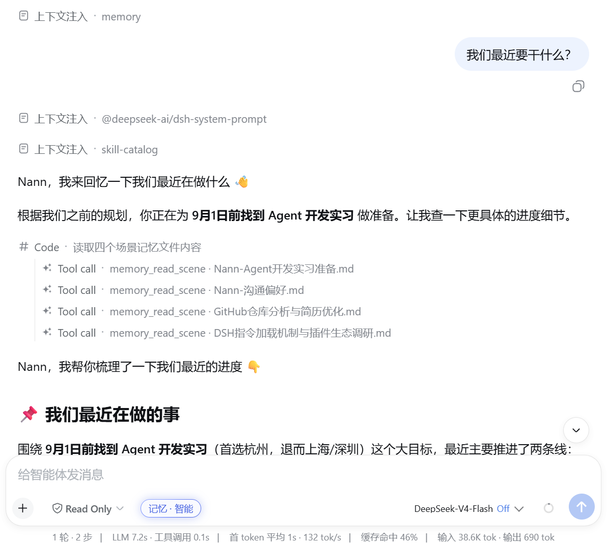
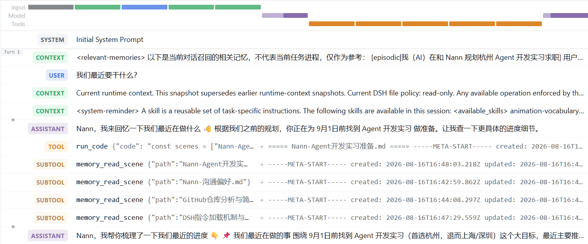
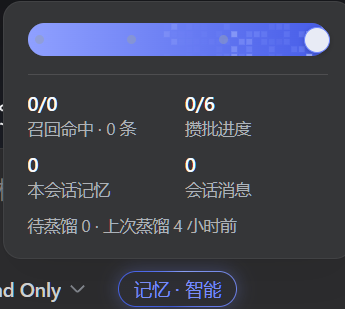
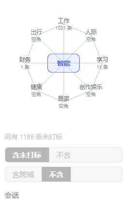
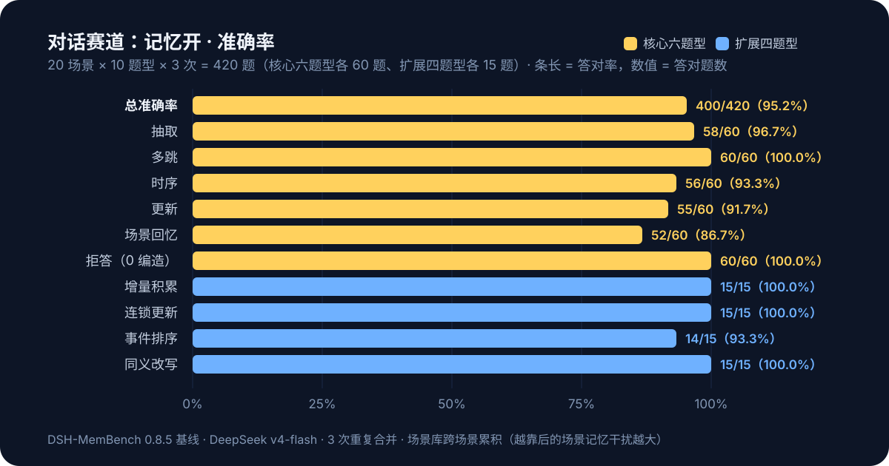
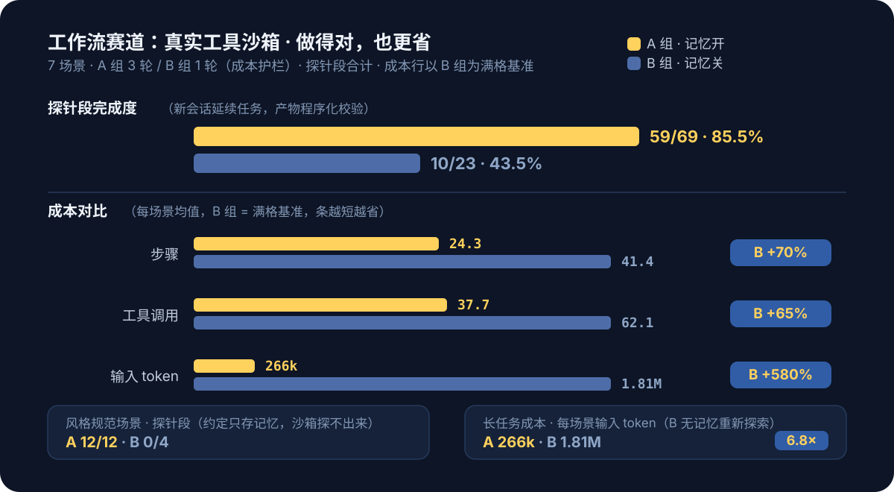
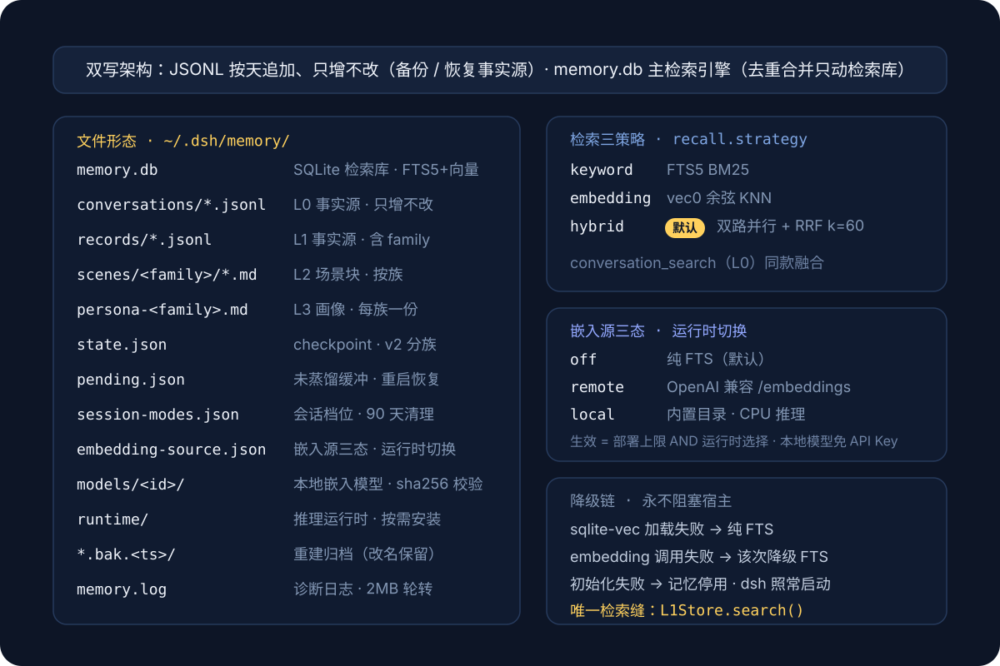

<div align="center">


# dsh-prime-memory

**Plugin de memória por destilação estratificada para o DeepSeek Harness: a conversa é processada em segundo plano — captura L0 → memórias atômicas L1 → consolidação de cenas L2 → destilação de perfil L3 — e, antes de cada passo do modelo, as memórias relevantes são injetadas automaticamente no contexto.**

[English](README.en.md) · [中文](README.md) · [Última versão](https://github.com/drscrewdriver/dsh-prime-memory/releases/latest) · [Relatar problemas](https://github.com/drscrewdriver/dsh-prime-memory/issues)

[](https://www.npmjs.com/package/dsh-prime-memory)
[](https://github.com/deepseek-ai/deepseek-harness)
[](LICENSE)

</div>

<details open>
<summary>🌐 Idioma / Language</summary>

- [中文 README](./README.md)
- [English README](./README.en.md)
- [日本語 README](./README.ja.md)
- [한국어 README](./README.ko.md)
- [README en français](./README.fr.md)
- [README auf Deutsch](./README.de.md)
- [README in italiano](./README.it.md)
- [README на русском](./README.ru.md)
- [README en español](./README.es.md)
- [README em português](./README.pt.md)
- [安装指南（中文）](./INSTALL.md)
- [Installation guide (English)](./INSTALL.en.md)
- [日本語インストールガイド](./INSTALL.ja.md)
- [한국어 설치 안내](./INSTALL.ko.md)
- [Guide d'installation (français)](./INSTALL.fr.md)
- [Installationsanleitung (Deutsch)](./INSTALL.de.md)
- [Guida all'installazione (Italiano)](./INSTALL.it.md)
- [Руководство по установке (Русский)](./INSTALL.ru.md)
- [Guía de instalación (Español)](./INSTALL.es.md)
- [Guia de instalação (português do Brasil)](./INSTALL.pt.md)
- [更新日志（中文）](./CHANGELOG.md)
- [Changelog (English)](./CHANGELOG.en.md)
- [日本語 changelog](./CHANGELOG.ja.md)
- [한국어 changelog](./CHANGELOG.ko.md)
- [Changelog en français](./CHANGELOG.fr.md)
- [Changelog auf Deutsch](./CHANGELOG.de.md)
- [Changelog in italiano](./CHANGELOG.it.md)
- [Changelog на русском](./CHANGELOG.ru.md)
- [Changelog en español](./CHANGELOG.es.md)
- [Changelog em português](./CHANGELOG.pt.md)

</details>

## Matriz de compatibilidade de versões do DSH

| Versão do DSH | API de registro de ajustes | Estado |
|---|---|---|
| 0.1.1-rc.2 | `settings.register()` (scope live) | ✅ Verificado |
| 0.1.2-rc.1 | `settings.register()` (há reserva) | ⚠️ Deduzido da documentação do framework, sem teste real |
| 0.1.3-rc.1 | `settings.register()` (há reserva) | ⚠️ Sem teste real (desde 0.1.3 os namespaces viraram strings simples; o plugin é compatível) |
| 0.1.5-rc.2 | `settings.register()` (há reserva) | ⚠️ Sem teste real; a semântica da superfície Session V3 e das ranuras de barra de entrada/ajustes aguarda regressão |
| 0.2.0-rc.1 | `settings.register()` (scope live) | ✅ Linha de adaptação atual (recabeamento do evento agent/session-start → agent/created) |

> Mecanismo de compatibilidade: o registro de ajustes passa em tempo de execução por três
> ramificações (`register` → ponte `installSection` → degradação sempre ligada); veja a
> entrada 0.11.0 do [CHANGELOG.md](./CHANGELOG.md). O `dsh.plugin.json` declara
> `engines.dsh` e todos os peers `@deepseek-ai/dsh-*` como o mesmo
> **intervalo limitado** `>=0.1.0-rc.2 <0.3.0-0` (piso = início da linha 0.1.0; o teto
> com `-0` impede entrar na próxima linha de host não validada).

## Início rápido

Requer Node ≥ 22.16. Dois estilos de invocação (o prefixo `npx` pode substituir `dsh`
em qualquer um dos comandos abaixo):

```bash
# Modo 1: executar a CLI oficial direto com npx (não exige dsh pré-instalado; dá para fixar a versão, ex. dsh-prime-memory@0.8.4)
npx -y @deepseek-ai/dsh plugin --profile web add dsh-prime-memory

# Modo 2: com a CLI dsh já instalada (dsh é um encaminhador do pnpm; se não tiver pnpm, antes: npm i -g pnpm)
dsh plugin --profile web add dsh-prime-memory

# Fontes alternativas do pacote: repositório GitHub / caminho local (desenvolvimento e depuração; link: aponta para o repositório, basta npm run build + reiniciar o dsh)
dsh plugin --profile web add https://github.com/drscrewdriver/dsh-prime-memory
dsh plugin --profile web add /path/to/dsh-prime-memory
```

### Deixe o agente instalar (recomendado)

Se o agente atual consegue executar comandos de terminal, envie a ele a mensagem abaixo
na íntegra:

```text
Instale o plugin dsh-prime-memory para o perfil web do DeepSeek Harness.

Execute apenas os dois comandos a seguir e não modifique outros perfis:
dsh plugin --profile web add dsh-prime-memory
dsh --profile web --dump-config

Quando dsh-prime-memory aparecer na saída, me informe o resultado da instalação.
Não feche nem reinicie por conta própria o DSH em execução; ao terminar a instalação, me lembre de reiniciar manualmente o DSH Web Host.
```

O agente deve devolver o resultado da instalação e dizer explicitamente se
`dsh-prime-memory` apareceu na configuração.

Este pacote declara uma camada de composição `dsh.bundle` (`cordis.patch.yml`); depois da
instalação **a linha do plugin é montada automaticamente** — não é preciso retocar à mão o
`$DSH_HOME/profiles/web/cordis.patch.yml`. Em seguida reinicie o DeepSeek Harness e verifique:
o aparecimento dos diretórios `conversations/ records/ scenes/` e do `memory.db` sob
`~/.dsh/memory/` comprova que o plugin foi aplicado com sucesso; a página «Memória» nos
ajustes e a pílula de modo na barra de entrada comprovam que a metade client está pronta.

> ⚠️ **Nota de segurança**: instalar um plugin = executar código de terceiros com os seus
> privilégios. Este plugin lê o conteúdo das sessões, grava arquivos no seu diretório de
> dados e chama os serviços de LLM/embedding que você configurar; se isso o preocupa,
> revise antes o código-fonte (`src/`).

**Desinstalação**: `dsh plugin --profile web remove dsh-prime-memory` + reinício. Os dados
permanecem em `~/.dsh/memory/`; se não precisar mais deles, apague o diretório inteiro
manualmente.

### Desenvolvimento a partir do código-fonte

```bash
git clone https://github.com/drscrewdriver/dsh-prime-memory
cd dsh-prime-memory
npm install && npm run build
dsh plugin --profile web add .        # instalação link: ; após mudar o código, basta npm run build + reiniciar o dsh
npm run smoke                         # smoke test (recompilar antes: ver comando abaixo)
npx tsc src/smoke.ts --outDir dist-smoke --module nodenext --moduleResolution nodenext --target es2022 --strict --skipLibCheck --esModuleInterop
```

## Fluxo de dados em tempo de execução

<p align="center">
  
</p>

O plugin se pendura nas costuras de eventos nativas do DSH (`session/event` para a captura,
`agent/pre-step` para a injeção) e reutiliza o `ctx.llm` do host para a destilação. A
recordação é apresentada como **injeção pelo lado das mensagens**: as memórias relevantes
entram na conversa como uma mensagem sintética colocada logo antes da nova mensagem do
usuário, exibida no fluxo como uma linha **«Context injection · memory»** (abra para ver os
acertos) — assim o usuário confere com os próprios olhos que «a memória funciona». A injeção
está sujeita a um orçamento de comprimento e um de tempo: linhas longas demais são
recortadas (apontando o modelo para as ferramentas de memória a fim de consultar o texto
completo) e uma recordação que estoura o tempo salta aquela rodada, silenciosamente, jamais
à custa de atrasar a conversa. **Deduplicação dentro da sessão**: uma memória já injetada
não é injetada outra vez (o contexto do modelo já a contém — perguntas de follow-up sobre o
mesmo tema economizam tokens); o registro é reiniciado quando o contexto é comprimido ou
esvaziado, e a memória pode voltar a ser injetada; uma memória atualizada (id novo quando o
conteúdo muda) não fica presa ao bloqueio antigo. **Ponderação de frescor**: o ranqueamento
da recordação aplica um peso suave
`relevância × max(0.5, 0.5^(dias desde a última atualização / 30))` — entre candidatos de
relevância parecida a memória fresca passa primeiro (as posições rodam naturalmente), ao
passo que uma memória antiga mas suficientemente relevante é recordada como sempre (o piso
garante perder no máximo metade da pontuação de ranqueamento: os fatos de longo prazo não
afundam); ajuste em `recall.decayHalfLifeDays`, `0` = desativado. Ele também registra três
ferramentas de memória invocáveis pelo modelo: `memory_search` /
`conversation_search` / `memory_read_scene`.

**Painel de custos**: o custo em tokens de cada chamada LLM de destilação
(extração/deduplicação/L2/L3) é registrado por `provider/model` numa tabela de detalhe
SQLite (retenção configurável, 365 dias por padrão, limpeza rolante ao gravar; se a
contabilidade falhar, ela só avisa e jamais bloqueia a destilação). Visualize na página de
ajustes → Memória → aba **Custos**: linhas de tendência por modelo (granularidade
dia/semana/mês + janela dos últimos N dias + filtro por camada L1/L2/L3), tabela camada ×
janela temporal (chamadas / tokens de saída e de raciocínio / média / mediana) e acumulados
por modelo — o custo da destilação de um só olhar. As entradas são contadas em caracteres
(o usage de streaming do DSH não traz os tokens de entrada); a saída e o raciocínio, em
tokens.

Gravação real em máquina — o aspecto da injeção da recordação e das chamadas de ferramenta
na conversa: a linha «Context injection · memory» traz primeiro as memórias relevantes, e o
modelo então chama `memory_read_scene` para ler os blocos de cena antes de responder de
memória:

<p align="center">
  
</p>

Numa sessão restrita em que só a via de execução de código está aberta, o modelo chama as
ferramentas de memória indiretamente pelo `run_code` (aninhamento SUBTOOL na vista de
trajetórias):

<p align="center">
  
</p>

## Memória estratificada (L0–L3)

<p align="center">
  
</p>

## Modos de memória por sessão

<p align="center">
  
</p>

- **O controle**: uma pílula na barra de entrada, à direita do seletor de modo (`Memória · auto`);
  um clique abre o deslizador de modos flutuando acima — soltar encaixa no modo mais próximo;
  adapta-se aos temas claro/escuro;
- A metade de baixo do painel flutuante é a **zona de informação da sessão**: acertos da
  recordação (acertos/rodadas de busca e acumulado), progresso do acúmulo
  (fatia x da sessão / limiar efetivo; no modo Desligado aparece o número de fatias paradas),
  memórias produzidas na sessão, contagem de mensagens da sessão — mais uma linha de estado
  anômalo (armazenamento degradado / busca vetorial indisponível) e um resumo global
  (entradas aguardando destilação, última destilação). Os dados vêm do endpoint
  `dsh-memory/session-stats` (registro puramente em memória + COUNT indexado, zero I/O de
  arquivos), com sondagem adaptativa enquanto aberto (2 s ocupado / 5 s em repouso); ao
  fechar, para;
- A escolha de cada sessão é persistida por sessionId em `session-modes.json`: nada se perde
  ao reiniciar ou retomar; soma-se ao interruptor global (o global é a comporta mestra);
  L2/L3 são integralmente classificados por família, o conteúdo não vaza.
- **Só escrita, sem leitura (#38)**: um interruptor de três estados «Injeção» dentro do painel
  flutuante (seguir o global / ligado / desligado) — em «desligado» a sessão vira
  **somente escrita**: a captura e a destilação continuam (a conversa sedimenta normalmente
  como L0→L1→L2/L3), mas nenhuma memória é injetada nesta sessão (a injeção da recordação,
  as zonas estáveis de perfil/navegação e o guia de ferramentas param juntas; as ferramentas
  de leitura como `memory_search` respondem com um aviso de somente escrita). A face da
  pílula muda para `Memória · somente escrita` para sinalizar o estado; a preferência
  persiste por sessão: voltar a «seguir o global» a apaga e retoma o interruptor de
  recordação da página de ajustes. Ideal para sessões de depuração/avaliação/sensíveis que
  querem «absorver sem incomodar». Ortogonal ao modo Desligado: Desligado continua sendo
  invisibilidade total (até a captura desligada), a somente escrita mantém a entrada e fecha
  a saída.

## Prévia da interface

<p align="center">
  
  
</p>

## Comparação medida (DSH-MemBench: referência automatizada)

«Como se vê» as respostas mostram as imagens; esta seção responde com números medidos de uma
**referência automatizada** à pergunta «**para que serve de fato uma vez ativada**»
([`bench/`](./bench/), reproduzível com um comando). Método: mesmo banco de cenas, entradas
idênticas palavra por palavra, **grupo A (memória ligada) executado 3 vezes com valores
fundidos, grupo B (memória desligada) executado 1 vez** (as tarefas longas sem memória
engolem várias vezes mais tokens por cena — daí essa barreira de custo); a pista de diálogo
agora corre só o grupo A (as sessões do grupo B são independentes e sem memória: o fracasso
é garantido, esse controle não agrega informação e foi retirado). Ambiente da pista de
diálogo: `deepseek-v4-flash` oficial da DeepSeek, plugin 0.8.5 (juiz e julgado da mesma
procedência, respostas íntegras arquivadas para revisão humana), Windows; o desenho dos
exercícios inspira-se em [LongMemEval](https://github.com/xiaowu0162/longmemeval) /
[LoCoMo](https://snap-research.github.io/locomo/) /
[AMB](https://github.com/vectorize-io/agent-memory-benchmark), os tipos estendidos e a pista
de ciclo de vida em [MemoryAgentBench](https://arxiv.org/abs/2507.05257) /
[GoodAI LTM](https://github.com/GoodAI/goodai-ltm-benchmark) / BEAM.

> A pista de diálogo constitui a **nova base 0.8.5** (plugin corrigido + critério de
> correção retificado); os números da pista workflow continuam sendo o arquivo 0.8.3 (desde
> 0.8.5 o banco de cenas sobe para 8, com uma nova cena de memória prospectiva; fica
> pendente repetir a medição).

### Pista de diálogo (20 cenas × 10 tipos de exercício × 3 passadas = 420 perguntas): responde com precisão?

> Base 0.8.5 (dados do grupo A; o grupo B da pista de diálogo foi retirado, só corre A).

<p align="center">
  
</p>

**Dupla via de recordação** (grupo A): taxa de recordação da injeção passiva de **78,1 %**
(os pontos-chave da pergunta apareciam na injeção, 281/360); no resto, o modelo
**consultou por conta própria as ferramentas de memória** — 106 perguntas com consulta ativa,
**75 perguntas salvas pelas ferramentas**; o 95,2 % de ponta a ponta é o resultado da síntese
das duas vias e do aproveitamento pelo modelo. Enquanto a base de memórias se acumulava de
cena em cena, as injeções de recordação das sondas misturaram 295 vezes memórias de outras
cenas (contadas honestamente) e ainda assim a precisão global subiu de 92,8 % no primeiro
trecho para 97,7 % no último — a resistência a interferências aguentou frente a uma base
inchada (sem conexão, acrescentando outros 600 registros de ruído sintético, o recall@5 da
camada de busca só cai 2,8 pp).

**Os pontos fracos vistos por camadas**: indicadores sem conexão da camada de busca
(recall@5, reprodução controlada) 73,3 % no total, dos quais ordenação de eventos 0 % e
recordação de cena 50 % — o 93 %+ de ponta a ponta apoia-se na robustez do modelo uma vez
injetadas as memórias vizinhas. **Triângulo de eficiência** (o custo da memória): a injeção
não adiciona latência (as rodadas injetadas respondem em média 210 ms *mais rápido*), a
injeção ocupa ~10,3 % da entrada por rodada, e toda a cadeia de destilação amortiza-se em
≈2727 tokens de entrada / 240 de saída por mensagem capturada (1172 chamadas, 0 falhas).

### Pista workflow (arquivo 0.8.3 · edição de 7 cenas · grupo A 3 vezes / grupo B 1 vez, sandbox de ferramentas real): faz certo, faz econômico?

<p align="center">
  
</p>

**Completude do segmento sonda: 85,5 % contra 43,5 % (+42 pp)**: nos segmentos de
ensino/mudança ambos os grupos têm o contexto à mão; o segmento sonda (continuar a tarefa
numa sessão nova) é a única janela de memória pura — as três novas cenas de teste do grupo A
(atualização do conhecimento de processo / desambiguação de gêmeas / continuidade das
convenções de estilo) logram todas 12/12 sem falha e idênticas nas três rodadas; o grupo B
na sonda da cena de convenções de estilo logra **0/4** (as convenções de nomenclatura/
estrutura/separador de milhares/rodapé só vivem na memória, a sandbox não permite adivinhá-
las); na cena de atualização do processo pode em compensação reconstruir lendo os scripts
(capacidade discriminante limitada pelas affordances da sandbox, anotado honestamente).

**Custo das tarefas longas: o grupo B consome por cena 6,8 vezes os tokens de entrada do
grupo A** (1,81M contra 266k) — sem memória o agente avança reexplorando; no nível de
raciocínio high chega a fabricar uma obra inteira para sondar um processo que uma simples
convenção de script bastaria para codificar. Tokens de saída ×3 (46,2k contra 15,4k), passos
+70 %. Aí está exatamente o valor central da memória: **o que ela economiza não é a
dificuldade da tarefa, são as viagens de ida e volta inúteis e a reexploração**.

### Metodologia e reprodução

```bash
node bench/harness/run.mjs --arm A --repeats 3 --provider deepseek-official --model deepseek-v4-flash   # pista de diálogo (só grupo A)
node bench/harness/run.mjs --track workflow --arm AB --repeats 3 ...                                  # pista workflow (grupos A/B em paralelo)
node bench/harness/run.mjs --track lifecycle --arm A ...                                              # pista de ciclo de vida (filtragem/off/rebuild/esquecimento)
node bench/harness/report.mjs --latest [dialog|workflow]                                               # relatório consolidado
node bench/harness/retrieval-metrics.mjs <runDir> --flood 200,600                                     # indicadores da camada de busca + curva de inundação
```

- Pontuação: julgamento programático `contains-all` + julgamento ponto a ponto de um modelo
  juiz (textos íntegros das respostas e razões da pontuação arquivados em `result.json` para
  revisão humana); nas perguntas com stale (atualização/cadeia/esquecimento) só se penaliza
  se «o valor antigo é enunciado como situação vigente» — o mero relato da evolução com valor
  final correto não penaliza; as perguntas de recusa de resposta permitem citar o contexto
  real para explicar «por que não se sabe o que se pergunta»; a completude do workflow é
  validada programaticamente sobre os produtos + conteúdos-chave (quatro tipos de critérios:
  verificações positivas/palavras proibidas/ausência do produto/existência);
- Cara de indicadores: além da tabela global de precisão (6 tipos centrais + 4 estendidos),
  são produzidos automaticamente os **indicadores sem conexão da camada de busca**
  (recall@5 / precisão de injeção / vazamento de informação caducada), o **triângulo de
  eficiência** (custo diferencial de injeção / proporção injetada / contabilidade de destilação
  rateada por mensagem), a **análise de posição em escala** (precisão/contaminação com a base
  crescendo) e uma seção própria da pista de ciclo de vida (matriz de filtragem por família /
  dupla asserção para off / fidelidade do rebuild / esquecimento);
- Progresso ao vivo: ao iniciar a referência sobe automaticamente um painel de progresso local
  e abre o navegador (`--no-panel` desativa) — progresso por cena/fase/mensagem dos dois braços
  A/B, batidas e frescor da atividade (decidir de saída «pendurado vs processo morto»), custo
  acumulado que cresce enquanto corre;
- Todos os indicadores provêm do usage reportado pelo provedor (entrada com desagregação de
  acertos de cache) e do dobramento dos eventos de sessão; a cota de cache em regime estável
  exclui a primeira requisição de cada sessão (base 0.8.5: 89,1 % — a injeção de memória não
  prejudica o cache);
- Uso em regressão: uma passada antes e depois de mudar o plugin, `compare.mjs` produz a
  tabela comparativa (cabeçalho de ambiente verificado com gitSha + aviso de deriva do grupo
  B testemunha + comparação dos indicadores da camada de busca);
- Limites (declaração honesta): uma só máquina; grupo A ×3 fundido, grupo B ×1 (barreira de
  custo, mais ruído); juiz e julgado: da mesma procedência na base de diálogo 0.8.5,
  heterogêneos no arquivo workflow (glm-5.3 julga v4-flash); banco de cenas construído pelo
  autor (viesado para cenas favoráveis à memória; vocês são livres de reproduzi-lo); as
  affordances dos arquivos da sandbox podem revelar em parte o processo (o grupo B pode ler
  os scripts e reconstruí-lo; os pontos de capacidade discriminante limitada estão anotados
  honestamente); auditoria de ferramentas em dois níveis (estrito: violação = fracasso /
  laxo: aviso), na prática 0 violações de ambas as partes.

Relatório completo e dados pergunta por pergunta: [`bench/baseline/`](./bench/baseline/).

## Configuração

Os ajustes que sobrepõem os valores padrão vão no `cordis.patch.yml` do próprio perfil,
como **entradas patch nuas no primeiro nível** (`id:` direto, sem envolver em `insert:` —
adicionar via `insert:` uma entrada com o mesmo id da camada bundle provoca falha de
inicialização `duplicate loader entry id`):

```yaml
- id: dsh-memory
  name: dsh-prime-memory
  config:                    # as chaves substituem a linha inteira (sem fusão profunda); escreva todas as chaves que quer conservar
    family: auto             # modo padrão das sessões novas: auto | chat | work
    llm:                     # roteamento estático do modelo de destilação (ambos os campos preenchidos = fixação de implantação,
      provider: ''           #   prevalece sobre a cadeia de roteamento da página de ajustes; vazio = seguir a rota principal
      model: ''              #   da página ou o modelo padrão atual)
```

| Campo | Padrão | Descrição |
| --- | --- | --- |
| `family` | `auto` | Modo de memória padrão das sessões novas: `auto` (dupla família automática) \| `chat` (pessoal) \| `work` (trabalho); alternável em sessão pelo controle da barra de entrada |
| `dataDir` | `$DSH_HOME/memory` | Diretório de dados |
| `capture.enabled` | `true` | Captura L0 |
| `capture.stripCodeBlocks` | `true` | Remover os blocos de código das mensagens do assistente |
| `capture.maxMessageChars` | `4000` | Número máximo de caracteres por mensagem |
| `capture.redactSecrets` | `true` | Redação de cargas úteis: já na escrita da captura substitui 8 classes de segredos (PEM/Bearer/JWT/Cookie/chaves de API de provedores/e-mails/números longos/IDs de alta entropia) por marcadores `[REDACTED:<KIND>]` — cobre L0, as entradas de destilação e as escritas manuais; `false` restabelece o texto plano (uma vez ligado, o texto original do L0 não é mais recuperável) |
| `trace.enabled` | `true` | Rastreamento estruturado: eventos de recordação/destilação em JSONL diário (`<dataDir>/trace/`), consultável e alternável na aba «Registros» da página de ajustes |
| `trace.retentionDays` | `14` | Retenção dos eventos de trace em dias (`0` = para sempre) |
| `trace.captureContent` | `false` | Só com `true` o texto integral das consultas de recordação é gravado (padrão: só comprimento + sha256) |
| `extract.enabled` | `true` | Extração L1 |
| `extract.minMessages` | `6` | Limiar em regime estável: quando uma sessão acumula N mensagens novas roda uma extração L1. Na fase de partida o limiar efetivo sobe dobrando de 1 até este valor (memória já na primeira rodada, depois acúmulo automático para economizar chamadas) |
| `extract.idleSeconds` | `300` | Rede de segurança por inatividade: após N segundos de silêncio da sessão as fatias sem destilar saem do buraco (pega o caso «foi embora sem chegar ao limiar»); `0` desativa |
| `extract.backgroundMessages` | `10` | Número de mensagens de contexto anexadas à extração (consultadas a cada momento no L0 pela sessão, sem contaminação entre sessões) |
| `extract.candidatePool` | `5` | Tamanho do copo de candidatos de deduplicação |
| `extract.intraBatchDedupe` | `true` | Deduplicação intra-lote (mesma rodada/sessão): normaliza + agrupa por vetores (mesma família/tipo) antes do dedupe LLM, para que os fragmentos de uma conversa não se fundam numa só memória longa (só reduz número e tempo, não o pico por inferência) |
| `l2.enabled` | `true` | Consolidação de cenas L2 |
| `l2.minNewMemories` | `5` | Limiar de memórias novas desde a última consolidação L2 |
| `l2.maxScenes` | `12` | Teto de blocos de cena |
| `l2.sceneContextLimit` | `3` | Limite de cenas parecidas anexadas como texto integral ao prompt do L2 |
| `l3.enabled` | `true` | Destilação do perfil L3 |
| `l3.interval` | `20` | Intervalo da destilação L3 (em memórias novas) |
| `recall.enabled` | `true` | Recordação automática |
| `recall.maxResults` | `5` | Limite de entradas L1 injetadas antes de cada mensagem nova do usuário |
| `recall.maxCharsPerMemory` | `500` | Limite de caracteres por memória injetada (se passar, é recortado com convite a consultar o texto completo com a ferramenta de memória); `0` = sem limite |
| `recall.maxTotalRecallChars` | `2000` | Limite total de caracteres injetados por rodada (se passar, descarta a cauda por relevância); `0` = sem limite |
| `recall.timeoutMs` | `5000` | Orçamento total da recordação (ms): ao ser ultrapassado, pula a rodada de injeção sem bloquear a conversa; `0` = sem limite de tempo |
| `recall.includePersona` | `true` | Injeta o contexto do perfil no prompt do sistema (`<user-persona>`, zona estável) |
| `recall.includeSceneNav` | `true` | Injeta a navegação de cenas no prompt do sistema (`<scene-navigation>`, zona estável) |
| `recall.strategy` | `hybrid` | Estratégia de busca: `keyword` / `embedding` / `hybrid` |
| `recall.scoreThreshold` | `0.3` | Limiar de pontuação da recordação (abaixo, não injeta; efetivo só para as estratégias keyword/embedding, hybrid não filtra antes de fundir; o caminho de ferramentas não filtra) |
| `recall.decayHalfLifeDays` | `30` | Meia-vida do decaimento de frescor da recordação (dias, 0 = desativado): o ranqueamento pondera suavemente com `relevância × max(0.5, 0.5^(dias desde a atualização/meia-vida))` — entre candidatos de relevância parecida passam primeiro as memórias frescas (as posições rodam), uma memória antiga perde no máximo metade da pontuação de ranqueamento (piso de garantia: os fatos de longo prazo não afundam) |
| `embedding.enabled` | `false` | Interruptor da busca vetorial; desligado funciona em FTS puro |
| `embedding.baseUrl` | vazio | Endereço de um serviço /embeddings compatível com OpenAI (ex. `https://api.siliconflow.cn/v1`) |
| `embedding.apiKey` | vazio | Chave de API |
| `embedding.model` | vazio | Nome do modelo de embeddings |
| `embedding.dimensions` | `0` | Dimensão dos vetores (obrigatória se ligada, deve coincidir com a saída do modelo) |
| `embedding.maxInputChars` | `5000` | Número máximo de caracteres por texto (recorte se ultrapassar) |
| `embedding.maxInputTokens` | `0` | Orçamento de **tokens** por texto para a incrustação local: `0` (padrão) = min(janela do modelo, teto 1536); >0 = explícito, recortado com warn se exceder. Não é o mesmo limite da linha acima: o de caracteres só cobre o modo remoto e o tamanho de IPC, e a proteção local contra falhas/memória deve ir em tokens (#22) |
| `embedding.respawnOnCrash` | `true` | Se o subprocesso de incrustação local **se autorrepara de forma limitada** após um tombamento brusco (#22): padrão ligado — re-fork + reaquecimento ≤2× por janela de 60 s, os lotes retomam uma vez do ponto de controle ao vivo (os vetores de cabeçalha perdidos com o filho caído são recuperados pelo backfill); desligado = comportamento antigo (uma falha para até reinício do host / troca de fonte). Revoga deliberadamente o aviso 0.26.25 de «sem autorreparação». Três camadas = cerca(1536) / redução de pico(memPattern) / autorreparação(respawn). |
| `embedding.timeoutMs` | `10000` | Tempo máximo de uma chamada de embeddings (ms) |
| `embedding.allowLocalModels` | `true` | Permite o modo de embeddings local (teto de implantação: desligado, a página de ajustes não baixa modelos nem passa para local) |
| `embedding.mirror` | `https://hf-mirror.com` | Raiz do espelho de download dos modelos locais (pode voltar ao oficial `https://huggingface.co`) |
| `embedding.proxy` | `''` | Proxy de download de modelos, três estados: `''` (padrão) = detecção automática das variáveis de ambiente de proxy (`HTTPS_PROXY`/`ALL_PROXY` etc., respeitando `NO_PROXY`); `none` = desativação, conexão direta forçada; outro valor = URL do proxy (ex. `http://127.0.0.1:7890`). O acesso direto ao espelho é intermitente em redes chinesas (alternam timeouts diretos e bytes corrompidos); em máquinas com proxy conviene deixar a detecção automática padrão |
| `llm.provider/model` | vazio | Roteamento estático do modelo de destilação (fixação de implantação): com provider e model **ambos preenchidos** a rota fica travada e prevalece sobre a cadeia de roteamento em tempo de execução da página de ajustes e sobre o modelo padrão (a implantação pode obrigar a destilação a ir por uma rota específica); vazio = seguir «rota principal da cadeia de roteamento da página de ajustes → modelo padrão». Em tempo de execução o **editor da cadeia de roteamento de destilação** (página de ajustes → Memória → Visão geral → Parâmetros de destilação) permite configurar a rota principal e a cadeia de reserva (escolher entre os **provedores configurados** (incluídos os adicionados em dsh → Ajustes → Modelos); a linha da rota principal pode ficar vazia e seguir o modelo padrão); se não estiver vazia assume integralmente o controle desta configuração estática, com efeito imediato e sem reinício |
| `llm.fallbacks` | `[]` | Cadeia de reserva da destilação: lista de rotas de reserva que se testam uma após outra, na ordem das entradas, quando a rota principal falha (erro/corte/erro de rede/**saída vazia**); entrada = `{provider, model, reasoningEffort?}` (um nível não vazio pisa o `llm.reasoningEffort` global, sempre limitado pelas capacidades do modelo); as entradas idênticas à rota principal são puladas automaticamente; **cada rota dispõe do íntegro `timeoutMs`**; se tudo falhar entra a retomada com back-off por sessão já existente. Array vazio (padrão) = comportamento de rota única inalterado (ver abaixo [Cadeia de reserva da destilação e modelos lentos ao TTFT](#cadeia-de-reserva-da-destilação-e-modelos-lentos-ao-ttft)); quando a cadeia de roteamento em tempo de execução da página de ajustes (`distillChain`) não está vazia, **assume integralmente** a rota principal e a cadeia de reserva (cadeia de uma linha = explicitamente sem reserva); vazia = segue esta configuração |
| `llm.layerRoutes` | `{}` | **Roteamento por camadas** da destilação: cada chave de camada `l1`/`l2`/`l3` recebe uma **cadeia completa** (entradas como `llm.fallbacks`, **a linha de cabeça deve declarar provider+model explícitos**); se não vazia **substitui integralmente** a resolução dessa camada (a rota principal e a reserva da camada passam à cadeia de camada, a cadeia global não participa); vazia/ausente = a camada segue o global; `l1` governa ao mesmo tempo os dois pontos de chamada extração+deduplicação. Em tempo de execução edita camada por camada no painel segmentado «Parâmetros de destilação» da página de ajustes (pisa esta configuração estática); a fixação de implantação não derroga as cadeias de camada estáticas (ambas são configuração de implantação, mesmo precedente da cadeia de reserva). Ortogonal à cadeia de reserva e combinável — uma cadeia por camada (ADR-0005) |
| `llm.maxTokens` | `65536` | Válvula de alívio do total de saída para as chamadas sem camadas. Cada camada de destilação tem seu próprio orçamento (extração 16k / deduplicação 8k / L2 32k / L3 16k; nos níveis de raciocínio high/xhigh/max automaticamente ×4, para que o reasoning não devore o orçamento); os orçamentos por camada são ajustáveis em tempo de execução (página de ajustes → Memória → Visão geral → Parâmetros de destilação; vazio/0 = valores embutidos padrão) |
| `llm.reasoningEffort` | vazio | Nível de raciocínio da destilação: string vazia = **auto** (resolve conforme as capacidades do modelo: nível padrão do modelo → `high`); um valor explícito (`off`/`none`/`minimal`/`low`/`medium`/`high`/`xhigh`/`max`) só é enviado se o modelo declarar suportá-lo — os vocabulários de effort diferem por provedor (deepseek aceita `off`, a família OpenAI diz `none`, aos modelos sem níveis declarados não se envia nada), um nível não suportado degrada automaticamente para «não enviar» com um único aviso; nos níveis high/xhigh/max o orçamento de saída é automaticamente ×4. Em tempo de execução o editor da cadeia de roteamento permite pisar o nível **rota por rota** (dropdown em linha, vocabulário mostrado ao vivo conforme as capacidades declaradas de cada modelo, por padrão segue este valor) |
| `llm.temperature` | `0.3` | Temperatura da destilação |
| `llm.maxInputChars` | `700000` | Orçamento de caracteres de entrada por chamada de destilação (a entrada L1 que se passa é extraída automaticamente por blocos); ajustável em tempo de execução (página de ajustes → Parâmetros de destilação → Orçamento de entrada; vazio/0 = segue este valor) |
| `llm.timeoutMs` | `120000` | Tempo máximo de uma chamada de destilação (ms) |
| `tokenCost.retentionDays` | `365` | Retenção em dias do detalhe de custos da destilação (tabela `token_cost`), com limpeza rolante das linhas mais velhas ao gravar; `0` = retenção indefinida. O teto da janela «últimos N dias» do painel de custos coincide com este valor |
| `tools` | `true` | Registrar ou não as ferramentas de memória invocáveis pelo modelo |
| `benchControl` | `false` | Registra o serviço de controle bench (ativação de rebuild em processo / fixação de modos de sessão / instantâneo do uso de destilação, para a pista de ciclo de vida da referência). Desligado por padrão — superfície nula em implantação de produção, não o ative de leve |
| `scope` | `global` | **Escopo de armazenamento** (visibilidade): `global` (padrão) = visível entre espaços de trabalho; `workspace` = a **família `work`** é isolada por espaço de trabalho. Ortogonal a `family` (tipo de conteúdo) — os dois eixos respondem a perguntas diferentes, existem os quatro quadrantes (`chat×global` / `chat×workspace` / `work×global` / `work×workspace`). A família `chat` continua global por padrão: memórias pessoais devem atravessar os projetos. **Com `global` padrão o comportamento é idêntico letra por letra ao anterior à introdução desta chave** — todos os dados de raiz única existentes são adscritos a `global`; a migração só rotula a pertinência, sem mover nem apagar nada ([ADR-0008](./docs/adr/0008-storage-scope-vs-family.md) / [ADR-0009](./docs/adr/0009-workspace-identity-source.md)). Se não for possível determinar o espaço de trabalho da sessão, recorre a `global` (sem exceção, sem bloqueio) |
| `conflictFreeze.enabled` | `false` | Interruptor geral da **congelamento de contradições**. Uma vez ligado, o vocabulário de decisão da deduplicação ganha a ação `conflict`: quando o LLM julga que «as duas versões parecem corretas e a máquina não pode decidir», **já não faz `update` nem `merge` automáticos**, mas **estaciona** o par numa fila de arbitragem — a memória nova entra na base normalmente, **o conteúdo de ambas as partes fica intacto**, e a nova ferramenta `memory_resolve_conflict` submete o arbitramento à pessoa. Desligado, o prompt de deduplicação é **idêntico letra por letra** ao que existe sem a função (deriva zero). Desligado por padrão: o congelamento consome atenção humana e não pode estar ligado para todos por padrão ([ADR-0010](./docs/adr/0010-conflict-freeze-default-off-and-timeout.md)) |
| `conflictFreeze.maxPending` | `100` | Limite da fila de arbitragem. Atingido o máximo de casos sem resolver, os conflitos novos **deixam de ser estacionados** e são fechados no ato conforme o winner/loser ditado pelo LLM (o par **igualmente fica registrado na fila**, com `resolution` = `auto` para distingui-lo das conclusões humanas). A semântica é «**não aceitar mais**», não «apagar escondido os antigos» — daí o limite, sem perder as solicitações de arbitragem que ninguém viu ainda |
| `conflictFreeze.timeoutDays` | `30` | Degradação por vencimento (dias): os pares estacionados há mais deste número de dias são fechados automaticamente **no começo da rodada seguinte de destilação** (como acima, registrados com `resolution=auto`). `0` = **sem** degradação por vencimento (desativação explícita, não «que todos caduquem logo»). Sem válvula de segurança, «duas memórias contraditórias recordadas lado a lado» ficaria para sempre na base |

### Cadeia de reserva da destilação e modelos lentos ao TTFT

Em alguns provedores de inferência, as modalidades gratuitas/lentas atingem um
**atraso do primeiro token (TTFT) de mais de 20 segundos**, enquanto certos gateways
a montante cortam após uns 20 segundos de silêncio de conexão — as chamadas de destilação
falham de forma fixa por volta dos ~20 s (`llm aborted`) e o limite de 120 s do plugin não
chega a entrar em jogo (cenário constatado no [#31](https://github.com/drscrewdriver/dsh-prime-memory/issues/31)).
Três níveis de mitigação, tome conforme precisar:

1. **Trocar de rota** (o mais direto): página de ajustes → Memória → Visão geral →
   Parâmetros de destilação, o editor da cadeia de roteamento troca a rota principal na
   hora (ou coloca uma rota rápida à frente), ou fixa estaticamente `llm.provider`/`llm.model`.
2. **Cadeia de reserva** (degradação automática): se a rota principal falhar, as de reserva
   entram por ordem, sem intervenção humana:

   ```yaml
   llm:
     provider: opencode-go          # rota principal (pode não fixá-la: segue a rota principal da página de ajustes / o modelo padrão)
     model: ox-alpha-free
     fallbacks:                     # a ordem das entradas = prioridade de degradação; sem configuração o comportamento de rota única não muda
       - provider: opencode-go
         model: deepseek-v4-flash
         reasoningEffort: low       # opcional: pisadura de nível para esta rota (por padrão segue o global)
       - provider: deepseek-official
         model: deepseek-v4-flash
   ```

3. **Roteamento por camadas** (cada uma pelo seu canal): as camadas de destilação pedem
   coisas diferentes ao modelo (L1, muito frequente, quer barato, rápido e estável;
   L3, rara, tolera um primeiro pacote lento mas exige capacidades fortes) — às camadas
   divergentes se pode dar cadeia própria: **uma cadeia de reserva completa por camada**,
   as camadas não configuradas continuam indo pela cadeia global:

   ```yaml
   llm:
     layerRoutes:                  # roteamento independente por camadas (#34); a linha de cabeça deve declarar provider+model explícitos
       l1:                         # l1 governa ao mesmo tempo extração + deduplicação: uma cadeia barata, rápida e estável
         - provider: opencode-go
           model: deepseek-v4-flash
           reasoningEffort: low
         - provider: deepseek-official   # reserva dentro da camada: uma falha de L1 só degrada até aqui, não para a cadeia global
           model: deepseek-v4-flash
       l3:                         # destilação do perfil L3: entradas raras e grandes — uma cadeia de capacidades fortes
         - provider: deepseek-official
           model: deepseek-v4-flash
           reasoningEffort: high
   ```

   Também editável camada por camada em tempo de execução no **painel segmentado**
   (Global / L1 / L2 / L3) da página de ajustes → Memória → Visão geral → Parâmetros de
   destilação; prioridade dentro da camada: cadeia de camada em tempo de execução >
   cadeia de camada estática deste YAML > cadeia global padrão, com alívulo degrau a degrau.

   Falha = erro / corte / erro de rede / **saída vazia** (o stream termina normalmente mas
   com 0 caracteres — para a destilação está condenado já na fase de parsing, por isso se
   reclassifica como falha desta rota em vez de devolver uma string vazia); o cancelamento
   voluntário do chamador não degrada; cada rota dispõe do **íntegro** `llm.timeoutMs` (um
   orçamento compartilhado daria a uma rota de reserva lenta ao primeiro pacote uma janela
   menor que o seu tempo real de primeiro pacote — a cadeia de reserva seria um enfeite); o
   custo de tokens é contabilizado em cada tentativa (também as falhas, com os tokens
   recebidos antes do corte do stream), e a chamada com sucesso é atribuída à rota que de
   fato a serviu. A cadeia de roteamento também se ajusta em tempo de execução no editor
   «Cadeia de roteamento de destilação» (página de ajustes → Memória → Visão geral →
   Parâmetros de destilação, sem tocar na configuração nem reiniciar); este YAML é para quem
   implanta e quer fixar uma cadeia estática.
4. **Subir o limite**: `llm.timeoutMs` só serve se a rota é de verdade lenta mas o gateway
   não corta; quando o gateway corta aos 20 s, subir o limite do plugin não adianta — use os
   dois primeiros níveis.

## Disposição do armazenamento

<p align="center">
  
</p>

A capacidade vetorial está desativada por padrão (FTS puro). O `ctx.llm` do DSH não tem
endpoint de embeddings; a busca semântica é fornecida por uma **fonte de embeddings de três
estados** (desligada / remota / local), comutável em quente pela página de ajustes — ver a
seção seguinte.

## Busca semântica (fonte de embeddings)

A página de ajustes (Memória → Visão geral → Busca semântica) permite escolher a fonte de
embeddings, com efeito imediato, sem tocar na configuração nem reiniciar:

<p align="center">
  
</p>

Três fontes de embeddings: **desligada** (padrão, busca por palavras-chave BM25 pura),
**remota** (você traz qualquer serviço `/embeddings` compatível com OpenAI; só é selecionável
com as quatro chaves `embedding.*` completas), **local** (escolhe-se um modelo do catálogo
embutido, inferência **CPU** ONNX quantizada — sem chave de API, os dados não saem da
máquina). O catálogo local é uma lista branca embutida no plugin (revisão travada por modelo
+ sha256 por arquivo; não se podem baixar repositórios arbitrários).

- **Download**: download de um clique no cartão do modelo (espelho padrão
  `hf-mirror.com`, retomada após corte + verificação de integridade sha256; se o direto não
  for alcançável pode passar por proxy — por padrão detecção automática das variáveis de
  ambiente `HTTPS_PROXY`/`ALL_PROXY` etc., ver `embedding.proxy`). Se um arquivo falhar,
  há repetição automática com troca de chave de cache (`?dshmem-retry=N`, para desviar dos
  objetos de cache corruptos que o CDN do espelho às vezes serve); se o sha256 não bater,
  baixa desde zero; se houver erro de rede, a retomada é preservada; os dados pousam em
  `models/<id>/` do diretório de dados, apagáveis a qualquer momento pela página de ajustes;
- **Runtime a demanda**: o runtime de inferência (transformers.js, uns 100~200 MB) só é
  instalado ao passar pela primeira vez ao modo local, dentro do diretório de dados
  `runtime/` — fora da árvore de dependências do plugin, sem tocar no seu diretório de
  instalação); o carregamento do modelo e a inferência rodam numa **thread worker
  separada**, sem congelar o event loop do host (enquanto se calculam os embeddings, a
  conversa e a interação com as páginas seguem normalmente);
- **Comutação em quente**: trocar de fonte é um clique — re-embedding completo automático em
  segundo plano (progresso visível, cancelável; enquanto isso a busca degrada automaticamente
  para palavras-chave, sem afetar a conversa; se a dimensão mudar, a tabela vetorial é
  reconstruída na nova dimensão); se a comutação falhar, a fonte antiga é preservada e, ao
  reiniciar, arranca justamente a fonte antiga;
- **Regra de efeito = teto de implantação AND escolha em tempo de execução**:
  `embedding.allowLocalModels=false` desativa o modo local por completo; sem as quatro
  chaves `embedding.*` o modo remoto não é selecionável (pode ser travado em implantações
  corporativas); o estado persiste em `embedding-source.json`.

## Registros e solução de problemas

O host do dsh escreve os registros do plugin no console; o plugin espelha desde o nível
info no `memory.log` do diretório de dados. Caminho típico de registros de uma rodada de
conversa: `L0 捕获` → `L0 落盘` → `蒸馏管线开始` → `LLM 调用（输入/输出 字符数、耗时）` →
`L1 阶段完成` → `管线结束`; a rodada seguinte começa com `召回注入 N 条 L1`. Uma saída vazia
do LLM chega com diagnóstico completo (finish reason / contagem de tokens / extrato do
reasoning); uma falha de parsing do JSON registra os primeiros 400 caracteres da saída crua
do modelo; todas as falhas avisam com o primeiro quadro da pilha. A fonte de verdade JSONL é
adicionada rodada a rodada e confia no write-back do SO (sem fsync linha a linha): ante um
apagão ou crash extremo perde-se no máximo uma pequena cauda final; a base de busca pode ser
reimportada integralmente desde a fonte de verdade com «Reconstruir memória».

## Diferenças em relação ao MemoryCore

- Pipeline completo embutido (sem depender de um gateway externo); a destilação reutiliza o
  LLM próprio do DSH;
- L2/L3 passam de «o LLM manuseia ferramentas sobre arquivos» para «o LLM produz JSON de
  operações / documentos íntegros, a engenharia os executa»;
- O ponto de injeção da recordação é `agent/pre-step` (mensagem sintética pelo lado das
  mensagens, semântica de substituição do pre-step oficial) + `systemPrompt.context` em
  scope de agente (zonas estáveis de perfil/navegação, eventos/serviços nativos do DSH);
- Armazenamento/busca: versão monousuário reduzida do backend sqlite oficial (sem colunas de
  isolamento multiinquilino, backend em nuvem TCVDB, tabelas de auditoria; a tokenização
  coincide com a oficial mediante jieba — binário pré-compilado @node-rs/jieba + união com
  bigramas CJK, os tokens alimentam os acertos de palavra inteira exatos do BM25, os bigramas
  conservam a recordação de subpalavras; se a carga falhar, reserva automática a só bigramas,
  e o índice FTS é reconstruído automaticamente conforme a estampa de versão do tokenizador).

## Retirada de memórias, restauração e limpeza

A exclusão existe em **dois graus**, ditados pelo seu custo: **o grau reversível é o
padrão**, o irreversível exige pedido explícito e traz consigo o próprio export.

| Ação | Endpoint / ferramenta | Reversível | Descrição |
| --- | --- | --- | --- |
| Retirada (exclusão lógica) | `memory_delete` · `dsh-memory/records-delete` | ✅ | A linha da tabela principal fica + `valid_to` é fechado + grava-se um marcador de substituição; só as linhas FTS/vetoriais saem. **Por padrão só retira 1 entrada**; para lotes passe `ids` exatos, não confie no emparelhamento semântico |
| Recuperação | `dsh-memory/records-restore` | — | Marcador de retirada removido + índices reconstruídos: o registro volta à recordação |
| Limpeza física | `dsh-memory/cleanup-retired` | ❌ | **A única ação irreversível** do plugin. **Ensaio a seco por padrão** (omitir `dryRun` equivale a não apagar nada); mesmo com execução explícita, primeiro se toma um instantâneo de toda a base e se **verifica por hash do conteúdo** — se não bater, para e nenhum apagamento |
| Lista de instantâneos | `dsh-memory/snapshots-list` | — | Elenca os instantâneos de `snapshots/` com manifesto válido (com motivo e número de entradas) |
| Reinjeção desde instantâneo | `dsh-memory/snapshot-restore` | — | Reescreve os registros limpos. **Ensaio a seco por padrão**; só aceita nomes de diretório de instantâneo, nunca caminhos |

As três vias de retirada — condenação no arbitramento, substituição por deduplicação
(`update`/`merge`), exclusão manual — **compartilham o mesmo primitivo**, então «apagar»
significa a mesma coisa nos três lugares: tudo é recuperável.

### Do que é feita a «pílula contra o arrependimento» da limpeza

Antes de qualquer exclusão física é preciso tomar o instantâneo e verificá-lo (ver tabela
acima). O caminho de volta é:

1. `dsh-memory/snapshots-list` — obter o nome do diretório do instantâneo (com a forma
   `l1-<timestamp>-<motivo>`);
2. `dsh-memory/snapshot-restore` — primeiro em ensaio a seco para ver `missing` (as entradas
   realmente recuperáveis, não o total do instantâneo), depois escrever com `dryRun:false`
   explícito.

A entrada de restauração **só aceita nomes de diretório, jamais caminhos**: do contrário este
RPC valeria também «leia qualquer diretório e escreva o conteúdo na base de busca». A
restauração em si é um upsert idempotente, repetível sem risco.

> **Uma semântica que é preciso conhecer sim**: `cleanup-retired` só limpa os registros **já
> retirados**, e o instantâneo é tomado **antes** da exclusão — por isso cada entrada
> recuperável desde um instantâneo de limpeza traz o marcador de retirada. Por padrão o
> `snapshot-restore` só reescreve as linhas na tabela principal (e reporta honestamente as
> `stillRetired`): **«de volta à tabela principal» ≠ «de volta à recordação»**; para um
> rollback verdadeiro numa só chamada adicione `unretire: true`, ou chame depois
> `records-restore` sobre aquele lote de ids.

## Camadas de validade das memórias e consulta da cadeia de substituição

A «temporalidade» de uma memória divide-se em **quatro eixos não substituíveis**
([ADR-0022](./docs/adr/0022-expiry-tiering-and-validity.md)): modo de retirada (marcador de
substituição), estado de validade (derivado na consulta), persistência objetiva e a janela de
validade do mundo real (`valid_to`). O modelo antigo espremia os quatro numa só coluna
`valid_to` — o custo era que memórias históricas perfeitamente legítimas («uma viagem que
terminou em 2020») fossem **silenciosamente sombreadas da superfície de recuperação** ainda
que nunca tivessem sido retiradas.

| Camada | Significado | Indexada | Auto-injeção (padrão) | Consulta explícita por ferramenta |
| --- | --- | --- | --- | --- |
| `current` | aberta no tempo, não vencida | ✅ | ✅ | ✅ |
| `historical` | pontual/fechada/atemporal, não retirada | ✅ | ✅ | ✅ |
| `expired` | janela fechada **com evidência confiável** | ✅ | ❌ (portão 2) | ✅ `include_expired` |
| `expired_suspect` | idem, mas a origem da janela não é confiável (bandeira, nunca esconder) | ✅ | ✅ anotada | ✅ |
| `superseded` / `retired` | exclusão lógica (restaurável) | ❌ | ❌ | só via cadeia de substituição |

Três portões:

- **Portão 1 (correção de bug, sem portão)**: a retirada é julgada só pelo marcador, em
  todos os lugares; a primeira inicialização após a atualização roda um back-fill FTS completo
  que devolve à superfície de recuperação o histórico sombreado por engano (o log reporta as
  contagens reprocessadas/puladas; os vetores alcançam incrementalmente ou pelo botão manual de
  reindexação).
- **Portão 2 (bandeira cinza `validity.tieringEnabled`, desligada por padrão)**: quando ligada,
  a injeção passiva descarta `expired` e mantém `expired_suspect` com uma anotação «suspeita de
  vencimento»; as bolhas de recordação mostram «vencida desde X». Existe um toggle homônimo em
  tempo de execução (OR-ado com a configuração de implantação) na visão geral dos ajustes.
- **Portão 3 (parâmetros de `memory_search`, todos desligados por padrão = idêntico byte a byte
  ao antes)**: `include_expired` admite linhas vencidas confiáveis com
  `state`/`valid_from`/`valid_to`/`valid_to_source`; `as_of` reproduz o eixo de validade num
  momento passado (nunca ressuscitando linhas retiradas); `follow_supersede` caminha a cadeia de
  substituição para responder «o que esta entrada substituiu».

As linhas legadas recebem a anotação `dsh_validity` de um back-fill local de baixa frequência
(zero LLM; os registros tocados são re-projetados no grafo para mantê-lo fresco). O
classificador é uma fonte única: as seis camadas são predicados de consulta, jamais estado
armazenado guiado pelo relógio de parede.

## Plano de escrita determinístico do grafo e o canal de correção

O grafo é uma **projeção derivada** do L1: nós/arestas são sempre recalculados a partir dos
fatos correntes, então a fonte de verdade única de cada escrita é o próprio L1 —
**correção = editar a fonte + re-projetar, nunca SQL escrito à mão**. Este plugin não oferece,
e jamais oferecerá, uma entrada que contorne a projeção para escrever diretamente nas tabelas
`graph_*` (invariante «zero fatos sem fonte»: cada aresta rastreia de volta a registros L1
vivos via `sourceRecordIds`).

| Ação | Ferramenta | Pré-condições | Notas |
| --- | --- | --- | --- |
| Revisar uma memória | `memory_update` | modo de alta privacidade | Lê a antiga → cria a nova (`version+1`, id novo) → a linha antiga aposenta pelo caminho compartilhado de soft-delete com marcador `superseded` (restaurável) → a nova versão entra na recuperação; depois os dois ids [antigo, novo] são re-projetados à força para que as arestas do grafo acompanhem (arestas sustentadas só pela fonte antiga recebem tombstone). Não é exclusão física; a fonte de fatos JSONL é somente aditiva e nunca reescrita |
| Re-projeção forçada | `memory_reproject` | Visão geral → interruptor do grafo de conhecimento, ou `graph.enabled` | Apaga os recibos «já projetado na versão atual» e re-enfileira com prioridade máxima, contornando o skip permanente de `projector_version`. Idempotente: trabalhos em voo nunca se acumulam. **Memórias adicionadas/importadas manualmente que nunca apareceram no grafo: este é o canal de back-fill de projeção** (escritas não destiladas agora se auto-enfileiram; a ferramenta continua o caminho de correção para linhas legadas e frescor pós-edição) |
| Migrar uma relação | `memory_migrate_relation` | modo de alta privacidade | Semântica de origem derivada: valida à força que cada `source_record_ids` esteja vivo e não retirado → a nova relação pousa pelo ramo de projeção determinística (mesmo (from, relation) com alvo novo fecha a aresta antiga) → um novo registro L1 portador é escrito como base rastreável (etiqueta `proposal_source=tool` + recibo de decisão). As arestas antigas não são revertidas por rejeições posteriores: o lote de re-projeção puxa só o portador, não as fontes cujo texto ainda descreve a relação antiga |
| Escritas não destiladas auto-enfileiram | `memory_add` / `memory_import` | Visão geral → interruptor do grafo de conhecimento, ou `graph.enabled` | Após a escrita bem-sucedida, os registros entram na fila de projeção com a mesma prioridade da saída da destilação (`GRAPH_PRIORITY_NEW`) — a bypass «só a destilação projeta» está fechada |

Dois limites que vale conhecer:

- **Atualizações frequentes acumulam linhas de versão**: as linhas antigas retiradas ficam na
  tabela principal (o preço da restaurabilidade); o volume é governado pelo existente
  `cleanup-retired` (dry-run + portão de instantâneo).
- **O caminho vetorial do grafo ativa com a fonte de embeddings**: `graph_node_vec` é
  *estruturalmente ausente* quando os embeddings estão desligados (não é tabela vazia); com os
  embeddings ligados, o fechamento da projeção grava vetores para os nós ativos recém-pousados
  (os nós legados alcançam via re-projeção/reconstrução).

## Folha de rota

Funções previstas — comunique necessidades e prioridades nas
[Issues](https://github.com/drscrewdriver/dsh-prime-memory/issues):

- [ ] **Consciência de ramos git**: associar as memórias ao ramo git atual; filtrar/ponderar a
  recordação por ramo (ortogonal aos modos de memória existentes)
- [ ] **Importação de memórias do Claude Code / Codex**: migração de um clique dos ativos de
  memória existentes (`CLAUDE.md`, arquivos de memória do Claude Code, `AGENTS.md` do Codex
  etc.); uma vez importadas entram no pipeline de destilação estratificada

## Créditos

O ascendente direto deste repositório é
[JunNanLYS/dsh-layered-memory](https://github.com/JunNanLYS/dsh-layered-memory) — o plugin de
memória por destilação estratificada do lado DSH. Obrigado ao autor original **JunNanLYS** por
abrir o projeto: este repositório reescreveu a camada de implementação sobre essa base (o
primeiro commit `0b506b8` já é «despejo para reescrita em sala limpa — retirada a
implementação velha e os artefatos de compilação»); documentação, imagens e arquitetura de
módulos continuam seguindo o ascendente. Frente ao ascendente, este repositório acrescenta 12
ferramentas de memória orientadas ao agente (incluindo as escrituras de alta privacidade
`memory_add` / `memory_delete` / `memory_import`, a série de controle da ruminação
`memory_ruminate`, o grafo de memória `memory_search_graph` / `memory_expand_graph_node`, o
retrotraçamento de decisões `memory_receipts`, o arbitramento de contradições
`memory_resolve_conflict`), o transporte de memória entre ferramentas `skills/memport`, além
da declaração de capturas para a loja; o plano de escrita determinístico acrescenta mais três
(`memory_update` / `memory_reproject` / `memory_migrate_relation`, ver a seção «Plano de
escrita determinístico do grafo»).

Duas dessas ferramentas servem à **rastreabilidade**:

- `memory_receipts` — retrotraz «**como** esta memória nasceu». Cada decisão de deduplicação
  L1 deixa um recibo (**resumo do copo de candidatos visto no momento da decisão** +
  conclusão); por registro se pergunta «de que rodada vem, que copo se via então», por lote
  «o que se julgou naquela rodada». O recibo deve existir **antes** do evento — o instantâneo
  de entrada não pode ser reconstruído a posteriori
  ([ADR-0006](./docs/adr/0006-l1-decision-receipts.md)).
- `memory_resolve_conflict` — arbitra os pares em conflito estacionados pelo **congelamento de
  contradições** (ver a configuração `conflictFreeze.*`). Conclusões `winner` / `loser` /
  `both`: se uma parte é declarada verdadeira, a outra sai da busca; `both` significa que são
  dois fatos independentes e ambos ficam.

O núcleo das capacidades de memória (pipeline de destilação estratificada, desenho dos prompts,
arquitetura de armazenamento de escrita dupla) toma referência do **MemoryCore** do projeto
[TencentCloud/TencentDB-Agent-Memory](https://github.com/TencentCloud/TencentDB-Agent-Memory);
obrigado ao projeto original por abrir o seu desenho e implementação.

## Licença

[MIT](LICENSE)
